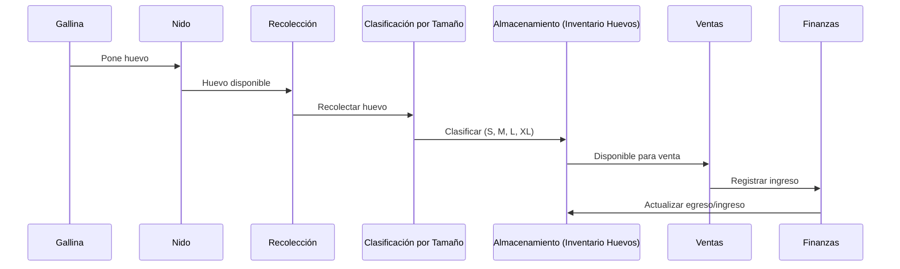
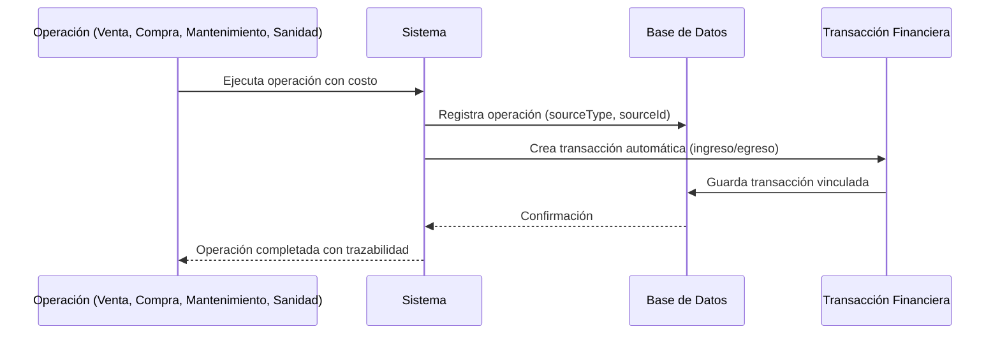

# El Gallinero 🐔

Sistema de gestión para **gallineros pequeños y medianos**: control integral del ciclo avícola — gallinas, pollos y gallos; producción e inventario de huevos por tamaño (PEPS); incubación; alimentación con programas por etapa; gallinaza; ventas con presentaciones; egresos; sacrificio/carne; control sanitario y un panel de finanzas con KPIs y comportamiento en el tiempo.

Todas las operaciones comerciales y de mantenimiento **alimentan automáticamente las finanzas** (cada venta, sacrificio, compra de alimento, tarea de mantenimiento o evento sanitario genera su transacción, con trazabilidad a su fuente).

## Requisitos

- **Node.js ≥ 20.9** (desarrollado con Node 22/24)
- **PostgreSQL** (cualquier versión reciente; desarrollado con la 14)
- **npm**

## Instalación

```bash
git clone https://github.com/Camilosal/El-Gallinero
cd El-Gallinero
npm install
```

### Configurar la base de datos

1. Crea la base de datos en Postgres (ajusta usuario/contraseña a tu entorno):

```bash
createdb app_db
```

2. Copia el archivo de entorno y edítalo con tu conexión:

```bash
cp .env.example .env.local
```

```env
DATABASE_URL=postgresql://TU_USUARIO@127.0.0.1:5432/app_db
```

> `.env.local` está excluido del repo por seguridad; cada quien crea el suyo.

### Crear tablas y sembrar datos

```bash
npm run db:push     # crea las tablas (drizzle-kit push)
npm run db:seed     # datos demo: usuarios, catálogos, producción, ventas y finanzas
```

El seed es idempotente: puedes ejecutarlo de nuevo sin problema.

#### Historial realista (Iwagé Dataset)
Para cargar un historial simulado de 3 a 6 meses con datos realistas que permitan evaluar gráficos y KPIs inmediatamente, ejecuta:

```bash
npm run seed:demo   # o el comando que corresponda a tu entorno
```

Este script pobla la base de datos con producción diaria, ventas, egresos y eventos sanitarios coherentes con un ciclo avícola completo.

### Arrancar

```bash
npm run dev         # modo desarrollo → http://localhost:3000
```

Para producción:

```bash
npm run build && npm start
```

## Despliegue cero fricción

El archivo `docker-compose.yml` levanta tanto la aplicación Next.js como la base de datos PostgreSQL en un solo paso:

```bash
docker compose up -d
```

Esto crea los contenedores `app` y `db`, expone la aplicación en `http://localhost:3000` y la base de datos en `5432`.

### Despliegue con un clic

[](https://railway.app/template/...)
[](https://render.com/deploy?repo=...)

## Acceso

El seed crea el usuario administrador:

- **Usuario:** `admin`
- **Contraseña:** `admin123`

## Módulos

La navegación está agrupada en **7 secciones** con páginas índice que muestran KPIs en tiempo real y accesos rápidos a sub-módulos:

### 🐔 Producción (`/produccion`)
Página índice con KPIs: huevos hoy, huevos semana, gallinas activas, mortalidad semana, consumo de alimento.

| Sub-módulo | Ruta | Funcionalidades |
| --- | --- | --- |
| Gallinas | `/produccion/gallinas` | Registro individual (código, raza, nacimiento, peso, estado, notas); ciclo de vida automático: 8 estados y etapa por edad (pollito → postura); detección de gallinas recomendadas a sacrificio y aviso de motivos; filtros por estado y etapa; edición y eliminación |
| Pollos y Gallos | `/produccion/pollos` | Gallos reproductores (código `GA-###` autogenerado) y lotes de engorde (código `L-###`); balance de parvada con alerta de gallos faltantes (1 por cada 10 gallinas); lotes pasan a "listo sacrificio" al alcanzar semanas o peso objetivo |
| Adquisiciones | `/produccion/adquisiciones` | Entrada de aves al sistema |
| Alimentación | `/produccion/alimentacion` | Inventario de alimentos (categoría, tipo, stock mín/máx, costo, proveedor) con alerta de stock bajo; movimientos de entrada/salida por etapa (bloquea stock negativo); programas de alimentación por etapa (% dieta y g/ave/día); proyección de stock con días restantes y actualización de mínimo sugerido; comparativo planificado vs real (7/14/21/30d) con gráfico; **predicción de stock** (14–365d): fecha de agotamiento, reposición sugerida, compra recomendada y gráfico de evolución por alimento |
| Producción de Huevos | `/produccion/huevos` | Recolección diaria por **tamaño de huevo** (precios del catálogo), rotos y para incubación, con total en vivo; comparación contra producción esperada por etapa (rendimiento %); validación de sobreproducción (1.5× lo esperado) con confirmación; gráfico apilado por tamaño con proyección |
| Incubación | `/produccion/incubacion` | Registro de incubaciones con eclosión a los 21 días y gallina clueca; **asignación automática de nacidos**: hembras → nuevas gallinas, machos → cubren déficit de gallos o lote de engorde; tasa de eclosión (%); historial y métricas |
| Carne / Sacrificio | `/produccion/sacrificio` | Registro de sacrificio por tipo de ave (gallina descarte, pollo, gallo) con pre-selección de la recomendada; peso en canal, destino (consumo, venta, donación); si se vende crea ingreso; revierte estados de las aves |
| Mortalidad | `/produccion/mortalidad` | Registro de bajas por lote |
| Plan Parvada | `/produccion/plan-parvada` | Proyecciones y planificación de la parvada |

### 📦 Inventarios (`/inventarios`)
Página índice con KPIs de stock consolidado.

| Sub-módulo | Ruta | Funcionalidades |
| --- | --- | --- |
| Inventario Huevos | `/inventarios/huevos` | Stock por tamaño (producidos − vendidos) con **PEPS** por talla; edad/envejecimiento con alerta de >21 días; valor estimado en dinero (disponible × precio catálogo); lotes con estado (disponible / vender pronto / por vencer / agotado) |
| Balance de Inventario | `/inventarios/balance` | Balance consolidado de entradas y salidas |
| Insumos | `/inventarios/insumos` | Inventario de insumos (alimento, medicamentos, empaques) |

### 💊 Sanidad (`/sanidad`)
Página índice con accesos rápidos a control y calendario sanitario.

| Sub-módulo | Ruta | Funcionalidades |
| --- | --- | --- |
| Control Sanitario | `/sanidad/control` | Eventos (vacunación, desparasitación, tratamiento, inspección, fumigación, vitaminas, otro) con producto, costo y próxima aplicación; los tratamientos marcan gallinas como enfermas; próximos eventos a vencer |
| Calendario Sanitario | `/sanidad/calendario` | Calendario de vacunas y recordatorios sanitarios |

### 🔧 Operaciones (`/operaciones`)
Página índice con accesos rápidos a mantenimiento y gallinaza.

| Sub-módulo | Ruta | Funcionalidades |
| --- | --- | --- |
| Mantenimiento | `/operaciones/mantenimiento` | Tareas del gallinero con estado (pendiente/en progreso/completado), costo y plantillas rápidas; al completar con costo genera egreso automático (sin duplicados al editar) |
| Gallinaza | `/operaciones/gallinaza` | Factores de producción por grupo (etapas, gallos, lotes) para estimar kg/día; acumulación de stock con ajustes (± con motivo); ventas con presentación (bulto/costal/granel) que descuentan stock y generan ingreso |

### 💰 Finanzas (`/finanzas`)
Página índice con KPIs financieros.

| Sub-módulo | Ruta | Funcionalidades |
| --- | --- | --- |
| Ventas | `/finanzas/ventas` | **Huevos**: ventas multi-ítem por tamaño y presentación (unidad, docena, media docena, bandeja/cubeta) con precios del catálogo y total en vivo; validación de disponibilidad por talla. **Aves**: gallinas/gallos/lotes con precio por ave o por kg. Cada venta crea su ingreso y actualiza inventario/estados |
| Egresos | `/finanzas/egresos` | Registro de gastos en dos modos: **compra con presentación** (categorías de compra; para alimento vincula el inventario y convierte a unidad base) y **general** (cantidad × valor o monto manual); métricas, gráfico por fecha y desglose por categoría |
| Finanzas | `/finanzas/finanzas` | Panel con KPIs (ingresos, egresos, utilidad, promedios diarios, flujo neto) e insights (mejor/peor día, margen, proyección mensual); gráficos de evolución temporal, utilidad acumulada y distribución por categoría (períodos 7/30/90/365); historial completo con nueva transacción manual |
| Presupuestos | `/finanzas/presupuestos` | Planificación financiera y presupuestos |
| Cuentas | `/finanzas/cuentas` | Cuentas por cobrar y cuentas por pagar |

### 📊 Análisis (`/analisis`)
Página índice con accesos rápidos a KPIs y reportes.

| Sub-módulo | Ruta | Funcionalidades |
| --- | --- | --- |
| KPIs | `/analisis/kpis` | Indicadores clave de productividad, mortalidad, conversión alimenticia |
| Reportes | `/analisis/reportes` | Reportes exportables del sistema |

### 🗂️ Configuración (`/configuracion`)
Página índice con accesos rápidos a catálogos.

| Sub-módulo | Ruta | Funcionalidades |
| --- | --- | --- |
| Catálogos | `/configuracion/catalogos` | Datos maestros (16 categorías): tamaños de huevo con precio, presentaciones con unidades/factores, razas, compradores, proveedores, unidades de medida, categorías de ingreso/egreso, tipos de sanidad/mantenimiento… Con activar/desactivar y orden |

## Reglas de negocio clave

- **Ciclo de vida de la gallina**: etapa según edad (Pollito 0–6, Juvenil 6–18, Pre-postura 18–20, Postura 20+ semanas); estados terminales (vendida, faena, muerta) nunca se sobreescriben; a los ~80 semanas se recomienda sacrificio.
- **Balance de parvada**: 1 gallo por cada 10 gallinas; los machos nacidos cubren primero el déficit y el resto pasa a lote de engorde.
- **Lotes de engorde**: listos a sacrificio al cumplir semanas objetivo o ≥2.5 kg promedio; baja de cantidad validada (0 ≤ actual ≤ inicial).
- **Inventario de huevos PEPS**: las ventas se descuentan del lote más antiguo de cada tamaño; huevos con más de 21 días generan alerta.
- **Producción esperada**: huevos/día = Σ(gallinas por etapa × factor del catálogo); rendimiento % contra lo real y alerta si supera 1.5×.
- **Alimentación**: bloqueo de stock negativo; consumo registrado por etapa con gramos/gallina/día; proyección de días de stock.
- **Trazabilidad financiera**: cada venta, sacrificio, compra de alimento, mantenimiento completado y evento sanitario con costo crea su transacción automáticamente (`sourceType`/`sourceId`); al borrar el origen se revierte la transacción.

## Diagramas de arquitectura

### Flujo de Producción de Huevos


### Integración Automática de Finanzas


## Estructura del proyecto

```
├── src/
│   ├── app/
│   │   ├── (app)/                    # Páginas del sistema agrupadas por sección
│   │   │   ├── page.tsx              # Dashboard principal
│   │   │   ├── produccion/           # 🐔 Producción
│   │   │   │   ├── page.tsx          # Índice con KPIs (huevos, gallinas, mortalidad)
│   │   │   │   ├── gallinas/         # Gestión de gallinas
│   │   │   │   ├── pollos/           # Pollos y gallos
│   │   │   │   ├── adquisiciones/    # Entrada de aves
│   │   │   │   ├── alimentacion/     # Programas y consumo
│   │   │   │   ├── huevos/           # Producción de huevos
│   │   │   │   ├── incubacion/       # Incubación
│   │   │   │   ├── sacrificio/       # Carne
│   │   │   │   ├── mortalidad/       # Bajas
│   │   │   │   └── plan-parvada/     # Proyecciones
│   │   │   ├── inventarios/          # 📦 Inventarios
│   │   │   │   ├── page.tsx          # Índice con KPIs de stock
│   │   │   │   ├── huevos/           # Inventario PEPS de huevos
│   │   │   │   ├── balance/          # Balance consolidado
│   │   │   │   └── insumos/          # Insumos
│   │   │   ├── sanidad/              # 💊 Sanidad
│   │   │   │   ├── page.tsx          # Índice
│   │   │   │   ├── control/          # Control sanitario
│   │   │   │   └── calendario/       # Calendario sanitario
│   │   │   ├── operaciones/          # 🔧 Operaciones
│   │   │   │   ├── page.tsx          # Índice
│   │   │   │   ├── mantenimiento/    # Tareas y equipos
│   │   │   │   └── gallinaza/        # Gestión de gallinaza
│   │   │   ├── finanzas/             # 💰 Finanzas
│   │   │   │   ├── page.tsx          # Índice con KPIs financieros
│   │   │   │   ├── ventas/           # Ventas de huevos y aves
│   │   │   │   ├── egresos/          # Gastos
│   │   │   │   ├── finanzas/         # Panel financiero
│   │   │   │   ├── presupuestos/     # Planificación
│   │   │   │   └── cuentas/          # CxC y CxP
│   │   │   ├── analisis/             # 📊 Análisis
│   │   │   │   ├── page.tsx          # Índice
│   │   │   │   ├── kpis/             # Indicadores clave
│   │   │   │   └── reportes/         # Reportes exportables
│   │   │   └── configuracion/        # 🗂️ Configuración
│   │   │       ├── page.tsx          # Índice
│   │   │       └── catalogos/        # Datos maestros
│   │   ├── api/                      # API Routes (Next.js)
│   │   │   ├── auth/                 # login, logout, me
│   │   │   ├── produccion/           # APIs de producción
│   │   │   │   ├── resumen/          # KPIs de producción
│   │   │   │   ├── gallinas/
│   │   │   │   ├── pollos/
│   │   │   │   ├── alimentacion/
│   │   │   │   ├── huevos/
│   │   │   │   └── ...
│   │   │   ├── inventarios/          # APIs de inventarios
│   │   │   ├── sanidad/              # APIs de sanidad
│   │   │   ├── operaciones/          # APIs de operaciones
│   │   │   ├── finanzas/             # APIs de finanzas
│   │   │   ├── analisis/             # APIs de análisis
│   │   │   └── configuracion/        # APIs de configuración
│   │   ├── login/                    # Página de acceso
│   │   └── layout.tsx
│   ├── components/                   # Sidebar y componentes UI (Card, StatCard, Modal, Table…)
│   ├── db/
│   │   ├── schema.ts                 # Modelo de datos (25 tablas, Drizzle ORM)
│   │   ├── seed.ts                   # Datos demo idempotentes (admin/admin123)
│   │   └── index.ts                  # Conexión a Postgres
│   └── lib/                          # auth (sesiones), inventory (PEPS), flock, lifecycle, manure, birdExit
├── docs/                             # Especificaciones y planes de diseño
├── tests/                            # Pruebas de flujo (vitest)
└── drizzle.config.ts
```

## Modelo de datos (resumen)

- **Aves:** `hens`, `roosters`, `broiler_batches`
- **Producción:** `egg_production` + `egg_production_details` (por tamaño), `incubation`
- **Comercial:** `egg_sales`, `egg_sales_items`, `chicken_sales`, `manure_sales`
- **Finanzas:** `transactions` (ingresos y egresos, enlazadas a su fuente)
- **Apoyo:** `feed_inventory`, `feed_movements`, `feed_programs`, `maintenance`, `health_control`, `manure_factors`, `manure_inventory`, `manure_adjustments`, `catalogos` (maestros), `users`, `sessions`

El esquema completo está en [`src/db/schema.ts`](src/db/schema.ts).

## Scripts

| Script | Descripción |
| --- | --- |
| `npm run dev` | Servidor de desarrollo |
| `npm run build` / `start` | Compilar y servir en producción |
| `npm run db:push` | Aplicar el esquema a la BD |
| `npm run db:seed` | Datos demo (idempotente) |
| `npm run db:generate` | Generar migración SQL |
| `npm run test` | Pruebas con vitest |
| `npm run typecheck` / `lint` | Verificación de tipos y estilo |

## Tecnologías

- **Next.js 16** (App Router) + **React 19**
- **Drizzle ORM** con **PostgreSQL** (`pg`)
- **Recharts** (gráficos del panel financiero)
- **Tailwind CSS 4** (estilos)
- **Vitest** (pruebas)

## Documentación para desarrolladores

- **[CONTRIBUTING.md](CONTRIBUTING.md)** – Guía para contribuir al proyecto (estilo de código, pull requests, etc.).
- **[CODE_OF_CONDUCT.md](CODE_OF_CONDUCT.md)** – Código de conducta esperado en la comunidad.
- **[SECURITY.md](SECURITY.md)** – Política de reporte de vulnerabilidades y procedimientos de seguridad.
- **[CHANGELOG.md](CHANGELOG.md)** – Historial de cambios y versiones del proyecto.
- **[docs/development.md](docs/development.md)** – Instrucciones detalladas de entorno de desarrollo, herramientas y flujos de trabajo.
- **[docs/features.md](docs/features.md)** – Descripción de funcionalidades planeadas y en desarrollo.
- **[docs/data-dictionary.md](docs/data-dictionary.md)** – Diccionario de datos del esquema de base de datos y definiciones de campos.
- **[docs/superpowers/](docs/superpowers/)** – Especificaciones y planes de características avanzadas (superpoderes) en desarrollo.
