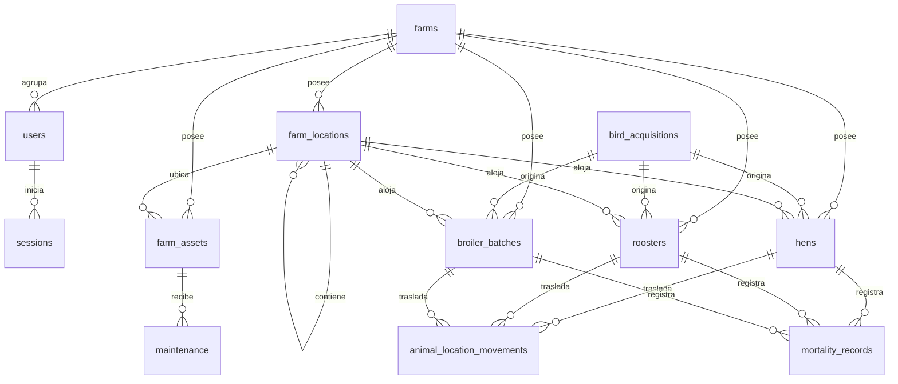
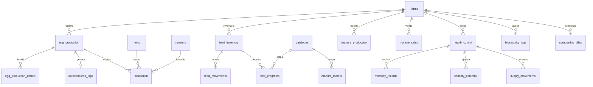
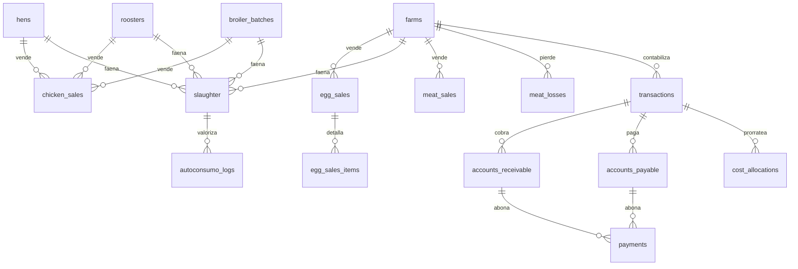
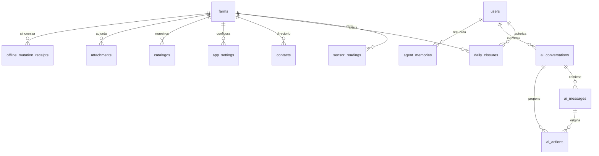

# Diccionario de datos — IwaGranja

> Modelo PostgreSQL de la aplicación de gestión avícola multi-especie **IwaGranja**.
> Documento generado a partir del esquema real de producción el **14 de noviembre de 2026**.

**Alcance.** 66 tablas de negocio y 893 columnas, más la tabla técnica `schema_migrations` (3 columnas). Se describen propósito, campos, tipos, claves, relaciones, enumeraciones, reglas de negocio, funciones que las usan y campos derivados.

Este es el documento canónico del modelo de datos. El [README](../README.md), [CONTRIBUTING](../CONTRIBUTING.md) y la [estrategia open core](estrategia-open-core.md) enlazan a esta ruta; si mueves el archivo, actualiza esos enlaces.

## Cómo leer este diccionario

Cada tabla se documenta con una ficha que contiene el propósito, el módulo de la aplicación que la usa, una tabla de campos y las reglas de negocio o relaciones que no se deducen del tipo.

| Convención | Significado |
|---|---|
| **PK** | Columna que forma la clave primaria. |
| **FK → tabla.columna** | Clave foránea declarada en PostgreSQL. |
| **—** | Sin valor por defecto o sin clave. |
| `SÍ` / `NO` | La columna acepta o no valores nulos. |
| `current_farm_id()` | Valor por defecto que toma la granja del contexto de sesión (`app.current_farm_id`). |
| `camelCase` en el código | Drizzle mapea `feedInventory` a la tabla `feed_inventory` y `feedId` a `feed_id`. |

**Tipos.** Los montos usan `numeric(p,2)` y se expresan en pesos colombianos (COP) salvo que se indique otra moneda. Las fechas de negocio usan `date` (día sin hora); los eventos técnicos usan `timestamp`. Los identificadores son `uuid` generados con `gen_random_uuid()`. Los documentos variables usan `jsonb`.

**Multi-granja.** Todas las tablas operativas llevan `farm_id` con valor por defecto `current_farm_id()` y la mayoría tiene RLS forzado para el rol `gallinero_tenant_role`: una consulta solo ve la granja activa. No tienen RLS por diseño: `farms` (raíz del tenant), `users` y `sessions` (el login resuelve la granja antes de abrir el contexto), `farm_subscriptions` y `billing_payments` (operación SaaS), `export_tokens` (el token resuelve la granja) y los catálogos globales `vaccination_templates` y `breed_weight_standards`, que no tienen `farm_id`.

## Mapa de dominios

| Dominio | Tablas | Qué cubre |
|---|---|---|
| **A. Identidad, granjas y SaaS** | 6 | El tenant raíz, las cuentas que acceden al sistema, las sesiones, el plan contratado y los tokens de integración. Todo lo demás cuelga de `farms` mediante `farm_id`.<br>[`farms`](#farms), [`users`](#users), [`sessions`](#sessions), [`farm_subscriptions`](#farm_subscriptions), [`billing_payments`](#billing_payments), [`export_tokens`](#export_tokens) |
| **B. Ubicaciones, activos y mantenimiento** | 3 | La geografía operativa del predio y los bienes que la sostienen. Las ubicaciones son la dimensión física que usan animales, inventarios, sensores y reglas de bioseguridad.<br>[`farm_locations`](#farm_locations), [`farm_assets`](#farm_assets), [`maintenance`](#maintenance) |
| **C. Animales** | 6 | Fichas individuales de gallinas y gallos, lotes multi-especie, su origen, sus traslados y sus bajas. Es la base del inventario animal y de la trazabilidad genealógica.<br>[`hens`](#hens), [`roosters`](#roosters), [`broiler_batches`](#broiler_batches), [`bird_acquisitions`](#bird_acquisitions), [`animal_location_movements`](#animal_location_movements), [`mortality_records`](#mortality_records) |
| **D. Huevos e incubación** | 4 | Recolección diaria, calibres, pérdidas y cargas de incubadora. De aquí sale el inventario PEPS de huevo y los pollitos que inician nuevos lotes.<br>[`egg_production`](#egg_production), [`egg_production_details`](#egg_production_details), [`egg_losses`](#egg_losses), [`incubation`](#incubation) |
| **E. Alimentación** | 3 | Catálogo de alimentos, existencias, movimientos y dietas por etapa. Conecta el costo del alimento con el consumo real de cada grupo de animales.<br>[`feed_inventory`](#feed_inventory), [`feed_movements`](#feed_movements), [`feed_programs`](#feed_programs) |
| **F. Sanidad y bioseguridad** | 4 | Eventos sanitarios, plan de vacunación, calendario y bitácoras POE/GAB. Los tiempos de retiro bloquean ventas y traslados hasta que se cumplan.<br>[`health_control`](#health_control), [`vaccination_templates`](#vaccination_templates), [`sanitary_calendar`](#sanitary_calendar), [`biosecurity_logs`](#biosecurity_logs) |
| **G. Gallinaza y compostaje** | 5 | Estimación, ajustes, venta y compostaje del abono. El inventario se calcula por movimientos, igual que el alimento.<br>[`manure_factors`](#manure_factors), [`manure_production`](#manure_production), [`manure_adjustments`](#manure_adjustments), [`manure_sales`](#manure_sales), [`composting_piles`](#composting_piles) |
| **H. Sacrificio, carne y ventas en pie** | 5 | Faena, rendimiento canal, venta de carne o de animales vivos y valorización del autoconsumo familiar.<br>[`slaughter`](#slaughter), [`meat_sales`](#meat_sales), [`meat_losses`](#meat_losses), [`chicken_sales`](#chicken_sales), [`autoconsumo_logs`](#autoconsumo_logs) |
| **I. Ventas de huevos** | 2 | Cabecera y detalle de las ventas de huevo por calibre, con lote PEPS, presentación y comprador.<br>[`egg_sales`](#egg_sales), [`egg_sales_items`](#egg_sales_items) |
| **J. Finanzas** | 12 | Libro de ingresos y egresos, categorías, presupuestos, flujo de caja, cartera, prorrateo de costos, cierre diario auditable y personal/nómina con prestaciones de ley.<br>[`transactions`](#transactions), [`financial_categories`](#financial_categories), [`budgets`](#budgets), [`budget_items`](#budget_items), [`cashflow_projections`](#cashflow_projections), [`accounts_receivable`](#accounts_receivable), [`accounts_payable`](#accounts_payable), [`payments`](#payments), [`cost_allocations`](#cost_allocations), [`daily_closures`](#daily_closures), [`staff_profiles`](#staff_profiles), [`payroll_entries`](#payroll_entries) |
| **K. Insumos y compras** | 3 | Existencias de insumos no alimenticios, sus movimientos y los atajos de compra frecuente.<br>[`supply_inventory`](#supply_inventory), [`supply_movements`](#supply_movements), [`purchase_products`](#purchase_products) |
| **L. Planeación, reproducción y peso** | 5 | Plan de parvada, hitos semanales, curvas de peso, pesajes de campo y ciclo reproductivo de conejos y cuyes.<br>[`flock_plans`](#flock_plans), [`flock_plan_milestones`](#flock_plan_milestones), [`breed_weight_standards`](#breed_weight_standards), [`weight_logs`](#weight_logs), [`reproduction_events`](#reproduction_events) |
| **M. Operación, IoT y catálogos** | 6 | Telemetría, datos maestros polimórficos, directorio comercial, parámetros clave-valor de la granja y fuentes externas oficiales (DANE, SIPSA, IDEAM, Banrep).<br>[`sensor_readings`](#sensor_readings), [`catalogos`](#catalogos), [`contacts`](#contacts), [`app_settings`](#app_settings), [`external_data_snapshots`](#external_data_snapshots), [`external_source_observations`](#external_source_observations) |
| **N. Asistente de IA** | 6 | Conversaciones, mensajes, acciones propuestas con confirmación humana, memoria persistente, briefings proactivos y chats de Telegram vinculados.<br>[`ai_conversations`](#ai_conversations), [`ai_messages`](#ai_messages), [`ai_actions`](#ai_actions), [`agent_memories`](#agent_memories), [`agent_briefings`](#agent_briefings), [`telegram_chats`](#telegram_chats) |
| **O. Adjuntos y offline** | 2 | Evidencia documental polimórfica e idempotencia de las mutaciones que llegan desde el modo offline.<br>[`attachments`](#attachments), [`offline_mutation_receipts`](#offline_mutation_receipts) |

Total: **72 tablas de dominio** agrupadas en 15 dominios funcionales, más la tabla de infraestructura `schema_migrations` (registro de migraciones aplicadas).

## Índice alfabético de tablas

| Tabla | Dominio | Propósito |
|---|---|---|
| [`accounts_payable`](#accounts_payable) | J. Finanzas | Obligaciones pendientes con proveedores por compras a crédito, con vencimiento y estado. |
| [`accounts_receivable`](#accounts_receivable) | J. Finanzas | Saldos pendientes de clientes por ventas a crédito, con vencimiento y estado de cobro. |
| [`agent_briefings`](#agent_briefings) | N. Asistente de IA | Briefings proactivos del agente (diario y de anomalía), idempotentes por granja/día/tipo, con narrativa y estado de lectura. |
| [`agent_memories`](#agent_memories) | N. Asistente de IA | Memoria persistente por usuario: hechos, preferencias y decisiones relevantes para personalizar respuestas. |
| [`ai_actions`](#ai_actions) | N. Asistente de IA | Cola de acciones que el asistente propone y que requieren confirmación humana antes de ejecutarse; deja auditoría completa. |
| [`ai_conversations`](#ai_conversations) | N. Asistente de IA | Hilos de conversación con el asistente de IA, con resumen incremental para no reenviar todo el historial. |
| [`ai_messages`](#ai_messages) | N. Asistente de IA | Mensajes de usuario, asistente, sistema y herramientas, incluidos los llamados a funciones. |
| [`animal_location_movements`](#animal_location_movements) | C. Animales | Bitácora de traslados de un ave individual o de un lote completo entre ubicaciones. |
| [`app_settings`](#app_settings) | M. Operación, IoT y catálogos | Configuración clave-valor por granja: datos del predio, parámetros de ciclo de vida, precios, umbrales y calendario sanitario. |
| [`attachments`](#attachments) | O. Adjuntos y offline | Archivos e imágenes asociados a cualquier registro (facturas, fotos, certificados, rótulos) con texto y datos extraídos por OCR. |
| [`autoconsumo_logs`](#autoconsumo_logs) | H. Sacrificio, carne y ventas en pie | Registro del alimento que la familia consume de la granja, valorizado a precio de mercado para medir el ahorro real. |
| [`billing_payments`](#billing_payments) | A. Identidad, granjas y SaaS | Pagos recibidos por Wompi (Nequi, Daviplata, PSE) para activar o renovar el plan. |
| [`biosecurity_logs`](#biosecurity_logs) | F. Sanidad y bioseguridad | Bitácora POE/GAB del ICA, bienestar animal, capacitaciones, ingreso de visitantes y desinfección. |
| [`bird_acquisitions`](#bird_acquisitions) | C. Animales | Entradas de animales por compra, donación o cría propia, con costo, origen y trazabilidad genética. |
| [`breed_weight_standards`](#breed_weight_standards) | L. Planeación, reproducción y peso | Curvas de referencia de peso por especie, raza, sexo y semana de vida, usadas para evaluar el crecimiento. |
| [`broiler_batches`](#broiler_batches) | C. Animales | Lotes multi-especie para engorde, postura, pie de cría o mixto. |
| [`budget_items`](#budget_items) | J. Finanzas | Metas mensuales por categoría dentro de un presupuesto. |
| [`budgets`](#budgets) | J. Finanzas | Presupuesto por periodo con metas mensuales por categoría, para comparar lo planeado contra lo ejecutado. |
| [`cashflow_projections`](#cashflow_projections) | J. Finanzas | Comparación mensual entre ingresos y egresos proyectados y reales. |
| [`catalogos`](#catalogos) | M. Operación, IoT y catálogos | Tabla polimórfica de maestros por categoría: razas, etapas de crecimiento, presentaciones de venta, unidades, compradores, proveedores y parámetros por especie. |
| [`chicken_sales`](#chicken_sales) | H. Sacrificio, carne y ventas en pie | Venta de aves, conejos, cuyes y lotes vivos, con precio por ave o por kilo y trazabilidad del animal vendido. |
| [`composting_piles`](#composting_piles) | G. Gallinaza y compostaje | Seguimiento de pilas de compostaje de mortalidad y gallinaza: fórmula, temperatura, humedad, volteos y cosecha. |
| [`contacts`](#contacts) | M. Operación, IoT y catálogos | Directorio único de contactos comerciales con datos de identificación, ubicación, condiciones de pago y logística de entrega. |
| [`cost_allocations`](#cost_allocations) | J. Finanzas | Distribución de costos indirectos o compartidos entre especies, lotes y ubicaciones, con base técnica y trazabilidad al gasto original. |
| [`daily_closures`](#daily_closures) | J. Finanzas | Cierre auditable del día: congela los registros operativos y guarda una foto de los indicadores para evitar ediciones posteriores. |
| [`egg_losses`](#egg_losses) | D. Huevos e incubación | Pérdidas posteriores a la recolección: rotura en bodega, vencimiento, contaminación o merma de transporte. |
| [`egg_production`](#egg_production) | D. Huevos e incubación | Registro diario de recolección de huevos por especie y ubicación. |
| [`egg_production_details`](#egg_production_details) | D. Huevos e incubación | Desglose de la recolección por calibre o tamaño de huevo (AAA, AA, A, B, jumbo, etc.). |
| [`egg_sales`](#egg_sales) | I. Ventas de huevos | Cabecera de la venta de huevos por especie, ubicación y lote PEPS, con comprador y presentación. |
| [`egg_sales_items`](#egg_sales_items) | I. Ventas de huevos | Líneas de una venta cuando se venden varios tamaños con precios distintos. |
| [`export_tokens`](#export_tokens) | A. Identidad, granjas y SaaS | Credenciales de integración con scopes: ERP de solo lectura y agentes de IA (`agent:read`/`agent:write`), sin usar la contraseña de un usuario. |
| [`external_data_snapshots`](#external_data_snapshots) | M. Operación, IoT y catálogos | Último estado válido de cada fuente externa oficial (DANE, SIPSA, IDEAM, Banrep) con modo de sincronización y vencimiento. |
| [`external_source_observations`](#external_source_observations) | M. Operación, IoT y catálogos | Serie histórica idempotente de observaciones externas por proveedor y periodo; no reemplaza los datos maestros. |
| [`farm_assets`](#farm_assets) | B. Ubicaciones, activos y mantenimiento | Inventario de equipos, herramientas, estructuras y vehículos, con costo, garantía, ubicación y estado. |
| [`farm_locations`](#farm_locations) | B. Ubicaciones, activos y mantenimiento | Jerarquía física del predio (galpones, corrales, potreros, bodegas, cuarentena). |
| [`farm_subscriptions`](#farm_subscriptions) | A. Identidad, granjas y SaaS | Plan SaaS contratado y límites operativos: lotes activos, usuarios y periodo de facturación. |
| [`farms`](#farms) | A. Identidad, granjas y SaaS | Granja o unidad productiva. |
| [`feed_inventory`](#feed_inventory) | E. Alimentación | Catálogo de alimentos disponibles con existencias, costo y calidad nutricional. |
| [`feed_movements`](#feed_movements) | E. Alimentación | Entradas y salidas de alimento: compras, donaciones, producción propia, consumo por programa, consumo manual, ventas, mermas y ajustes. |
| [`feed_programs`](#feed_programs) | E. Alimentación | Dieta por etapa: qué alimentos componen la ración y en qué porcentaje y cantidad diaria. |
| [`financial_categories`](#financial_categories) | J. Finanzas | Árbol de categorías para clasificar ingresos y egresos y construir reportes comparables. |
| [`flock_plan_milestones`](#flock_plan_milestones) | L. Planeación, reproducción y peso | Metas semanales de población, postura y alimento, comparadas con lo real. |
| [`flock_plans`](#flock_plans) | L. Planeación, reproducción y peso | Planificación del ciclo de postura: tamaño objetivo, reposición y fase actual de la parvada. |
| [`health_control`](#health_control) | F. Sanidad y bioseguridad | Bitácora de vacunaciones, desparasitaciones, tratamientos e inspecciones, con producto, costo y tiempo de retiro. |
| [`hens`](#hens) | C. Animales | Ficha individual de cada gallina: identidad, raza, edad, estado reproductivo, peso y ubicación. |
| [`incubation`](#incubation) | D. Huevos e incubación | Seguimiento de cada carga de incubación: huevos puestos, fertilidad, nacimientos y parámetros de máquina. |
| [`maintenance`](#maintenance) | B. Ubicaciones, activos y mantenimiento | Tareas de mantenimiento únicas o recurrentes. |
| [`manure_adjustments`](#manure_adjustments) | G. Gallinaza y compostaje | Correcciones manuales al inventario de gallinaza por conteos físicos, mermas o reclasificaciones. |
| [`manure_factors`](#manure_factors) | G. Gallinaza y compostaje | Kilogramos de gallinaza estimados por ave y por día, según etapa, gallos o lote. |
| [`manure_production`](#manure_production) | G. Gallinaza y compostaje | Registro de gallinaza producida en el día, ya sea estimada automáticamente o capturada manualmente. |
| [`manure_sales`](#manure_sales) | G. Gallinaza y compostaje | Ventas de abono orgánico con peso, precio, comprador y presentación. |
| [`meat_losses`](#meat_losses) | H. Sacrificio, carne y ventas en pie | Mermas de carne por descomposición, congelación inadecuada, rotura o error de inventario. |
| [`meat_sales`](#meat_sales) | H. Sacrificio, carne y ventas en pie | Ventas de carne en canal o por presas, separadas del evento de sacrificio. |
| [`mortality_records`](#mortality_records) | C. Animales | Bajas de animales con causa, cantidad y vínculo al evento sanitario que las explica. |
| [`offline_mutation_receipts`](#offline_mutation_receipts) | O. Adjuntos y offline | Idempotencia de las mutaciones enviadas desde el modo offline: evita duplicar registros cuando el cliente reintenta una sincronización. |
| [`payments`](#payments) | J. Finanzas | Aplicación de pagos o abonos a una cuenta por cobrar o por pagar. |
| [`payroll_entries`](#payroll_entries) | J. Finanzas | Liquidaciones de nómina por trabajador y periodo, con prestaciones, deducciones, retefuente y foto de las tarifas maestras vigentes. |
| [`purchase_products`](#purchase_products) | K. Insumos y compras | Atajos para registrar egresos recurrentes con su presentación, unidad, categoría y último precio. |
| [`reproduction_events`](#reproduction_events) | L. Planeación, reproducción y peso | Ciclo reproductivo de mamíferos menores: empadre, palpación, nidal, parto, destete y diagnóstico, con genealogía y métricas de camada. |
| [`roosters`](#roosters) | C. Animales | Ficha individual de los gallos usados para reproducción y equilibrio de parvada. |
| [`sanitary_calendar`](#sanitary_calendar) | F. Sanidad y bioseguridad | Plan de eventos sanitarios con próxima fecha, frecuencia y días de retiro; alimenta las alertas de sanidad. |
| [`sensor_readings`](#sensor_readings) | M. Operación, IoT y catálogos | Telemetría de sensores ambientales y básculas: temperatura, humedad, índice de temperatura-humedad (ITH), amoniaco, agua y peso. |
| [`sessions`](#sessions) | A. Identidad, granjas y SaaS | Sesiones activas del navegador. |
| [`slaughter`](#slaughter) | H. Sacrificio, carne y ventas en pie | Faena de animales con peso vivo, peso en canal, rendimiento, destino y valorización del autoconsumo. |
| [`staff_profiles`](#staff_profiles) | J. Finanzas | Personal de la granja (productor propio o apoyo): contrato, tarifa base, seguridad social y auxilio de transporte. |
| [`supply_inventory`](#supply_inventory) | K. Insumos y compras | Existencias de insumos no alimenticios: medicamentos, desinfectantes, empaques, herramientas menores y consumibles. |
| [`supply_movements`](#supply_movements) | K. Insumos y compras | Entradas y salidas de insumos, vinculadas al evento sanitario o de mantenimiento que las consume. |
| [`telegram_chats`](#telegram_chats) | N. Asistente de IA | Chats de Telegram vinculados a usuarios de la granja para el canal bidireccional del agente (voz, confirmaciones y partes). |
| [`transactions`](#transactions) | J. Finanzas | Libro único de ingresos y egresos de la granja. |
| [`users`](#users) | A. Identidad, granjas y SaaS | Cuentas que acceden al sistema. |
| [`vaccination_templates`](#vaccination_templates) | F. Sanidad y bioseguridad | Catálogo global de vacunas y tratamientos sugeridos por especie, raza y semana de vida. |
| [`weight_logs`](#weight_logs) | L. Planeación, reproducción y peso | Pesajes de campo con muestra, promedio, coeficiente de variación y uniformidad del lote. |

## Fichas por dominio

## A. Identidad, granjas y SaaS

El tenant raíz, las cuentas que acceden al sistema, las sesiones, el plan contratado y los tokens de integración. Todo lo demás cuelga de `farms` mediante `farm_id`.

### farms

**Propósito.** Granja o unidad productiva. Es la raíz del aislamiento multi-granja: todas las tablas de negocio cuelgan de aquí mediante `farm_id`.

**Módulo.** Registro, superadmin y facturación

| Campo | Tipo | Nulo | Por defecto | Clave | Descripción |
|---|---|---|---|---|---|
| `id` | uuid | NO | gen_random_uuid() | PK | Identificador de la granja (tenant). |
| `slug` | varchar(100) | NO | — | — | Identificador legible y único, usado en URLs y soporte. |
| `name` | varchar(200) | NO | — | — | Nombre de la granja. |
| `deployment_mode` | varchar(20) | NO | saas | — | `saas` (varias granjas por instancia) o `dedicated` (instancia exclusiva). |
| `owner_user_id` | uuid | SÍ | — | — | Usuario dueño de la cuenta; se completa después del registro. |
| `qr_source` | varchar(120) | SÍ | — | — | Campaña o código QR de origen que trajo a la granja. |
| `ally_code` | varchar(120) | SÍ | — | — | Código del aliado o referidor. |
| `plan_code` | varchar(40) | NO | FREEMIUM_SEMILLA | — | Plan comercial vigente (por ejemplo `FREEMIUM_SEMILLA`). |
| `trial_ends_at` | timestamp | SÍ | — | — | Fecha de fin de la prueba gratuita. |
| `created_at` | timestamp | NO | now() | — | Fecha y hora de creación. |
| `updated_at` | timestamp | NO | now() | — | Fecha y hora de la última modificación. |

**Reglas y relaciones**

- No tiene FK hacia `users` para evitar dependencia circular; `owner_user_id` se valida en la capa de aplicación.
- El `id` por defecto en instalaciones de una sola granja es `00000000-0000-0000-0000-000000000001`.

### users

**Propósito.** Cuentas que acceden al sistema. Cada usuario pertenece a una granja y tiene un rol que determina sus permisos.

**Módulo.** Configuración → Usuarios

| Campo | Tipo | Nulo | Por defecto | Clave | Descripción |
|---|---|---|---|---|---|
| `id` | uuid | NO | gen_random_uuid() | PK | Identificador único del registro (UUID). |
| `username` | varchar(100) | NO | — | — | Nombre de usuario, único en toda la instancia. |
| `password_hash` | varchar(255) | NO | — | — | Hash de la contraseña (nunca se guarda en claro). |
| `name` | varchar(200) | NO | — | — | Nombre visible de la persona. |
| `role` | varchar(50) | NO | admin | — | Rol RBAC: `admin`, `propietario`, `gerente`, `veterinario` u `operario`. |
| `created_at` | timestamp | NO | now() | — | Fecha y hora de creación. |
| `recovery_code_hash` | varchar(64) | SÍ | — | — | Hash del código de recuperación de administrador. |
| `recovery_code_issued_at` | timestamp | SÍ | — | — | Fecha de emisión del código de recuperación. |
| `farm_id` | uuid | NO | current_farm_id() | — | Granja propietaria del registro. Es la llave del aislamiento multi-granja (RLS). |

**Reglas y relaciones**

- El rol define los permisos `finance:write`, `sanitary:write`, `closure:close`, `closure:reopen`, `config:write`, `production:write` y `biosecurity:write`.
- `username` es único global; el inicio de sesión valida además que el usuario pertenezca a la granja activa.

### sessions

**Propósito.** Sesiones activas del navegador. Guarda solo el hash del token que viaja en la cookie `galli_session`.

**Módulo.** Autenticación

| Campo | Tipo | Nulo | Por defecto | Clave | Descripción |
|---|---|---|---|---|---|
| `id` | uuid | NO | gen_random_uuid() | PK | Identificador único del registro (UUID). |
| `user_id` | uuid | NO | — | FK → `users.id` | Usuario de la sesión (FK `users`). |
| `token_hash` | varchar(64) | NO | — | — | Hash del token de sesión. |
| `expires_at` | timestamp | NO | — | — | Fecha y hora de expiración. |
| `created_at` | timestamp | NO | now() | — | Fecha y hora de creación. |
| `farm_id` | uuid | NO | current_farm_id() | — | Granja propietaria del registro. Es la llave del aislamiento multi-granja (RLS). |

**Reglas y relaciones**

- Una fila por inicio de sesión; se elimina al cerrar sesión o al expirar.

### farm_subscriptions

**Propósito.** Plan SaaS contratado y límites operativos: lotes activos, usuarios y periodo de facturación.

**Módulo.** Configuración → Plan

| Campo | Tipo | Nulo | Por defecto | Clave | Descripción |
|---|---|---|---|---|---|
| `id` | uuid | NO | gen_random_uuid() | PK | Identificador único del registro (UUID). |
| `farm_id` | uuid | NO | — | FK → `farms.id` | Granja propietaria del registro. Es la llave del aislamiento multi-granja (RLS). |
| `plan_code` | varchar(40) | NO | FREEMIUM_SEMILLA | — | Código del plan contratado. |
| `status` | varchar(20) | NO | trial | — | `trial`, `active`, `grace` o `expired`. |
| `max_active_batches` | integer | SÍ | — | — | Máximo de lotes activos permitidos; nulo = sin límite. |
| `max_users` | integer | NO | 2 | — | Máximo de usuarios permitidos. |
| `current_period_start` | timestamp | NO | now() | — | Inicio del periodo facturado. |
| `current_period_end` | timestamp | SÍ | — | — | Fin del periodo facturado. |
| `created_at` | timestamp | NO | now() | — | Fecha y hora de creación. |
| `updated_at` | timestamp | NO | now() | — | Fecha y hora de la última modificación. |

**Reglas y relaciones**

- Una suscripción por granja (índice único en `farm_id`).

### billing_payments

**Propósito.** Pagos recibidos por Wompi (Nequi, Daviplata, PSE) para activar o renovar el plan.

**Módulo.** Facturación SaaS

| Campo | Tipo | Nulo | Por defecto | Clave | Descripción |
|---|---|---|---|---|---|
| `id` | uuid | NO | gen_random_uuid() | PK | Identificador único del registro (UUID). |
| `farm_id` | uuid | NO | — | FK → `farms.id` | Granja que paga. |
| `provider` | varchar(30) | NO | wompi | — | Pasarela de pago (`wompi` por defecto). |
| `external_reference` | varchar(120) | NO | — | — | Referencia única enviada a la pasarela. |
| `provider_tx_id` | varchar(120) | SÍ | — | — | Identificador de la transacción en la pasarela. |
| `method` | varchar(30) | NO | — | — | Medio de pago: `nequi`, `daviplata` o `pse`. |
| `amount_cop` | integer | NO | — | — | Monto pagado en pesos colombianos (entero). |
| `plan_code` | varchar(40) | NO | — | — | Plan que se está pagando. |
| `status` | varchar(20) | NO | pending | — | `pending`, `approved` o `declined`. |
| `raw_payload` | jsonb | SÍ | — | — | Respuesta original de la pasarela, conservada para auditoría. |
| `paid_at` | timestamp | SÍ | — | — | Fecha y hora del pago aprobado. |
| `created_at` | timestamp | NO | now() | — | Fecha y hora de creación. |

### export_tokens

**Propósito.** Credenciales de integración para sistemas externos: dashboards y ERP de solo lectura (CSV/XLSX) y agentes de IA (API v1 de herramientas y MCP), sin usar la contraseña de un usuario.

**Módulo.** Exportar → Conectores · API `/api/export`, `/api/v1/integrations/*`, `/api/v1/agent/tools` y `/api/mcp`

| Campo | Tipo | Nulo | Por defecto | Clave | Descripción |
|---|---|---|---|---|---|
| `id` | uuid | NO | gen_random_uuid() | PK | Identificador único del registro (UUID). |
| `farm_id` | uuid | NO | — | FK → `farms.id` | Granja propietaria del registro. Es la llave del aislamiento multi-granja (RLS). |
| `name` | varchar(120) | NO | Dashboard externo | — | Nombre de la integración (por ejemplo «Power BI» o «Cliente MCP Claude»). |
| `token_hash` | varchar(64) | NO | — | UNIQUE | SHA-256 del token. El token en claro nunca se almacena. |
| `token_prefix` | varchar(24) | NO | — | — | Primeros caracteres del token para poder identificarlo sin revelarlo. |
| `scopes` | jsonb | NO | ["read:finance","read:inventory","read:contacts","read:production"] | — | Alcances del token: `read:finance`, `read:inventory`, `read:contacts`, `read:production`, `agent:read`, `agent:write`. |
| `profile` | varchar(30) | NO | generic | — | Perfil de conector ERP (siigo, alegra, odoo, zoho, generic). |
| `expires_at` | timestamp | SÍ | — | — | Expiración del token. Obligatoria y ≤ 90 días cuando incluye `agent:write`. |
| `created_by` | uuid | SÍ | — | FK → `users.id` | Usuario delegante que generó el token; las escrituras externas se ejecutan como este usuario (FK `users`). |
| `last_used_at` | timestamp | SÍ | — | — | Última vez que el token se usó correctamente. |
| `revoked_at` | timestamp | SÍ | — | — | Fecha de revocación; nulo mientras está activo. |
| `created_at` | timestamp | NO | now() | — | Fecha y hora de creación. |

**Reglas y relaciones**

- Pueden coexistir varios tokens activos por granja (`replacePrevious` decide si se revocan los anteriores); revocar corta de inmediato ERP, API v1 y MCP.
- Los tokens legacy sin scopes explícitos conservan el paquete de solo lectura; nunca ganan `agent:write` por defecto.
- `agent:write` exige `expires_at` futura y a máximo 90 días (validado en `issueExportToken` y en la ruta HTTP).
- La tabla no tiene RLS a propósito: el token debe resolver la granja antes de abrir el contexto tenant; todas las consultas filtran `farm_id` de forma explícita.

## B. Ubicaciones, activos y mantenimiento

La geografía operativa del predio y los bienes que la sostienen. Las ubicaciones son la dimensión física que usan animales, inventarios, sensores y reglas de bioseguridad.

### farm_locations

**Propósito.** Jerarquía física del predio (galpones, corrales, potreros, bodegas, cuarentena). Ubica animales, inventario y sensores, y sostiene las reglas de bioseguridad.

**Módulo.** Ubicaciones

| Campo | Tipo | Nulo | Por defecto | Clave | Descripción |
|---|---|---|---|---|---|
| `id` | uuid | NO | gen_random_uuid() | PK | Identificador único del registro (UUID). |
| `code` | varchar(50) | NO | — | — | Código único de la ubicación dentro de la granja. |
| `name` | varchar(150) | NO | — | — | Nombre visible del lugar. |
| `type` | varchar(30) | NO | — | — | Tipo: `corral`, `jaula`, `galpon`, `potrero`, `jardin`, `patio`, `compostaje`, `bodega`, `cuarentena` u `otro`. |
| `parent_location_id` | uuid | SÍ | — | FK → `farm_locations.id` | Ubicación padre para formar jerarquía (FK autorreferente). |
| `description` | text | SÍ | — | — | Descripción libre del registro. |
| `local_reference` | text | SÍ | — | — | Instrucciones para encontrarla dentro del predio. |
| `latitude` | numeric(10,7) | SÍ | — | — | Latitud geográfica (-90 a 90). |
| `longitude` | numeric(10,7) | SÍ | — | — | Longitud geográfica (-180 a 180). |
| `area_m2` | numeric(12,2) | SÍ | — | — | Área en metros cuadrados. |
| `capacity` | integer | SÍ | — | — | Capacidad máxima de animales. |
| `status` | varchar(20) | NO | activa | — | `activa` o `inactiva`. |
| `operational_status` | varchar(30) | NO | operativa | — | `operativa`, `mantenimiento`, `restringida` o `fuera_servicio`. |
| `sanitary_status` | varchar(30) | NO | pendiente_revision | — | `pendiente_revision`, `cumple`, `requiere_atencion` o `no_cumple`. |
| `sanitary_requirements` | text | SÍ | — | — | Requisitos sanitarios que debe cumplir el lugar. |
| `sanitary_reviewed_at` | date | SÍ | — | — | Última revisión sanitaria. |
| `operational_reviewed_at` | date | SÍ | — | — | Última revisión operativa. |
| `maintenance_needs` | text | SÍ | — | — | Necesidades de mantenimiento detectadas. |
| `notes` | text | SÍ | — | — | Notas libres del usuario. |
| `created_at` | timestamp | NO | now() | — | Fecha y hora de creación. |
| `updated_at` | timestamp | NO | now() | — | Fecha y hora de la última modificación. |
| `zone_type` | varchar(30) | NO | produccion | — | Zona: `limpia`, `sucia`, `produccion`, `cuarentena`, `almacen` o `forraje`. |
| `allowed_species` | jsonb | NO | [] | — | Especies permitidas en el lugar (arreglo JSON). |
| `sanitary_empty_until` | date | SÍ | — | — | Fin del vacío sanitario; no se deben ingresar animales antes de esta fecha. |
| `altitude_meters` | integer | SÍ | — | — | Altitud del lugar en metros. |
| `floor_type` | varchar(40) | SÍ | — | — | Tipo de piso (tierra, cemento, malla…). |
| `environmental_temp_c` | numeric(5,2) | SÍ | — | — | Temperatura ambiental de referencia del lugar. |
| `is_quarantine` | boolean | NO | false | — | Marca el lugar como cuarentena. |
| `farm_id` | uuid | NO | current_farm_id() | — | Granja propietaria del registro. Es la llave del aislamiento multi-granja (RLS). |

**Reglas y relaciones**

- `code` es único por granja.
- La jerarquía no puede formar ciclos.

### farm_assets

**Propósito.** Inventario de equipos, herramientas, estructuras y vehículos, con costo, garantía, ubicación y estado.

**Módulo.** Operaciones → Activos

| Campo | Tipo | Nulo | Por defecto | Clave | Descripción |
|---|---|---|---|---|---|
| `id` | uuid | NO | gen_random_uuid() | PK | Identificador único del registro (UUID). |
| `code` | varchar(50) | NO | — | — | Código único legible dentro de la granja. |
| `name` | varchar(200) | NO | — | — | Nombre descriptivo. |
| `category` | varchar(30) | NO | equipo | — | `equipo`, `herramienta`, `estructura`, `vehiculo` u `otro`. |
| `brand` | varchar(120) | SÍ | — | — | Marca del activo. |
| `model` | varchar(120) | SÍ | — | — | Modelo o referencia. |
| `serial_number` | varchar(150) | SÍ | — | — | Número de serie o placa. |
| `acquisition_date` | date | SÍ | — | — | Fecha de compra. |
| `acquisition_cost` | numeric(12,2) | NO | 0 | — | Costo de adquisición en COP. |
| `warranty_until` | date | SÍ | — | — | Fin de la garantía. |
| `location_id` | uuid | SÍ | — | FK → `farm_locations.id` | Ubicación de la finca (FK `farm_locations`). |
| `status` | varchar(30) | NO | operativo | — | `operativo`, `requiere_mantenimiento`, `fuera_servicio` o `retirado`. |
| `description` | text | SÍ | — | — | Descripción libre del registro. |
| `notes` | text | SÍ | — | — | Notas libres del usuario. |
| `created_at` | timestamp | NO | now() | — | Fecha y hora de creación. |
| `updated_at` | timestamp | NO | now() | — | Fecha y hora de la última modificación. |
| `farm_id` | uuid | NO | current_farm_id() | — | Granja propietaria del registro. Es la llave del aislamiento multi-granja (RLS). |

**Reglas y relaciones**

- `code` es único por granja; el costo de adquisición no puede ser negativo.

### maintenance

**Propósito.** Tareas de mantenimiento únicas o recurrentes. Al completarlas se puede generar el egreso correspondiente en `transactions`.

**Módulo.** Operaciones → Mantenimiento

| Campo | Tipo | Nulo | Por defecto | Clave | Descripción |
|---|---|---|---|---|---|
| `id` | uuid | NO | gen_random_uuid() | PK | Identificador único del registro (UUID). |
| `title` | varchar(300) | NO | — | — | Título de la tarea. |
| `description` | text | SÍ | — | — | Descripción libre del registro. |
| `scheduled_date` | date | NO | — | — | Fecha programada. |
| `completed_date` | date | SÍ | — | — | Fecha de finalización. |
| `status` | maintenance_status | NO | pendiente | — | `pendiente`, `en_progreso` o `completado`. |
| `cost` | numeric(10,2) | SÍ | 0 | — | Costo en COP. |
| `created_at` | timestamp | NO | now() | — | Fecha y hora de creación. |
| `location_id` | uuid | SÍ | — | FK → `farm_locations.id` | Ubicación de la finca (FK `farm_locations`). |
| `asset_id` | uuid | SÍ | — | FK → `farm_assets.id` | Activo intervenido (FK `farm_assets`). |
| `recurrence_series_id` | uuid | NO | gen_random_uuid() | — | Identificador de la serie de mantenimientos recurrentes. |
| `recurrence_parent_id` | uuid | SÍ | — | FK → `maintenance.id` | Ocurrencia anterior que dio origen a esta (FK autorreferente). |
| `recurrence_interval_days` | integer | SÍ | — | — | Cada cuántos días se repite (1 a 3650). |
| `species` | varchar(20) | SÍ | — | — | Especie animal (enum `animal_species`). |
| `batch_id` | uuid | SÍ | — | FK → `broiler_batches.id` | Lote de producción (FK `broiler_batches`). |
| `farm_id` | uuid | NO | current_farm_id() | — | Granja propietaria del registro. Es la llave del aislamiento multi-granja (RLS). |

**Reglas y relaciones**

- La serie y la fecha son únicas (`recurrence_series_id`, `scheduled_date`).
- Cada ocurrencia tiene como máximo un padre.
- El costo genera un egreso con `source_type='mantenimiento'` y no se duplica.

## C. Animales

Fichas individuales de gallinas y gallos, lotes multi-especie, su origen, sus traslados y sus bajas. Es la base del inventario animal y de la trazabilidad genealógica.

### hens

**Propósito.** Ficha individual de cada gallina: identidad, raza, edad, estado reproductivo, peso y ubicación.

**Módulo.** Producción → Gallinas

| Campo | Tipo | Nulo | Por defecto | Clave | Descripción |
|---|---|---|---|---|---|
| `id` | uuid | NO | gen_random_uuid() | PK | Identificador único del registro (UUID). |
| `code` | varchar(50) | NO | — | — | Código único de la gallina dentro de la granja. |
| `breed` | varchar(100) | NO | — | — | Raza o línea genética. |
| `birth_date` | date | NO | — | — | Fecha de nacimiento. |
| `status` | hen_status | NO | activa | — | `activa`, `empollando`, `enferma`, `descarte`, `recomendada_sacrificio`, `vendida`, `faena` o `muerta`. |
| `weight` | numeric(6,2) | SÍ | — | — | Peso actual en kg. |
| `notes` | text | SÍ | — | — | Notas libres del usuario. |
| `is_broody` | boolean | NO | false | — | Indica si está empollando. |
| `clutch_size` | integer | SÍ | 0 | — | Número de huevos en la puesta actual. |
| `acquisition_id` | uuid | SÍ | — | FK → `bird_acquisitions.id` | Adquisición de origen (FK `bird_acquisitions`). |
| `acquisition_cost` | numeric(10,2) | SÍ | — | — | Costo de adquisición en COP. |
| `created_at` | timestamp | NO | now() | — | Fecha y hora de creación. |
| `updated_at` | timestamp | NO | now() | — | Fecha y hora de la última modificación. |
| `location_id` | uuid | SÍ | — | FK → `farm_locations.id` | Ubicación de la finca (FK `farm_locations`). |
| `farm_id` | uuid | NO | current_farm_id() | — | Granja propietaria del registro. Es la llave del aislamiento multi-granja (RLS). |

**Reglas y relaciones**

- `code` es único por granja.
- La etapa (pollito, juvenil, pre-postura, postura) se deriva de `birth_date` y de los parámetros de ciclo de vida.
- Los estados terminales (`vendida`, `faena`, `muerta`) no se sobrescriben.

### roosters

**Propósito.** Ficha individual de los gallos usados para reproducción y equilibrio de parvada.

**Módulo.** Producción → Gallos

| Campo | Tipo | Nulo | Por defecto | Clave | Descripción |
|---|---|---|---|---|---|
| `id` | uuid | NO | gen_random_uuid() | PK | Identificador único del registro (UUID). |
| `code` | varchar(50) | NO | — | — | Código único legible dentro de la granja. |
| `breed` | varchar(100) | NO | — | — | Raza o línea genética. |
| `birth_date` | date | NO | — | — | Fecha de nacimiento. |
| `status` | rooster_status | NO | activo | — | `activo`, `enfermo`, `vendido`, `faena` o `muerto`. |
| `weight` | numeric(6,2) | SÍ | — | — | Peso actual en kg. |
| `notes` | text | SÍ | — | — | Notas libres del usuario. |
| `acquisition_id` | uuid | SÍ | — | FK → `bird_acquisitions.id` | Adquisición de origen (FK `bird_acquisitions`). |
| `acquisition_cost` | numeric(10,2) | SÍ | — | — | Costo de adquisición en COP. |
| `created_at` | timestamp | NO | now() | — | Fecha y hora de creación. |
| `updated_at` | timestamp | NO | now() | — | Fecha y hora de la última modificación. |
| `location_id` | uuid | SÍ | — | FK → `farm_locations.id` | Ubicación de la finca (FK `farm_locations`). |
| `farm_id` | uuid | NO | current_farm_id() | — | Granja propietaria del registro. Es la llave del aislamiento multi-granja (RLS). |

**Reglas y relaciones**

- `code` es único por granja.
- El balance recomendado es 1 gallo por cada 10 gallinas (`flock.hens_per_rooster`).

### broiler_batches

**Propósito.** Lotes multi-especie para engorde, postura, pie de cría o mixto. Agrupa animales cuando no se sigue un individuo por individuo.

**Módulo.** Producción → Pollos y lotes

| Campo | Tipo | Nulo | Por defecto | Clave | Descripción |
|---|---|---|---|---|---|
| `id` | uuid | NO | gen_random_uuid() | PK | Identificador único del registro (UUID). |
| `code` | varchar(50) | NO | — | — | Código único legible dentro de la granja. |
| `breed` | varchar(100) | NO | — | — | Raza o línea genética. |
| `start_date` | date | NO | — | — | Fecha de inicio del ciclo. |
| `initial_quantity` | integer | NO | — | — | Animales al iniciar. |
| `current_quantity` | integer | NO | — | — | Animales vivos hoy. |
| `target_weeks` | integer | NO | 7 | — | Semanas objetivo del ciclo. |
| `target_weight_kg` | numeric(6,2) | NO | 2.5 | — | Peso objetivo de salida en kg. |
| `avg_weight_kg` | numeric(6,2) | SÍ | — | — | Peso promedio actual del lote. |
| `status` | broiler_batch_status | NO | activo | — | `activo`, `listo_sacrificio`, `vendido` o `faena`. |
| `notes` | text | SÍ | — | — | Notas libres del usuario. |
| `acquisition_id` | uuid | SÍ | — | FK → `bird_acquisitions.id` | Adquisición de origen (FK `bird_acquisitions`). |
| `total_production_cost` | numeric(12,2) | SÍ | — | — | Costo acumulado de producción del lote. |
| `created_at` | timestamp | NO | now() | — | Fecha y hora de creación. |
| `updated_at` | timestamp | NO | now() | — | Fecha y hora de la última modificación. |
| `species` | animal_species | NO | pollo | — | Especie del lote (enum `animal_species`). |
| `purpose` | batch_purpose | NO | engorde_carne | — | `engorde_carne`, `postura_huevo`, `pie_cria` o `mixto`. |
| `system_type` | varchar(50) | SÍ | piso | — | Sistema productivo: piso, jaula, pastoreo o baterías. |
| `target_days` | integer | SÍ | — | — | Días objetivo cuando el ciclo no se mide en semanas. |
| `feed_conversion_target` | numeric(4,2) | SÍ | — | — | Conversión alimenticia objetivo (kg alimento / kg peso). |
| `location_id` | uuid | SÍ | — | FK → `farm_locations.id` | Ubicación de la finca (FK `farm_locations`). |
| `farm_id` | uuid | NO | current_farm_id() | — | Granja propietaria del registro. Es la llave del aislamiento multi-granja (RLS). |

**Reglas y relaciones**

- `code` es único por granja y `0 ≤ current_quantity ≤ initial_quantity`.
- Pasa a `listo_sacrificio` al cumplir las semanas o el peso objetivo.

### bird_acquisitions

**Propósito.** Entradas de animales por compra, donación o cría propia, con costo, origen y trazabilidad genética.

**Módulo.** Producción → Adquisiciones

| Campo | Tipo | Nulo | Por defecto | Clave | Descripción |
|---|---|---|---|---|---|
| `id` | uuid | NO | gen_random_uuid() | PK | Identificador único del registro (UUID). |
| `date` | date | NO | — | — | Fecha del hecho registrado (día, sin hora). |
| `acquisition_type` | varchar(50) | NO | — | — | Forma de ingreso: compra, donación, pollito comprado, gazapo, cría propia… |
| `bird_type` | varchar(50) | NO | — | — | Tipo de animal ingresado (gallina, gallo, lote de pollos, codorniz, pato, conejo…). |
| `quantity` | integer | NO | — | — | Cantidad registrada, en la unidad indicada por el contexto. |
| `unit_cost` | numeric(12,2) | SÍ | — | — | Costo por animal en COP. |
| `total_cost` | numeric(12,2) | SÍ | — | — | Costo total de la adquisición en COP. |
| `supplier` | varchar(200) | SÍ | — | — | Nombre del proveedor. |
| `breed` | varchar(100) | SÍ | — | — | Raza o línea genética. |
| `birth_date` | date | SÍ | — | — | Fecha de nacimiento de los animales adquiridos. |
| `notes` | text | SÍ | — | — | Notas libres del usuario. |
| `created_at` | timestamp | NO | now() | — | Fecha y hora de creación. |
| `species` | animal_species | SÍ | pollo | — | Especie animal (enum `animal_species`). |
| `genetic_line` | varchar(150) | SÍ | — | — | Línea genética. |
| `generation` | varchar(50) | SÍ | — | — | Generación dentro del programa de cría. |
| `origin_farm` | varchar(200) | SÍ | — | — | Granja de origen. |
| `origin_location` | varchar(200) | SÍ | — | — | Lugar de origen. |
| `source_batch_code` | varchar(100) | SÍ | — | — | Código del lote de origen. |
| `mother_hen_id` | uuid | SÍ | — | FK → `hens.id` | Madre conocida (FK `hens`). |
| `father_rooster_id` | uuid | SÍ | — | FK → `roosters.id` | Padre conocido (FK `roosters`). |
| `mother_identifier` | varchar(100) | SÍ | — | — | Identificador de la madre cuando no está en el sistema. |
| `father_identifier` | varchar(100) | SÍ | — | — | Identificador del padre cuando no está en el sistema. |
| `genetic_evidence_reference` | text | SÍ | — | — | Soporte de trazabilidad genética (documento o adjunto). |
| `health_evidence_reference` | text | SÍ | — | — | Soporte sanitario o de movilización. |
| `destination_location_id` | uuid | SÍ | — | FK → `farm_locations.id` | Lugar de destino al ingresar (FK `farm_locations`). |
| `farm_id` | uuid | NO | current_farm_id() | — | Granja propietaria del registro. Es la llave del aislamiento multi-granja (RLS). |

**Reglas y relaciones**

- Si hay costo, genera una transacción de egreso con `source_type='adquisicion'`.
- Puede crear gallinas, gallos o un lote según `bird_type` y la cantidad.

### animal_location_movements

**Propósito.** Bitácora de traslados de un ave individual o de un lote completo entre ubicaciones.

**Módulo.** Ubicaciones → Traslados

| Campo | Tipo | Nulo | Por defecto | Clave | Descripción |
|---|---|---|---|---|---|
| `id` | uuid | NO | gen_random_uuid() | PK | Identificador único del registro (UUID). |
| `hen_id` | uuid | SÍ | — | FK → `hens.id` | Gallina trasladada (FK `hens`). |
| `rooster_id` | uuid | SÍ | — | FK → `roosters.id` | Gallo trasladado (FK `roosters`). |
| `batch_id` | uuid | SÍ | — | FK → `broiler_batches.id` | Lote trasladado (FK `broiler_batches`). |
| `from_location_id` | uuid | SÍ | — | FK → `farm_locations.id` | Lugar de origen (FK `farm_locations`). |
| `to_location_id` | uuid | NO | — | FK → `farm_locations.id` | Lugar de destino (FK `farm_locations`). |
| `quantity` | integer | NO | 1 | — | Cantidad registrada, en la unidad indicada por el contexto. |
| `date` | date | NO | — | — | Fecha del hecho registrado (día, sin hora). |
| `reason` | varchar(100) | NO | — | — | Motivo del traslado. |
| `notes` | text | SÍ | — | — | Notas libres del usuario. |
| `created_at` | timestamp | NO | now() | — | Fecha y hora de creación. |
| `farm_id` | uuid | NO | current_farm_id() | — | Granja propietaria del registro. Es la llave del aislamiento multi-granja (RLS). |

**Reglas y relaciones**

- Exactamente uno de `hen_id`, `rooster_id` o `batch_id` debe estar presente.
- Origen y destino deben ser distintos y la cantidad debe ser mayor que cero.

### mortality_records

**Propósito.** Bajas de animales con causa, cantidad y vínculo al evento sanitario que las explica.

**Módulo.** Producción → Mortalidad · Sanidad

| Campo | Tipo | Nulo | Por defecto | Clave | Descripción |
|---|---|---|---|---|---|
| `id` | uuid | NO | gen_random_uuid() | PK | Identificador único del registro (UUID). |
| `date` | date | NO | — | — | Fecha del hecho registrado (día, sin hora). |
| `bird_type` | varchar(50) | NO | — | — | Tipo de animal fallecido. |
| `quantity` | integer | NO | — | — | Número de animales fallecidos. |
| `cause` | mortality_cause | NO | — | — | `enfermedad`, `depredador`, `accidente`, `sacrificio_sanitario`, `causa_natural` u `otro`. |
| `hen_id` | uuid | SÍ | — | FK → `hens.id` | Gallina específica (FK `hens`). |
| `rooster_id` | uuid | SÍ | — | FK → `roosters.id` | Gallo específico (FK `roosters`). |
| `batch_id` | uuid | SÍ | — | FK → `broiler_batches.id` | Lote afectado (FK `broiler_batches`). |
| `health_control_id` | uuid | SÍ | — | FK → `health_control.id` | Evento sanitario asociado (FK `health_control`). |
| `description` | text | SÍ | — | — | Descripción libre del registro. |
| `created_at` | timestamp | NO | now() | — | Fecha y hora de creación. |
| `species` | animal_species | SÍ | pollo | — | Especie animal (enum `animal_species`). |
| `previous_animal_states` | jsonb | SÍ | — | — | Estado previo para revertir la baja si se corrige el registro. |
| `location_id` | uuid | SÍ | — | FK → `farm_locations.id` | Ubicación de la finca (FK `farm_locations`). |
| `farm_id` | uuid | NO | current_farm_id() | — | Granja propietaria del registro. Es la llave del aislamiento multi-granja (RLS). |

**Reglas y relaciones**

- Cambia el estado del animal o descuenta `current_quantity` del lote.

## D. Huevos e incubación

Recolección diaria, calibres, pérdidas y cargas de incubadora. De aquí sale el inventario PEPS de huevo y los pollitos que inician nuevos lotes.

### egg_production

**Propósito.** Registro diario de recolección de huevos por especie y ubicación. Es la cabecera del inventario PEPS: de aquí salen los huevos disponibles para venta, incubación, autoconsumo y descarte.

**Módulo.** Producción → Huevos · Inventario de huevos

| Campo | Tipo | Nulo | Por defecto | Clave | Descripción |
|---|---|---|---|---|---|
| `id` | uuid | NO | gen_random_uuid() | PK | Identificador único del registro (UUID). |
| `date` | date | NO | — | — | Día de la recolección. |
| `total_collected` | integer | NO | — | — | Huevos recolectados en el día, antes de descartes. |
| `broken` | integer | NO | 0 | — | Huevos quebrados durante la recolección o el traslado. |
| `for_incubation` | integer | NO | 0 | — | Huevos apartados para incubación. |
| `notes` | text | SÍ | — | — | Notas libres del usuario. |
| `created_at` | timestamp | NO | now() | — | Fecha y hora de creación. |
| `species` | animal_species | NO | gallina | — | Especie animal (enum `animal_species`). |
| `batch_id` | uuid | SÍ | — | FK → `broiler_batches.id` | Lote de producción (FK `broiler_batches`). |
| `quantity_autoconsumo` | integer | NO | 0 | — | Huevos asignados al consumo de la familia. |
| `quantity_excedente` | integer | NO | 0 | — | Huevos disponibles para la venta. |
| `reference_unit_price` | numeric(10,2) | SÍ | — | — | Precio unitario de mercado usado para valorizar el autoconsumo. |
| `location_id` | uuid | SÍ | — | FK → `farm_locations.id` | Ubicación de la finca (FK `farm_locations`). |
| `discarded` | integer | NO | 0 | — | Huevos descartados por calidad, suciedad o rotura. |
| `lot_code` | varchar(60) | SÍ | — | — | Código del lote PEPS asignado a la producción del día. |
| `storage_temp_c` | numeric(4,1) | SÍ | — | — | Temperatura de almacenamiento registrada (°C). |
| `storage_humidity_pct` | numeric(5,2) | SÍ | — | — | Humedad relativa de almacenamiento (%). |
| `farm_id` | uuid | NO | current_farm_id() | — | Granja propietaria del registro. Es la llave del aislamiento multi-granja (RLS). |

**Reglas y relaciones**

- El detalle por tamaño vive en `egg_production_details` y solo contiene huevos buenos: `total_collected = suma de detalles + broken + discarded + for_incubation`.
- El inventario se calcula por PEPS: entradas por producción menos salidas por venta, incubación, autoconsumo y pérdidas.
- Si `quantity_autoconsumo > 0` se crea (o actualiza) un registro en `autoconsumo_logs` ligado a esta producción.
- El autoconsumo se valoriza con `reference_unit_price` y alimenta el indicador de ahorro familiar.

### egg_production_details

**Propósito.** Desglose de la recolección por calibre o tamaño de huevo (AAA, AA, A, B, jumbo, etc.).

**Módulo.** Producción → Huevos

| Campo | Tipo | Nulo | Por defecto | Clave | Descripción |
|---|---|---|---|---|---|
| `id` | uuid | NO | gen_random_uuid() | PK | Identificador único del registro (UUID). |
| `production_id` | uuid | NO | — | FK → `egg_production.id` | Producción a la que pertenece el detalle (FK `egg_production`). |
| `size` | varchar(50) | NO | — | — | Calibre o tamaño del huevo. |
| `quantity` | integer | NO | 0 | — | Huevos de ese tamaño. |
| `farm_id` | uuid | NO | current_farm_id() | — | Granja propietaria del registro. Es la llave del aislamiento multi-granja (RLS). |

**Reglas y relaciones**

- Un mismo tamaño no puede repetirse en la misma producción (índice único `production_id`, `size`).
- Se elimina en cascada cuando se borra la producción.

### egg_losses

**Propósito.** Pérdidas posteriores a la recolección: rotura en bodega, vencimiento, contaminación o merma de transporte.

**Módulo.** Producción → Huevos → Pérdidas

| Campo | Tipo | Nulo | Por defecto | Clave | Descripción |
|---|---|---|---|---|---|
| `id` | uuid | NO | gen_random_uuid() | PK | Identificador único del registro (UUID). |
| `date` | date | NO | — | — | Fecha del hecho registrado (día, sin hora). |
| `quantity` | integer | NO | — | — | Huevos perdidos. |
| `size` | varchar(50) | SÍ | — | — | Tamaño afectado, si se conoce. |
| `reason` | varchar(50) | NO | — | — | Causa: rotura, vencimiento, contaminación, transporte u otra. |
| `notes` | text | SÍ | — | — | Notas libres del usuario. |
| `created_at` | timestamp | NO | now() | — | Fecha y hora de creación. |
| `farm_id` | uuid | NO | current_farm_id() | — | Granja propietaria del registro. Es la llave del aislamiento multi-granja (RLS). |

**Reglas y relaciones**

- Descuenta inventario de huevos; no genera movimiento financiero.

### incubation

**Propósito.** Seguimiento de cada carga de incubación: huevos puestos, fertilidad, nacimientos y parámetros de máquina.

**Módulo.** Producción → Incubación

| Campo | Tipo | Nulo | Por defecto | Clave | Descripción |
|---|---|---|---|---|---|
| `id` | uuid | NO | gen_random_uuid() | PK | Identificador único del registro (UUID). |
| `hen_id` | uuid | SÍ | — | FK → `hens.id` | Gallina ponente asociada, cuando la carga es individual (FK `hens`). |
| `start_date` | date | NO | — | — | Fecha de inicio de incubación. |
| `expected_hatch_date` | date | NO | — | — | Fecha prevista de nacimiento. |
| `eggs_set` | integer | NO | — | — | Huevos cargados en la incubadora. |
| `eggs_hatched` | integer | SÍ | 0 | — | Pollitos nacidos. |
| `males_hatched` | integer | SÍ | — | — | Machos nacidos. |
| `females_hatched` | integer | SÍ | — | — | Hembras nacidas. |
| `is_complete` | boolean | NO | false | — | Indica si la carga ya se cerró. |
| `notes` | text | SÍ | — | — | Notas libres del usuario. |
| `created_at` | timestamp | NO | now() | — | Fecha y hora de creación. |
| `rooster_id` | uuid | SÍ | — | FK → `roosters.id` | Gallo progenitor (FK `roosters`). |
| `rooster_code` | varchar(50) | SÍ | — | — | Código del gallo copiado al momento de la carga, por si luego se elimina el registro. |
| `species` | animal_species | NO | gallina | — | Especie animal (enum `animal_species`). |
| `batch_id` | uuid | SÍ | — | FK → `broiler_batches.id` | Lote de producción (FK `broiler_batches`). |
| `location_id` | uuid | SÍ | — | FK → `farm_locations.id` | Ubicación de la finca (FK `farm_locations`). |
| `incubator_name` | varchar(120) | SÍ | — | — | Nombre o identificador de la incubadora. |
| `tray_code` | varchar(60) | SÍ | — | — | Código de la bandeja o charola. |
| `turn_stop_date` | date | SÍ | — | — | Fecha en que se deja de voltear los huevos. |
| `humidity_target_pct` | numeric(5,2) | SÍ | — | — | Humedad objetivo de la máquina (%). |
| `temp_target_c` | numeric(4,1) | SÍ | — | — | Temperatura objetivo de la máquina (°C). |
| `fertile_eggs` | integer | SÍ | — | — | Huevos fértiles detectados por ovoscopia. |
| `discarded_eggs` | integer | SÍ | 0 | — | Huevos infértiles o rotos retirados. |
| `farm_id` | uuid | NO | current_farm_id() | — | Granja propietaria del registro. Es la llave del aislamiento multi-granja (RLS). |

**Reglas y relaciones**

- La duración esperada depende de la especie: gallina 21 días, codorniz 17 y pato 28 (`incubation.*` en `app_settings`).
- Al completar, los pollitos pueden convertirse en un lote en `broiler_batches`.

## E. Alimentación

Catálogo de alimentos, existencias, movimientos y dietas por etapa. Conecta el costo del alimento con el consumo real de cada grupo de animales.

### feed_inventory

**Propósito.** Catálogo de alimentos disponibles con existencias, costo y calidad nutricional.

**Módulo.** Producción → Alimentación · Insumos

| Campo | Tipo | Nulo | Por defecto | Clave | Descripción |
|---|---|---|---|---|---|
| `id` | uuid | NO | gen_random_uuid() | PK | Identificador único del registro (UUID). |
| `name` | varchar(200) | NO | — | — | Nombre descriptivo. |
| `category` | feed_category | NO | — | — | Categoría del alimento (enum `feed_category`); convive con valores históricos y actuales del catálogo. |
| `feed_type` | feed_type | NO | — | — | Tipo concreto de alimento (enum `feed_type`: concentrado, maíz, forraje, mosca soldado…). |
| `unit` | varchar(30) | NO | — | — | Unidad de medida (kg, lb, litros, unidades, docenas…). |
| `current_stock` | numeric(10,2) | NO | 0 | — | Existencia actual en la unidad del alimento. |
| `min_stock` | numeric(10,2) | NO | 0 | — | Existencia mínima para disparar alerta de reposición. |
| `cost_per_unit` | numeric(10,2) | NO | 0 | — | Costo unitario vigente en COP. |
| `supplier` | varchar(200) | SÍ | — | — | Nombre del proveedor. |
| `created_at` | timestamp | NO | now() | — | Fecha y hora de creación. |
| `updated_at` | timestamp | NO | now() | — | Fecha y hora de la última modificación. |
| `dry_matter_pct` | numeric(5,2) | SÍ | — | — | % de materia seca (forrajes frescos 20-30 %, concentrados 88-90 %). |
| `crude_protein_pct` | numeric(5,2) | SÍ | — | — | % de proteína cruda en base fresca. |
| `farm_id` | uuid | NO | current_farm_id() | — | Granja propietaria del registro. Es la llave del aislamiento multi-granja (RLS). |

**Reglas y relaciones**

- El stock solo cambia por movimientos en `feed_movements`; no se edita a mano.
- Se bloquea la fila al registrar consumo para evitar descuadres por concurrencia.

### feed_movements

**Propósito.** Entradas y salidas de alimento: compras, donaciones, producción propia, consumo por programa, consumo manual, ventas, mermas y ajustes.

**Módulo.** Producción → Alimentación → Movimientos

| Campo | Tipo | Nulo | Por defecto | Clave | Descripción |
|---|---|---|---|---|---|
| `id` | uuid | NO | gen_random_uuid() | PK | Identificador único del registro (UUID). |
| `feed_id` | uuid | NO | — | FK → `feed_inventory.id` | Alimento afectado (FK `feed_inventory`). |
| `quantity` | numeric(10,2) | NO | — | — | Cantidad movida, en la unidad del alimento. |
| `is_entry` | boolean | NO | — | — | `true` para entrada, `false` para salida. |
| `movement_type` | feed_movement_type | NO | otro | — | Motivo clasificado (enum `feed_movement_type`, 11 valores). |
| `auto_generated` | boolean | NO | false | — | `true` si lo generó el programa alimenticio y no un usuario. |
| `stage_catalogo_id` | uuid | SÍ | — | FK → `catalogos.id` | Etapa de crecimiento destino, solo en consumos (FK `catalogos`). |
| `hen_count` | integer | SÍ | — | — | Animales del grupo al momento del consumo. |
| `date` | date | NO | — | — | Fecha del hecho registrado (día, sin hora). |
| `notes` | text | SÍ | — | — | Notas libres del usuario. |
| `created_at` | timestamp | NO | now() | — | Fecha y hora de creación. |
| `location_id` | uuid | SÍ | — | FK → `farm_locations.id` | Ubicación de la finca (FK `farm_locations`). |
| `species` | varchar(20) | SÍ | — | — | Especie animal (enum `animal_species`). |
| `unit_cost` | numeric(10,2) | SÍ | — | — | Costo unitario del alimento al momento del consumo. |
| `farm_id` | uuid | NO | current_farm_id() | — | Granja propietaria del registro. Es la llave del aislamiento multi-granja (RLS). |

**Reglas y relaciones**

- Una entrada con costo puede generar un egreso en `transactions` con `source_type='alimento'`.
- El consumo descuenta stock y puede valorizarse como costo de producción del lote.
- El borrado revierte el stock y elimina el egreso asociado si sigue siendo editable.

### feed_programs

**Propósito.** Dieta por etapa: qué alimentos componen la ración y en qué porcentaje y cantidad diaria.

**Módulo.** Configuración → Programas de alimentación

| Campo | Tipo | Nulo | Por defecto | Clave | Descripción |
|---|---|---|---|---|---|
| `id` | uuid | NO | gen_random_uuid() | PK | Identificador único del registro (UUID). |
| `stage_catalogo_id` | uuid | NO | — | FK → `catalogos.id` | Etapa de crecimiento (FK `catalogos`, categoría `etapa_crecimiento`). |
| `feed_id` | uuid | NO | — | FK → `feed_inventory.id` | Alimento que compone la dieta (FK `feed_inventory`). |
| `percentage` | numeric(5,2) | NO | — | — | % del alimento dentro de la ración. |
| `daily_amount_per_hen` | numeric(6,2) | NO | — | — | Gramos por ave y por día. |
| `created_at` | timestamp | NO | now() | — | Fecha y hora de creación. |
| `updated_at` | timestamp | NO | now() | — | Fecha y hora de la última modificación. |
| `farm_id` | uuid | NO | current_farm_id() | — | Granja propietaria del registro. Es la llave del aislamiento multi-granja (RLS). |

**Reglas y relaciones**

- La combinación etapa + alimento es única.
- La suma de porcentajes de una etapa debería ser 100 %; se valida en la capa de aplicación.

## F. Sanidad y bioseguridad

Eventos sanitarios, plan de vacunación, calendario y bitácoras POE/GAB. Los tiempos de retiro bloquean ventas y traslados hasta que se cumplan.

### health_control

**Propósito.** Bitácora de vacunaciones, desparasitaciones, tratamientos e inspecciones, con producto, costo y tiempo de retiro.

**Módulo.** Sanidad → Control · Calendario sanitario

| Campo | Tipo | Nulo | Por defecto | Clave | Descripción |
|---|---|---|---|---|---|
| `id` | uuid | NO | gen_random_uuid() | PK | Identificador único del registro (UUID). |
| `date` | date | NO | — | — | Fecha del hecho registrado (día, sin hora). |
| `type` | varchar(100) | NO | — | — | Tipo de evento: vacunación, desparasitación, tratamiento, inspección… |
| `description` | text | NO | — | — | Descripción libre del registro. |
| `affected_hens` | text | SÍ | — | — | Animales afectados: arreglo JSON de IDs o el texto «todas». |
| `product` | varchar(200) | SÍ | — | — | Producto o vacuna aplicada. |
| `cost` | numeric(10,2) | SÍ | 0 | — | Costo del tratamiento en COP. |
| `next_scheduled` | date | SÍ | — | — | Fecha sugerida para la siguiente aplicación. |
| `notes` | text | SÍ | — | — | Notas libres del usuario. |
| `created_at` | timestamp | NO | now() | — | Fecha y hora de creación. |
| `previous_animal_states` | jsonb | SÍ | — | — | Estado previo de los animales para revertir el evento. |
| `location_id` | uuid | SÍ | — | FK → `farm_locations.id` | Ubicación de la finca (FK `farm_locations`). |
| `species` | varchar(20) | SÍ | — | — | Especie animal (enum `animal_species`). |
| `batch_id` | uuid | SÍ | — | FK → `broiler_batches.id` | Lote de producción (FK `broiler_batches`). |
| `withdrawal_days` | integer | NO | 0 | — | Días de retiro antes de vender huevo o carne. |
| `withdrawal_until_date` | date | SÍ | — | — | Fecha hasta la que rige el retiro. |
| `vaccine_lot` | varchar(80) | SÍ | — | — | Lote de la vacuna. |
| `vaccine_lab` | varchar(120) | SÍ | — | — | Laboratorio fabricante. |
| `vaccine_expiry_date` | date | SÍ | — | — | Vencimiento de la vacuna. |
| `cold_chain_temp_c` | numeric(4,1) | SÍ | — | — | Temperatura de cadena de frío al aplicar (°C). |
| `administration_route` | varchar(60) | SÍ | — | — | Vía de administración: ocular, oral, subcutánea, intramuscular… |
| `farm_id` | uuid | NO | current_farm_id() | — | Granja propietaria del registro. Es la llave del aislamiento multi-granja (RLS). |

**Reglas y relaciones**

- Mientras `withdrawal_until_date` esté vigente, `sanitary_locks` bloquea la venta de huevo o carne del lote o ubicación.
- Un costo mayor que cero genera egreso con `source_type='sanidad'`.
- Puede vincularse con `mortality_records.health_control_id` para explicar bajas.

### vaccination_templates

**Propósito.** Catálogo global de vacunas y tratamientos sugeridos por especie, raza y semana de vida.

**Módulo.** Configuración → Vacunas · Sanidad → Plan

| Campo | Tipo | Nulo | Por defecto | Clave | Descripción |
|---|---|---|---|---|---|
| `id` | uuid | NO | gen_random_uuid() | PK | Identificador único del registro (UUID). |
| `species` | varchar(50) | NO | gallina | — | Especie animal (enum `animal_species`). |
| `breed` | varchar(100) | NO |  | — | Raza o línea; cadena vacía significa «aplica a todas». |
| `week_number` | integer | NO | — | — | Semana de vida en que corresponde la aplicación. |
| `name` | varchar(200) | NO | — | — | Nombre descriptivo. |
| `description` | text | SÍ | — | — | Descripción libre del registro. |
| `type` | varchar(50) | NO | vacunacion | — | Tipo o clasificación del registro. |
| `frequency_days` | integer | SÍ | — | — | Cada cuántos días se repite, si es recurrente. |
| `is_active` | boolean | NO | true | — | Indica si el registro está vigente y disponible para operar. |
| `created_at` | timestamp | NO | now() | — | Fecha y hora de creación. |
| `updated_at` | timestamp | NO | now() | — | Fecha y hora de la última modificación. |

**Reglas y relaciones**

- Es una tabla global (sin `farm_id`): sirve de plantilla para todas las granjas.
- La combinación especie + raza + semana + nombre es única.
- El usuario puede sembrar el calendario desde estas plantillas.

### sanitary_calendar

**Propósito.** Plan de eventos sanitarios con próxima fecha, frecuencia y días de retiro; alimenta las alertas de sanidad.

**Módulo.** Sanidad → Calendario · Planeación → Calendario

| Campo | Tipo | Nulo | Por defecto | Clave | Descripción |
|---|---|---|---|---|---|
| `id` | uuid | NO | gen_random_uuid() | PK | Identificador único del registro (UUID). |
| `type` | varchar(50) | NO | — | — | Tipo o clasificación del registro. |
| `name` | varchar(200) | NO | — | — | Nombre descriptivo. |
| `description` | text | SÍ | — | — | Descripción libre del registro. |
| `target_birds` | varchar(50) | SÍ | todas | — | Población objetivo: todas, gallinas, gallos, lote… |
| `target_stage_id` | uuid | SÍ | — | FK → `catalogos.id` | Etapa objetivo (FK `catalogos`). |
| `frequency_days` | integer | SÍ | — | — | Frecuencia en días; nulo = evento único. |
| `next_due_date` | date | NO | — | — | Próxima fecha de ejecución. |
| `withdrawal_days` | integer | SÍ | — | — | Días de retiro asociados. |
| `last_health_control_id` | uuid | SÍ | — | FK → `health_control.id` | Último evento sanitario ejecutado (FK `health_control`). |
| `is_active` | boolean | NO | true | — | Si el evento sigue vigente en el plan. |
| `created_at` | timestamp | NO | now() | — | Fecha y hora de creación. |
| `updated_at` | timestamp | NO | now() | — | Fecha y hora de la última modificación. |
| `farm_id` | uuid | NO | current_farm_id() | — | Granja propietaria del registro. Es la llave del aislamiento multi-granja (RLS). |

**Reglas y relaciones**

- Las alertas se calculan comparando `next_due_date` con la fecha actual y el horizonte configurado.
- Al ejecutar el evento se actualiza `last_health_control_id` y se recalcula `next_due_date`.

### biosecurity_logs

**Propósito.** Bitácora POE/GAB del ICA, bienestar animal, capacitaciones, ingreso de visitantes y desinfección.

**Módulo.** Sanidad → Bioseguridad

| Campo | Tipo | Nulo | Por defecto | Clave | Descripción |
|---|---|---|---|---|---|
| `id` | uuid | NO | gen_random_uuid() | PK | Identificador único del registro (UUID). |
| `date` | date | NO | — | — | Fecha del hecho registrado (día, sin hora). |
| `log_type` | varchar(30) | NO | — | — | `poe_gab`, `bienestar_animal`, `capacitacion`, `ingreso_visitante` o `desinfeccion`. |
| `location_id` | uuid | SÍ | — | FK → `farm_locations.id` | Ubicación de la finca (FK `farm_locations`). |
| `species` | varchar(20) | SÍ | — | — | Especie animal (enum `animal_species`). |
| `checklist_items` | jsonb | NO | {} | — | Respuestas del checklist en JSON (booleano, número o texto por ítem). |
| `welfare_score` | integer | SÍ | — | — | Puntaje de bienestar: 0, 20, 55 o 100. |
| `compliance_status` | varchar(30) | NO | cumple | — | `cumple`, `parcial` o `no_cumple`. |
| `inspector_name` | varchar(150) | SÍ | — | — | Nombre del inspector o responsable de la verificación. |
| `staff_name` | varchar(150) | SÍ | — | — | Persona capacitada. |
| `training_topic` | varchar(200) | SÍ | — | — | Tema de la capacitación. |
| `training_certificate_until` | date | SÍ | — | — | Vigencia del certificado de capacitación. |
| `disinfectant_used` | varchar(150) | SÍ | — | — | Desinfectante utilizado. |
| `notes` | text | SÍ | — | — | Notas libres del usuario. |
| `created_by` | uuid | SÍ | — | FK → `users.id` | Usuario que registró la bitácora (FK `users`). |
| `created_at` | timestamp | NO | now() | — | Fecha y hora de creación. |
| `farm_id` | uuid | NO | current_farm_id() | — | Granja propietaria del registro. Es la llave del aislamiento multi-granja (RLS). |

**Reglas y relaciones**

- Soporta los requisitos de las resoluciones ICA 3651/3652 y 8452/2025.
- Se usa como evidencia en las rutas de verificación y en el módulo de cumplimiento.

## G. Gallinaza y compostaje

Estimación, ajustes, venta y compostaje del abono. El inventario se calcula por movimientos, igual que el alimento.

### manure_factors

**Propósito.** Kilogramos de gallinaza estimados por ave y por día, según etapa, gallos o lote.

**Módulo.** Configuración → Factores de gallinaza

| Campo | Tipo | Nulo | Por defecto | Clave | Descripción |
|---|---|---|---|---|---|
| `id` | uuid | NO | gen_random_uuid() | PK | Identificador único del registro (UUID). |
| `stage_catalogo_id` | uuid | SÍ | — | FK → `catalogos.id` | Etapa de crecimiento (FK `catalogos`); nulo = factor global del grupo. |
| `bird_group` | varchar(20) | NO | — | — | Grupo: `etapa`, `gallo` o `lote`. |
| `kg_per_bird_per_day` | numeric(6,3) | NO | — | — | Kilogramos estimados por ave y día. |
| `created_at` | timestamp | NO | now() | — | Fecha y hora de creación. |
| `updated_at` | timestamp | NO | now() | — | Fecha y hora de la última modificación. |
| `farm_id` | uuid | NO | current_farm_id() | — | Granja propietaria del registro. Es la llave del aislamiento multi-granja (RLS). |

**Reglas y relaciones**

- Hay un factor por etapa y grupo, y un factor global por grupo cuando `stage_catalogo_id` es nulo.
- El stock estimado de gallinaza se calcula con estos factores por la población animal de cada día.

### manure_production

**Propósito.** Registro de gallinaza producida en el día, ya sea estimada automáticamente o capturada manualmente.

**Módulo.** Producción → Gallinaza → Producción

| Campo | Tipo | Nulo | Por defecto | Clave | Descripción |
|---|---|---|---|---|---|
| `id` | uuid | NO | gen_random_uuid() | PK | Identificador único del registro (UUID). |
| `date` | date | NO | — | — | Fecha del hecho registrado (día, sin hora). |
| `kg_produced` | numeric(10,2) | NO | — | — | Kilogramos producidos en el día. |
| `source` | varchar(20) | NO | estimado | — | `estimado` (captura), `auto_diario` (generado por el sistema) u otro valor manual. |
| `notes` | text | SÍ | — | — | Notas libres del usuario. |
| `created_at` | timestamp | NO | now() | — | Fecha y hora de creación. |
| `farm_id` | uuid | NO | current_farm_id() | — | Granja propietaria del registro. Es la llave del aislamiento multi-granja (RLS). |

**Reglas y relaciones**

- Solo puede existir un registro `auto_diario` por granja y fecha (índice único parcial).
- Alimenta el inventario de gallinaza junto con ajustes y ventas.

### manure_adjustments

**Propósito.** Correcciones manuales al inventario de gallinaza por conteos físicos, mermas o reclasificaciones.

**Módulo.** Producción → Gallinaza → Ajustes

| Campo | Tipo | Nulo | Por defecto | Clave | Descripción |
|---|---|---|---|---|---|
| `id` | uuid | NO | gen_random_uuid() | PK | Identificador único del registro (UUID). |
| `date` | date | NO | — | — | Fecha del hecho registrado (día, sin hora). |
| `delta_kg` | numeric(10,2) | NO | — | — | Diferencia en kg: positiva agrega, negativa retira. |
| `reason` | text | NO | — | — | Motivo del ajuste (obligatorio). |
| `created_at` | timestamp | NO | now() | — | Fecha y hora de creación. |
| `farm_id` | uuid | NO | current_farm_id() | — | Granja propietaria del registro. Es la llave del aislamiento multi-granja (RLS). |

**Reglas y relaciones**

- El inventario no puede quedar negativo después del ajuste.

### manure_sales

**Propósito.** Ventas de abono orgánico con peso, precio, comprador y presentación.

**Módulo.** Producción → Gallinaza → Ventas · Finanzas

| Campo | Tipo | Nulo | Por defecto | Clave | Descripción |
|---|---|---|---|---|---|
| `id` | uuid | NO | gen_random_uuid() | PK | Identificador único del registro (UUID). |
| `date` | date | NO | — | — | Fecha del hecho registrado (día, sin hora). |
| `quantity_kg` | numeric(10,2) | NO | — | — | Kilogramos vendidos. |
| `price_per_kg` | numeric(10,2) | NO | — | — | Precio por kilogramo en COP. |
| `total_amount` | numeric(12,2) | NO | — | — | Monto total en COP. |
| `presentation` | varchar(100) | SÍ | — | — | Presentación comercial (docena, caja, bulto, kg…). |
| `buyer` | varchar(200) | SÍ | — | — | Nombre del comprador. |
| `notes` | text | SÍ | — | — | Notas libres del usuario. |
| `created_at` | timestamp | NO | now() | — | Fecha y hora de creación. |
| `species` | varchar(20) | SÍ | — | — | Especie animal (enum `animal_species`). |
| `location_id` | uuid | SÍ | — | FK → `farm_locations.id` | Ubicación de la finca (FK `farm_locations`). |
| `batch_id` | uuid | SÍ | — | FK → `broiler_batches.id` | Lote de producción (FK `broiler_batches`). |
| `farm_id` | uuid | NO | current_farm_id() | — | Granja propietaria del registro. Es la llave del aislamiento multi-granja (RLS). |

**Reglas y relaciones**

- Descuenta inventario de gallinaza y genera ingreso con `source_type='gallinaza'`.
- Si es a crédito, crea cuenta por cobrar.

### composting_piles

**Propósito.** Seguimiento de pilas de compostaje de mortalidad y gallinaza: fórmula, temperatura, humedad, volteos y cosecha.

**Módulo.** Operaciones → Compostaje · Sanidad → Bioseguridad

| Campo | Tipo | Nulo | Por defecto | Clave | Descripción |
|---|---|---|---|---|---|
| `id` | uuid | NO | gen_random_uuid() | PK | Identificador único del registro (UUID). |
| `code` | varchar(50) | NO | — | — | Código único legible dentro de la granja. |
| `name` | varchar(150) | NO | — | — | Nombre descriptivo. |
| `start_date` | date | NO | — | — | Fecha de armado de la pila. |
| `location_id` | uuid | SÍ | — | FK → `farm_locations.id` | Ubicación de la finca (FK `farm_locations`). |
| `species` | varchar(20) | SÍ | — | — | Especie animal (enum `animal_species`). |
| `formula_ratio` | varchar(30) | NO | 3:1:1 | — | Proporción usada: `3:1:1`, `7:2:2` u otra. |
| `manure_kg` | numeric(10,2) | NO | 0 | — | Gallinaza incorporada (kg). |
| `mortality_kg` | numeric(10,2) | NO | 0 | — | Mortalidad incorporada (kg). |
| `carbon_material_kg` | numeric(10,2) | NO | 0 | — | Material carbonado incorporado (kg). |
| `carbon_material_type` | varchar(120) | SÍ | — | — | Tipo de material carbonado (viruta, paja, cascarilla…). |
| `current_temp_c` | numeric(5,1) | SÍ | — | — | Temperatura actual de la pila (°C). |
| `moisture_pct` | numeric(5,1) | SÍ | — | — | Humedad actual (%). |
| `turn_count` | integer | NO | 0 | — | Número de volteos realizados. |
| `last_turn_date` | date | SÍ | — | — | Fecha del último volteo. |
| `next_turn_due_date` | date | SÍ | — | — | Fecha del próximo volteo. |
| `expected_harvest_date` | date | SÍ | — | — | Fecha prevista de cosecha. |
| `status` | varchar(30) | NO | activa | — | `activa`, `madurando`, `cosechada` o `alerta`. |
| `harvested_kg` | numeric(10,2) | SÍ | — | — | Compost cosechado (kg). |
| `notes` | text | SÍ | — | — | Notas libres del usuario. |
| `created_at` | timestamp | NO | now() | — | Fecha y hora de creación. |
| `updated_at` | timestamp | NO | now() | — | Fecha y hora de la última modificación. |
| `farm_id` | uuid | NO | current_farm_id() | — | Granja propietaria del registro. Es la llave del aislamiento multi-granja (RLS). |

**Reglas y relaciones**

- `code` es único por granja.
- La temperatura y la humedad fuera de rango sugieren el estado `alerta`.
- El compost cosechado puede venderse o usarse como enmienda; no modifica el inventario de gallinaza automáticamente.

## H. Sacrificio, carne y ventas en pie

Faena, rendimiento canal, venta de carne o de animales vivos y valorización del autoconsumo familiar.

### slaughter

**Propósito.** Faena de animales con peso vivo, peso en canal, rendimiento, destino y valorización del autoconsumo.

**Módulo.** Producción → Sacrificio · Inventario de carne

| Campo | Tipo | Nulo | Por defecto | Clave | Descripción |
|---|---|---|---|---|---|
| `id` | uuid | NO | gen_random_uuid() | PK | Identificador único del registro (UUID). |
| `date` | date | NO | — | — | Fecha del hecho registrado (día, sin hora). |
| `bird_type` | varchar(50) | NO | — | — | Tipo de animal faenado: gallina de descarte, pollo, gallo, codorniz, pato, conejo… |
| `quantity` | integer | NO | — | — | Número de animales sacrificados. |
| `weight_kg` | numeric(8,2) | NO | — | — | Peso de canal limpia obtenido (kg). |
| `destination` | varchar(50) | NO | consumo_propio | — | `venta`, `consumo_propio`, `mixto` o `donacion`. |
| `price_per_kg` | numeric(10,2) | SÍ | — | — | Precio de venta por kg, si aplica. |
| `total_amount` | numeric(12,2) | SÍ | — | — | Valor total de la venta, si aplica. |
| `hen_id` | uuid | SÍ | — | FK → `hens.id` | Gallina específica faenada (FK `hens`). |
| `rooster_id` | uuid | SÍ | — | FK → `roosters.id` | Gallo específico faenado (FK `roosters`). |
| `batch_id` | uuid | SÍ | — | FK → `broiler_batches.id` | Lote de producción (FK `broiler_batches`). |
| `notes` | text | SÍ | — | — | Notas libres del usuario. |
| `created_at` | timestamp | NO | now() | — | Fecha y hora de creación. |
| `species` | animal_species | NO | pollo | — | Especie animal (enum `animal_species`). |
| `live_weight_kg` | numeric(8,2) | SÍ | — | — | Peso vivo total antes de la faena (kg). |
| `carcass_yield_percent` | numeric(5,2) | SÍ | — | — | Rendimiento canal = `weight_kg / live_weight_kg × 100`. |
| `heads_autoconsumo` | integer | NO | 0 | — | Cabezas destinadas al consumo del hogar. |
| `weight_kg_autoconsumo` | numeric(8,2) | NO | 0 | — | Kg de canal para el hogar. |
| `heads_excedente` | integer | NO | 0 | — | Cabezas destinadas a la venta. |
| `weight_kg_excedente` | numeric(8,2) | NO | 0 | — | Kg de canal para la venta. |
| `market_reference_price_per_kg` | numeric(10,2) | SÍ | — | — | Precio de mercado por kg para valorizar el autoconsumo. |
| `estimated_savings_amount` | numeric(12,2) | SÍ | — | — | Ahorro estimado del autoconsumo = kg × precio de referencia. |
| `previous_animal_states` | jsonb | SÍ | — | — | Estado previo de los animales para revertir la faena. |
| `location_id` | uuid | SÍ | — | FK → `farm_locations.id` | Ubicación de la finca (FK `farm_locations`). |
| `farm_id` | uuid | NO | current_farm_id() | — | Granja propietaria del registro. Es la llave del aislamiento multi-granja (RLS). |

**Reglas y relaciones**

- Si `destination` es venta o mixto, genera ingreso con `source_type='venta_carne'`.
- El autoconsumo se refleja en `autoconsumo_logs` con `product_type='carne_canal'`.
- El rendimiento canal se calcula solo si hay peso vivo.
- El inventario de carne se calcula por entradas de faena menos ventas y pérdidas.

### meat_sales

**Propósito.** Ventas de carne en canal o por presas, separadas del evento de sacrificio.

**Módulo.** Producción → Carne → Ventas

| Campo | Tipo | Nulo | Por defecto | Clave | Descripción |
|---|---|---|---|---|---|
| `id` | uuid | NO | gen_random_uuid() | PK | Identificador único del registro (UUID). |
| `date` | date | NO | — | — | Fecha del hecho registrado (día, sin hora). |
| `quantity_kg` | numeric(8,2) | NO | — | — | Kilogramos vendidos. |
| `price_per_kg` | numeric(10,2) | NO | — | — | Precio por kilogramo en COP. |
| `total_amount` | numeric(12,2) | NO | — | — | Monto total en COP. |
| `presentation` | varchar(100) | SÍ | — | — | Presentación comercial (docena, caja, bulto, kg…). |
| `buyer` | varchar(200) | SÍ | — | — | Nombre del comprador. |
| `notes` | text | SÍ | — | — | Notas libres del usuario. |
| `created_at` | timestamp | NO | now() | — | Fecha y hora de creación. |
| `species` | animal_species | NO | pollo | — | Especie animal (enum `animal_species`). |
| `location_id` | uuid | SÍ | — | FK → `farm_locations.id` | Ubicación de la finca (FK `farm_locations`). |
| `batch_id` | uuid | SÍ | — | FK → `broiler_batches.id` | Lote de producción (FK `broiler_batches`). |
| `farm_id` | uuid | NO | current_farm_id() | — | Granja propietaria del registro. Es la llave del aislamiento multi-granja (RLS). |

**Reglas y relaciones**

- Descuenta inventario de carne y genera ingreso con `source_type='venta_carne'`.
- Puede registrarse con o sin lote asociado.

### meat_losses

**Propósito.** Mermas de carne por descomposición, congelación inadecuada, rotura o error de inventario.

**Módulo.** Producción → Carne → Pérdidas

| Campo | Tipo | Nulo | Por defecto | Clave | Descripción |
|---|---|---|---|---|---|
| `id` | uuid | NO | gen_random_uuid() | PK | Identificador único del registro (UUID). |
| `date` | date | NO | — | — | Fecha del hecho registrado (día, sin hora). |
| `quantity_kg` | numeric(8,2) | NO | — | — | Kilogramos perdidos. |
| `reason` | varchar(50) | NO | — | — | Causa de la pérdida. |
| `notes` | text | SÍ | — | — | Notas libres del usuario. |
| `created_at` | timestamp | NO | now() | — | Fecha y hora de creación. |
| `farm_id` | uuid | NO | current_farm_id() | — | Granja propietaria del registro. Es la llave del aislamiento multi-granja (RLS). |

**Reglas y relaciones**

- Descuenta inventario de carne; no genera movimiento financiero.

### chicken_sales

**Propósito.** Venta de aves, conejos, cuyes y lotes vivos, con precio por ave o por kilo y trazabilidad del animal vendido.

**Módulo.** Producción → Ventas de aves · Finanzas

| Campo | Tipo | Nulo | Por defecto | Clave | Descripción |
|---|---|---|---|---|---|
| `id` | uuid | NO | gen_random_uuid() | PK | Identificador único del registro (UUID). |
| `date` | date | NO | — | — | Fecha del hecho registrado (día, sin hora). |
| `bird_type` | varchar(50) | NO | — | — | Tipo vendido: gallina de descarte, pollo, gallo, pollito, codorniz, pato, conejo, cuy. |
| `quantity` | integer | NO | — | — | Número de animales vendidos. |
| `weight_kg` | numeric(8,2) | SÍ | — | — | Peso total vendido (kg). |
| `price_per_unit` | numeric(10,2) | NO | — | — | Precio por animal o por kg, según `price_mode`. |
| `price_mode` | varchar(20) | NO | por_ave | — | `por_ave` o `por_kg`. |
| `total_amount` | numeric(12,2) | NO | — | — | Monto total en COP. |
| `buyer` | varchar(200) | SÍ | — | — | Nombre del comprador. |
| `presentation` | varchar(100) | SÍ | — | — | Presentación comercial (docena, caja, bulto, kg…). |
| `hen_id` | uuid | SÍ | — | FK → `hens.id` | Gallina específica vendida (FK `hens`). |
| `rooster_id` | uuid | SÍ | — | FK → `roosters.id` | Gallo específico vendido (FK `roosters`). |
| `batch_id` | uuid | SÍ | — | FK → `broiler_batches.id` | Lote de origen (FK `broiler_batches`). |
| `notes` | text | SÍ | — | — | Notas libres del usuario. |
| `created_at` | timestamp | NO | now() | — | Fecha y hora de creación. |
| `previous_animal_states` | jsonb | SÍ | — | — | Estado previo para revertir la venta si se anula. |
| `species` | varchar(20) | SÍ | — | — | Especie animal (enum `animal_species`). |
| `location_id` | uuid | SÍ | — | FK → `farm_locations.id` | Ubicación de la finca (FK `farm_locations`). |
| `farm_id` | uuid | NO | current_farm_id() | — | Granja propietaria del registro. Es la llave del aislamiento multi-granja (RLS). |

**Reglas y relaciones**

- Marca el animal como `vendida` o descuenta `current_quantity` del lote.
- Genera ingreso con `source_type='venta_ave'`.
- Si es a crédito, crea cuenta por cobrar.

### autoconsumo_logs

**Propósito.** Registro del alimento que la familia consume de la granja, valorizado a precio de mercado para medir el ahorro real.

**Módulo.** Soberanía · Producción → Huevos / Sacrificio

| Campo | Tipo | Nulo | Por defecto | Clave | Descripción |
|---|---|---|---|---|---|
| `id` | uuid | NO | gen_random_uuid() | PK | Identificador único del registro (UUID). |
| `date` | date | NO | — | — | Fecha del hecho registrado (día, sin hora). |
| `species` | animal_species | NO | — | — | Especie animal (enum `animal_species`). |
| `product_type` | varchar(50) | NO | — | — | `huevo`, `carne_canal`, `visceras_subproducto` o `abono_huerta`. |
| `quantity` | numeric(10,2) | NO | — | — | Cantidad consumida, en la unidad indicada. |
| `unit` | varchar(30) | NO | — | — | Unidad de medida (kg, lb, litros, unidades, docenas…). |
| `market_reference_price` | numeric(10,2) | NO | — | — | Precio de mercado por unidad o kg. |
| `savings_amount` | numeric(12,2) | NO | — | — | Ahorro = `quantity × market_reference_price`. |
| `destination_household` | varchar(100) | SÍ | Familia Granja | — | Hogar o grupo familiar que recibe el alimento. |
| `batch_id` | uuid | SÍ | — | FK → `broiler_batches.id` | Lote de producción (FK `broiler_batches`). |
| `slaughter_id` | uuid | SÍ | — | FK → `slaughter.id` | Faena de origen (FK `slaughter`). |
| `notes` | text | SÍ | — | — | Notas libres del usuario. |
| `created_at` | timestamp | NO | now() | — | Fecha y hora de creación. |
| `egg_production_id` | uuid | SÍ | — | FK → `egg_production.id` | Producción de huevos de origen (FK `egg_production`). |
| `farm_id` | uuid | NO | current_farm_id() | — | Granja propietaria del registro. Es la llave del aislamiento multi-granja (RLS). |

**Reglas y relaciones**

- Una producción de huevos solo puede tener un registro de autoconsumo (índice único).
- No genera ingreso contable: es un indicador de bienestar, no una venta.

## I. Ventas de huevos

Cabecera y detalle de las ventas de huevo por calibre, con lote PEPS, presentación y comprador.

### egg_sales

**Propósito.** Cabecera de la venta de huevos por especie, ubicación y lote PEPS, con comprador y presentación.

**Módulo.** Finanzas → Ventas · Producción → Huevos

| Campo | Tipo | Nulo | Por defecto | Clave | Descripción |
|---|---|---|---|---|---|
| `id` | uuid | NO | gen_random_uuid() | PK | Identificador único del registro (UUID). |
| `date` | date | NO | — | — | Fecha del hecho registrado (día, sin hora). |
| `quantity` | integer | NO | — | — | Total de huevos vendidos. |
| `price_per_unit` | numeric(10,2) | NO | — | — | Precio unitario en COP. |
| `total_amount` | numeric(12,2) | NO | — | — | Monto total en COP. |
| `size` | varchar(50) | SÍ | — | — | Tamaño vendido cuando la venta es de un solo calibre. |
| `presentation` | varchar(100) | SÍ | — | — | Presentación comercial: docena, caja x30, cubeta… |
| `buyer` | varchar(200) | SÍ | — | — | Nombre del comprador. |
| `notes` | text | SÍ | — | — | Notas libres del usuario. |
| `created_at` | timestamp | NO | now() | — | Fecha y hora de creación. |
| `species` | animal_species | NO | gallina | — | Especie animal (enum `animal_species`). |
| `location_id` | uuid | SÍ | — | FK → `farm_locations.id` | Ubicación de la finca (FK `farm_locations`). |
| `batch_id` | uuid | SÍ | — | FK → `broiler_batches.id` | Lote de producción (FK `broiler_batches`). |
| `lot_code` | varchar(60) | SÍ | — | — | Lote PEPS vendido (trazabilidad de la producción). |
| `farm_id` | uuid | NO | current_farm_id() | — | Granja propietaria del registro. Es la llave del aislamiento multi-granja (RLS). |

**Reglas y relaciones**

- El detalle por tamaño vive en `egg_sales_items`.
- Descuenta inventario PEPS y genera ingreso con `source_type='venta'`.
- Si es a crédito, crea cuenta por cobrar.

### egg_sales_items

**Propósito.** Líneas de una venta cuando se venden varios tamaños con precios distintos.

**Módulo.** Finanzas → Ventas

| Campo | Tipo | Nulo | Por defecto | Clave | Descripción |
|---|---|---|---|---|---|
| `id` | uuid | NO | gen_random_uuid() | PK | Identificador único del registro (UUID). |
| `sale_id` | uuid | NO | — | FK → `egg_sales.id` | Venta a la que pertenece la línea (FK `egg_sales`). |
| `size` | varchar(50) | NO | — | — | Calibre vendido. |
| `quantity` | integer | NO | — | — | Huevos vendidos de ese calibre. |
| `price_per_unit` | numeric(10,2) | NO | — | — | Precio unitario del calibre. |
| `total_amount` | numeric(12,2) | NO | — | — | Valor de la línea en COP. |
| `presentation` | varchar(100) | SÍ | — | — | Presentación de la línea. |
| `created_at` | timestamp | NO | now() | — | Fecha y hora de creación. |
| `farm_id` | uuid | NO | current_farm_id() | — | Granja propietaria del registro. Es la llave del aislamiento multi-granja (RLS). |

**Reglas y relaciones**

- Se elimina en cascada con la venta.

## J. Finanzas

Libro de ingresos y egresos, categorías, presupuestos, flujo de caja, cartera, prorrateo de costos y cierre diario auditable.

### transactions

**Propósito.** Libro único de ingresos y egresos de la granja. Es la fuente de verdad del panel financiero, del estado de resultados y de la contabilidad analítica por especie, lote y ubicación.

**Módulo.** Finanzas → Movimientos · Dashboard

| Campo | Tipo | Nulo | Por defecto | Clave | Descripción |
|---|---|---|---|---|---|
| `id` | uuid | NO | gen_random_uuid() | PK | Identificador único del registro (UUID). |
| `date` | date | NO | — | — | Fecha del hecho registrado (día, sin hora). |
| `type` | transaction_type | NO | — | — | `ingreso` o `egreso` (enum `transaction_type`). |
| `category` | varchar(100) | NO | — | — | Categoría financiera del movimiento (venta de huevo, alimento, sanidad, mano de obra…). |
| `description` | text | NO | — | — | Descripción libre del registro. |
| `counterparty` | varchar(200) | SÍ | — | — | Contraparte: comprador, proveedor o entidad. |
| `amount` | numeric(12,2) | NO | — | — | Monto en COP. |
| `quantity` | numeric(12,2) | SÍ | — | — | Cantidad asociada al movimiento, si aplica. |
| `unit_price` | numeric(12,2) | SÍ | — | — | Precio unitario del movimiento. |
| `unit` | varchar(30) | SÍ | — | — | Unidad de medida (kg, lb, litros, unidades, docenas…). |
| `presentation` | varchar(100) | SÍ | — | — | Presentación comercial (docena, caja, bulto, kg…). |
| `source_type` | varchar(50) | SÍ | — | — | Origen polimórfico: `adquisicion`, `alimento`, `gallinaza`, `mantenimiento`, `sanidad`, `venta`, `venta_ave`, `venta_carne`. |
| `source_id` | uuid | SÍ | — | — | ID del registro de origen; junto con `source_type` evita duplicar el ingreso o egreso. |
| `is_credit` | boolean | NO | false | — | `true` si la operación quedó a crédito y debe generar cuenta por cobrar o pagar. |
| `notes` | text | SÍ | — | — | Notas libres del usuario. |
| `created_at` | timestamp | NO | now() | — | Fecha y hora de creación. |
| `species` | varchar(20) | SÍ | — | — | Dimensión analítica: especie. |
| `location_id` | uuid | SÍ | — | FK → `farm_locations.id` | Dimensión analítica: ubicación (FK `farm_locations`). |
| `batch_id` | uuid | SÍ | — | FK → `broiler_batches.id` | Dimensión analítica: lote (FK `broiler_batches`). |
| `subtotal_amount` | numeric(12,2) | SÍ | — | — | Base gravable antes de impuestos y deducciones (migración 0002). |
| `iva_rate` | numeric(6,2) | SÍ | — | — | Tarifa de IVA aplicada (%). |
| `iva_amount` | numeric(12,2) | SÍ | — | — | Valor de IVA en COP. |
| `rete_fuente_rate` | numeric(6,2) | SÍ | — | — | Tarifa de retefuente aplicada (%). |
| `rete_fuente_amount` | numeric(12,2) | SÍ | — | — | Valor de retefuente en COP. |
| `ica_rate` | numeric(6,2) | SÍ | — | — | Tarifa de ICA municipal aplicada (%). |
| `ica_amount` | numeric(12,2) | SÍ | — | — | Valor de ICA en COP. |
| `other_deductions_amount` | numeric(12,2) | SÍ | — | — | Otras deducciones acordadas en COP. |
| `net_settlement_amount` | numeric(12,2) | SÍ | — | — | Neto liquidado tras impuestos y deducciones. |
| `tax_notes` | text | SÍ | — | — | Notas fiscales del movimiento. |
| `farm_id` | uuid | NO | current_farm_id() | — | Granja propietaria del registro. Es la llave del aislamiento multi-granja (RLS). |

**Reglas y relaciones**

- Los módulos de producción crean la transacción automáticamente; no se digitan dos veces.
- La pareja `source_type` + `source_id` es la clave de idempotencia funcional: al borrar el origen se elimina el movimiento.
- `is_credit=true` crea la cuenta por cobrar o pagar correspondiente.
- El borrado de una transacción arrastra sus cuentas y pagos asociados cuando estos siguen abiertos.

### financial_categories

**Propósito.** Árbol de categorías para clasificar ingresos y egresos y construir reportes comparables.

**Módulo.** Configuración → Finanzas · Presupuestos

| Campo | Tipo | Nulo | Por defecto | Clave | Descripción |
|---|---|---|---|---|---|
| `id` | uuid | NO | gen_random_uuid() | PK | Identificador único del registro (UUID). |
| `name` | varchar(100) | NO | — | — | Nombre descriptivo. |
| `parent_id` | uuid | SÍ | — | — | Categoría padre para formar jerarquía (autorreferencia lógica, sin FK en base). |
| `type` | varchar(20) | NO | — | — | `ingreso` o `egreso`. |
| `sort_order` | integer | NO | 0 | — | Orden de presentación en listas y selectores. |
| `created_at` | timestamp | NO | now() | — | Fecha y hora de creación. |
| `farm_id` | uuid | NO | current_farm_id() | — | Granja propietaria del registro. Es la llave del aislamiento multi-granja (RLS). |

**Reglas y relaciones**

- `type` distingue ingreso de egreso.
- La jerarquía no debe formar ciclos; se valida en la aplicación.

### budgets

**Propósito.** Presupuesto por periodo con metas mensuales por categoría, para comparar lo planeado contra lo ejecutado.

**Módulo.** Planeación → Presupuestos

| Campo | Tipo | Nulo | Por defecto | Clave | Descripción |
|---|---|---|---|---|---|
| `id` | uuid | NO | gen_random_uuid() | PK | Identificador único del registro (UUID). |
| `name` | varchar(200) | NO | — | — | Nombre descriptivo. |
| `period_start` | date | NO | — | — | Inicio del periodo presupuestado. |
| `period_end` | date | NO | — | — | Fin del periodo presupuestado. |
| `type` | varchar(50) | NO | — | — | `ingreso` o `egreso`. |
| `created_at` | timestamp | NO | now() | — | Fecha y hora de creación. |
| `updated_at` | timestamp | NO | now() | — | Fecha y hora de la última modificación. |
| `farm_id` | uuid | NO | current_farm_id() | — | Granja propietaria del registro. Es la llave del aislamiento multi-granja (RLS). |

**Reglas y relaciones**

- El comparativo se calcula contra `transactions` del mismo periodo y categoría.

### budget_items

**Propósito.** Metas mensuales por categoría dentro de un presupuesto.

**Módulo.** Planeación → Presupuestos

| Campo | Tipo | Nulo | Por defecto | Clave | Descripción |
|---|---|---|---|---|---|
| `id` | uuid | NO | gen_random_uuid() | PK | Identificador único del registro (UUID). |
| `budget_id` | uuid | NO | — | FK → `budgets.id` | Presupuesto al que pertenece (FK `budgets`). |
| `category` | varchar(100) | NO | — | — | Categoría de clasificación. |
| `description` | varchar(200) | SÍ | — | — | Descripción libre del registro. |
| `monthly_target` | numeric(12,2) | NO | — | — | Meta mensual en COP. |
| `unit` | varchar(30) | SÍ | — | — | Unidad de la meta, cuando no es dinero. |
| `notes` | text | SÍ | — | — | Notas libres del usuario. |
| `created_at` | timestamp | NO | now() | — | Fecha y hora de creación. |
| `updated_at` | timestamp | NO | now() | — | Fecha y hora de la última modificación. |
| `farm_id` | uuid | NO | current_farm_id() | — | Granja propietaria del registro. Es la llave del aislamiento multi-granja (RLS). |

**Reglas y relaciones**

- Se elimina en cascada con el presupuesto.

### cashflow_projections

**Propósito.** Comparación mensual entre ingresos y egresos proyectados y reales.

**Módulo.** Finanzas → Flujo de caja

| Campo | Tipo | Nulo | Por defecto | Clave | Descripción |
|---|---|---|---|---|---|
| `id` | uuid | NO | gen_random_uuid() | PK | Identificador único del registro (UUID). |
| `month` | date | NO | — | — | Mes de referencia (primer día del mes). |
| `projected_income` | numeric(12,2) | SÍ | — | — | Ingreso proyectado del mes. |
| `projected_expense` | numeric(12,2) | SÍ | — | — | Egreso proyectado del mes. |
| `actual_income` | numeric(12,2) | SÍ | — | — | Ingreso real del mes. |
| `actual_expense` | numeric(12,2) | SÍ | — | — | Egreso real del mes. |
| `notes` | text | SÍ | — | — | Notas libres del usuario. |
| `created_at` | timestamp | NO | now() | — | Fecha y hora de creación. |
| `updated_at` | timestamp | NO | now() | — | Fecha y hora de la última modificación. |
| `farm_id` | uuid | NO | current_farm_id() | — | Granja propietaria del registro. Es la llave del aislamiento multi-granja (RLS). |

**Reglas y relaciones**

- Un registro por mes; los valores reales se concilian contra `transactions`.

### accounts_receivable

**Propósito.** Saldos pendientes de clientes por ventas a crédito, con vencimiento y estado de cobro.

**Módulo.** Finanzas → Cuentas por cobrar

| Campo | Tipo | Nulo | Por defecto | Clave | Descripción |
|---|---|---|---|---|---|
| `id` | uuid | NO | gen_random_uuid() | PK | Identificador único del registro (UUID). |
| `transaction_id` | uuid | NO | — | FK → `transactions.id` | Transacción que originó la cuenta (FK `transactions`). |
| `buyer` | varchar(200) | NO | — | — | Nombre del comprador. |
| `total_amount` | numeric(12,2) | NO | — | — | Monto total en COP. |
| `paid_amount` | numeric(12,2) | NO | 0 | — | Monto ya cobrado. |
| `pending_amount` | numeric(12,2) | NO | — | — | Saldo pendiente = `total_amount − paid_amount`. |
| `due_date` | date | SÍ | — | — | Fecha de vencimiento. |
| `status` | varchar(20) | NO | pendiente | — | `pendiente`, `parcial` o `pagado`. El estado «vencida» se deriva comparando `due_date` con la fecha actual. |
| `created_at` | timestamp | NO | now() | — | Fecha y hora de creación. |
| `updated_at` | timestamp | NO | now() | — | Fecha y hora de la última modificación. |
| `farm_id` | uuid | NO | current_farm_id() | — | Granja propietaria del registro. Es la llave del aislamiento multi-granja (RLS). |

**Reglas y relaciones**

- Se crea desde una venta marcada como crédito.
- Cada abono se registra en `payments` y recalcula `paid_amount` y `pending_amount`.

### accounts_payable

**Propósito.** Obligaciones pendientes con proveedores por compras a crédito, con vencimiento y estado.

**Módulo.** Finanzas → Cuentas por pagar

| Campo | Tipo | Nulo | Por defecto | Clave | Descripción |
|---|---|---|---|---|---|
| `id` | uuid | NO | gen_random_uuid() | PK | Identificador único del registro (UUID). |
| `transaction_id` | uuid | NO | — | FK → `transactions.id` | Transacción que originó la obligación (FK `transactions`). |
| `supplier` | varchar(200) | NO | — | — | Nombre del proveedor. |
| `total_amount` | numeric(12,2) | NO | — | — | Monto total en COP. |
| `paid_amount` | numeric(12,2) | NO | 0 | — | Monto ya pagado. |
| `pending_amount` | numeric(12,2) | NO | — | — | Saldo pendiente = `total_amount − paid_amount`. |
| `due_date` | date | SÍ | — | — | Fecha de vencimiento. |
| `status` | varchar(20) | NO | pendiente | — | `pendiente`, `parcial` o `pagado`. El estado «vencida» se deriva comparando `due_date` con la fecha actual. |
| `created_at` | timestamp | NO | now() | — | Fecha y hora de creación. |
| `updated_at` | timestamp | NO | now() | — | Fecha y hora de la última modificación. |
| `farm_id` | uuid | NO | current_farm_id() | — | Granja propietaria del registro. Es la llave del aislamiento multi-granja (RLS). |

**Reglas y relaciones**

- Se crea desde un egreso marcado como crédito.
- Cada pago se registra en `payments` y recalcula el saldo.

### payments

**Propósito.** Aplicación de pagos o abonos a una cuenta por cobrar o por pagar.

**Módulo.** Finanzas → Cuentas por cobrar / pagar

| Campo | Tipo | Nulo | Por defecto | Clave | Descripción |
|---|---|---|---|---|---|
| `id` | uuid | NO | gen_random_uuid() | PK | Identificador único del registro (UUID). |
| `date` | date | NO | — | — | Fecha del hecho registrado (día, sin hora). |
| `type` | varchar(20) | NO | — | — | `cobro` (abono a una cuenta por cobrar) o `pago` (abono a una cuenta por pagar). |
| `receivable_id` | uuid | SÍ | — | FK → `accounts_receivable.id` | Cuenta por cobrar abonada (FK `accounts_receivable`). |
| `payable_id` | uuid | SÍ | — | FK → `accounts_payable.id` | Cuenta por pagar abonada (FK `accounts_payable`). |
| `amount` | numeric(12,2) | NO | — | — | Monto del pago o abono. |
| `method` | varchar(50) | SÍ | — | — | Medio: efectivo, transferencia, Nequi, Daviplata… |
| `reference` | varchar(100) | SÍ | — | — | Número de comprobante o referencia. |
| `notes` | text | SÍ | — | — | Notas libres del usuario. |
| `created_at` | timestamp | NO | now() | — | Fecha y hora de creación. |
| `farm_id` | uuid | NO | current_farm_id() | — | Granja propietaria del registro. Es la llave del aislamiento multi-granja (RLS). |

**Reglas y relaciones**

- Un pago debe apuntar a una cuenta por cobrar o a una por pagar, no a ambas.
- El monto no puede superar el saldo pendiente.
- Al eliminar un pago se revierte el abono en la cuenta y se recalculan `paid_amount`, `pending_amount` y `status`.

### cost_allocations

**Propósito.** Distribución de costos indirectos o compartidos entre especies, lotes y ubicaciones, con base técnica y trazabilidad al gasto original.

**Módulo.** Finanzas → Prorrateo · Análisis → Contabilidad analítica

| Campo | Tipo | Nulo | Por defecto | Clave | Descripción |
|---|---|---|---|---|---|
| `id` | uuid | NO | gen_random_uuid() | PK | Identificador único del registro (UUID). |
| `date` | date | NO | — | — | Fecha del hecho registrado (día, sin hora). |
| `title` | varchar(200) | NO | — | — | Nombre del prorrateo. |
| `source_transaction_id` | uuid | SÍ | — | FK → `transactions.id` | Gasto original que se distribuye (FK `transactions`). |
| `expense_category` | varchar(100) | SÍ | — | — | Categoría del gasto. |
| `total_amount` | numeric(12,2) | NO | — | — | Monto total distribuido. |
| `basis` | varchar(30) | NO | head_count | — | Base de reparto: `head_count`, `biomass`, `feed_kg`, `area_m2` o `manual`. |
| `allocations` | jsonb | NO | [] | — | Arreglo JSON de asignaciones: especie, ubicación, lote, etiqueta, porcentaje y monto. |
| `period_from` | date | SÍ | — | — | Inicio del periodo cubierto. |
| `period_to` | date | SÍ | — | — | Fin del periodo cubierto. |
| `notes` | text | SÍ | — | — | Notas libres del usuario. |
| `created_at` | timestamp | NO | now() | — | Fecha y hora de creación. |
| `farm_id` | uuid | NO | current_farm_id() | — | Granja propietaria del registro. Es la llave del aislamiento multi-granja (RLS). |

**Reglas y relaciones**

- La suma de porcentajes y montos de `allocations` debe cuadrar con el total.
- Evita el subsidio cruzado entre especies al imputar cada peso a quien lo consume.

### daily_closures

**Propósito.** Cierre auditable del día: congela los registros operativos y guarda una foto de los indicadores para evitar ediciones posteriores.

**Módulo.** Operaciones → Cierre diario

| Campo | Tipo | Nulo | Por defecto | Clave | Descripción |
|---|---|---|---|---|---|
| `id` | uuid | NO | gen_random_uuid() | PK | Identificador único del registro (UUID). |
| `closure_date` | date | NO | — | — | Día cerrado (único por granja). |
| `status` | varchar(20) | NO | cerrado | — | `abierto`, `cerrado` o `reabierto`. |
| `closed_by` | uuid | SÍ | — | FK → `users.id` | Usuario que ejecutó el cierre (FK `users`). |
| `closed_at` | timestamp | NO | now() | — | Momento del cierre. |
| `reopened_by` | uuid | SÍ | — | FK → `users.id` | Usuario que reabrió el cierre (FK `users`). |
| `reopened_at` | timestamp | SÍ | — | — | Momento de la reapertura. |
| `reopen_reason` | text | SÍ | — | — | Justificación obligatoria para reabrir. |
| `summary_snapshot` | jsonb | SÍ | — | — | Foto JSON de los totales del día (producción, ventas, caja, mortalidad…). |
| `notes` | text | SÍ | — | — | Notas libres del usuario. |
| `created_at` | timestamp | NO | now() | — | Fecha y hora de creación. |
| `farm_id` | uuid | NO | current_farm_id() | — | Granja propietaria del registro. Es la llave del aislamiento multi-granja (RLS). |

**Reglas y relaciones**

- Mientras el día está cerrado, `sanitary_locks` impide crear o editar registros con esa fecha.
- Solo los roles con `closure:reopen` pueden reabrir, y queda auditado con usuario, fecha y motivo.
- Solo existe un cierre por granja y fecha (índice único).

### staff_profiles

**Propósito.** Personal de la granja: productor propio (trabajo imputado) o apoyo contratado, con su contrato, tarifa base y parámetros de seguridad social de ley.

**Módulo.** Finanzas → Personal y Nómina (`/finanzas/personal`) · migraciones 0002–0004

| Campo | Tipo | Nulo | Por defecto | Clave | Descripción |
|---|---|---|---|---|---|
| `id` | uuid | NO | gen_random_uuid() | PK | Identificador único del registro (UUID). |
| `full_name` | varchar(150) | NO | — | — | Nombre completo del trabajador. |
| `document_id` | varchar(40) | SÍ | — | UNIQUE por granja | Documento de identidad (único por granja cuando se diligencia, migración 0003). |
| `worker_kind` | varchar(30) | NO | apoyo | — | `productor` (trabajo propio imputado) o `apoyo` (contratado). |
| `contract_type` | varchar(40) | NO | jornal | — | Tipo de contrato: jornal, salario, obra labor, etc. |
| `pay_period` | varchar(20) | NO | dia | — | Periodicidad de pago: día, semana, quincena, mes. |
| `base_rate_cop` | numeric(12,2) | NO | — | — | Tarifa base en COP por periodo. |
| `role_label` | varchar(100) | SÍ | — | — | Oficio o rol en la granja (galponero, administrador…). |
| `default_species` | varchar(20) | SÍ | — | — | Especie a la que se imputa su trabajo por defecto. |
| `default_location_id` | uuid | SÍ | — | FK → `farm_locations.id` | Lugar de manejo habitual (FK `farm_locations`). |
| `apply_social_security` | boolean | NO | false | — | Si se calculan prestaciones y seguridad social de ley. |
| `employer_burden_pct` | numeric(6,2) | NO | 0 | — | Carga prestacional del empleador (%). |
| `worker_deduction_pct` | numeric(6,2) | NO | 0 | — | Deducciones al trabajador (salud/pensión, %). |
| `arl_risk_rate_pct` | numeric(6,3) | NO | 0.522 | — | Tarifa ARL según clase de riesgo (%). |
| `include_transport_allowance` | boolean | NO | false | — | Si incluye auxilio de transporte (migración 0004). |
| `is_active` | boolean | NO | true | — | Si el perfil sigue vigente para liquidar. |
| `notes` | text | SÍ | — | — | Notas libres. |
| `created_at` | timestamp | NO | now() | — | Fecha y hora de creación. |
| `updated_at` | timestamp | NO | now() | — | Fecha y hora de la última modificación. |
| `farm_id` | uuid | NO | current_farm_id() | — | Granja propietaria del registro. Es la llave del aislamiento multi-granja (RLS). |

**Reglas y relaciones**

- RLS `tenant_isolation_policy` por `farm_id` (FORCE ROW LEVEL SECURITY).
- Un perfil inactivo conserva su histórico de liquidaciones; no se ofrece en nuevas.
- El trabajo `productor` se imputa como costo sin salida real de caja (ver `payroll_entries.accounting_mode`).

### payroll_entries

**Propósito.** Liquidaciones de nómina por trabajador y periodo: bruto, prestaciones, deducciones, retefuente, auxilio de transporte y neto, con foto de las tarifas maestras vigentes al momento de liquidar.

**Módulo.** Finanzas → Personal y Nómina · migraciones 0002 y 0004

| Campo | Tipo | Nulo | Por defecto | Clave | Descripción |
|---|---|---|---|---|---|
| `id` | uuid | NO | gen_random_uuid() | PK | Identificador único del registro (UUID). |
| `staff_id` | uuid | NO | — | FK → `staff_profiles.id` | Trabajador liquidado (FK `staff_profiles`, ON DELETE RESTRICT). |
| `date` | date | NO | — | — | Fecha de la liquidación. |
| `period_from` | date | SÍ | — | — | Inicio del periodo liquidado. |
| `period_to` | date | SÍ | — | — | Fin del periodo liquidado. |
| `units_worked` | numeric(10,2) | NO | 1 | — | Unidades trabajadas (jornales, días, meses…). |
| `unit_rate_cop` | numeric(12,2) | NO | — | — | Tarifa unitaria aplicada (foto de la tarifa al liquidar). |
| `gross_pay_cop` | numeric(12,2) | NO | — | — | Devengado bruto en COP. |
| `bonuses_cop` | numeric(12,2) | NO | 0 | — | Bonificaciones en COP. |
| `transport_allowance_cop` | numeric(12,2) | NO | 0 | — | Auxilio de transporte aplicado (migración 0004). |
| `employer_burden_cop` | numeric(12,2) | NO | 0 | — | Prestaciones a cargo del empleador en COP. |
| `worker_deductions_cop` | numeric(12,2) | NO | 0 | — | Deducciones al trabajador en COP. |
| `rete_fuente_cop` | numeric(12,2) | NO | 0 | — | Retención en la fuente en COP. |
| `net_payable_cop` | numeric(12,2) | NO | — | — | Neto a pagar al trabajador. |
| `total_employer_cost_cop` | numeric(12,2) | NO | — | — | Costo total para la granja (neto + cargas). |
| `employer_burden_pct` | numeric(6,2) | NO | 0 | — | Foto del % prestacional usado (migración 0004). |
| `worker_deduction_pct` | numeric(6,2) | NO | 0 | — | Foto del % de deducciones usado (migración 0004). |
| `rete_fuente_rate_pct` | numeric(6,2) | NO | 0 | — | Foto de la tarifa de retefuente usada (migración 0004). |
| `accounting_mode` | varchar(30) | NO | cash_expense | — | `cash_expense` (sale de caja) o `imputed_economic` (trabajo propio imputado). |
| `payment_status` | varchar(20) | NO | pagado | — | Estado de pago: pagado o pendiente. |
| `due_date` | date | SÍ | — | — | Vencimiento si quedó pendiente. |
| `species` | varchar(20) | SÍ | — | — | Dimensión analítica: especie. |
| `location_id` | uuid | SÍ | — | FK → `farm_locations.id` | Dimensión analítica: ubicación (FK `farm_locations`). |
| `proration_basis` | varchar(30) | SÍ | — | — | Base de prorrateo cuando el costo es compartido. |
| `linked_transaction_id` | uuid | SÍ | — | FK → `transactions.id` | Egreso de caja generado (FK `transactions`). |
| `linked_allocation_id` | uuid | SÍ | — | FK → `cost_allocations.id` | Prorrateo analítico generado (FK `cost_allocations`). |
| `notes` | text | SÍ | — | — | Notas libres. |
| `created_at` | timestamp | NO | now() | — | Fecha y hora de creación. |
| `farm_id` | uuid | NO | current_farm_id() | — | Granja propietaria del registro. Es la llave del aislamiento multi-granja (RLS). |

**Reglas y relaciones**

- RLS `tenant_isolation_policy` por `farm_id` (FORCE ROW LEVEL SECURITY).
- Los porcentajes y tarifas se congelan en la liquidación (snapshots maestros, migración 0004): cambiar la tarifa del perfil no altera liquidaciones pasadas.
- `cash_expense` genera transacción de egreso; `imputed_economic` genera costo analítico sin movimiento de caja.

## K. Insumos y compras

Existencias de insumos no alimenticios, sus movimientos y los atajos de compra frecuente.

### supply_inventory

**Propósito.** Existencias de insumos no alimenticios: medicamentos, desinfectantes, empaques, herramientas menores y consumibles.

**Módulo.** Inventarios → Insumos

| Campo | Tipo | Nulo | Por defecto | Clave | Descripción |
|---|---|---|---|---|---|
| `id` | uuid | NO | gen_random_uuid() | PK | Identificador único del registro (UUID). |
| `name` | varchar(200) | NO | — | — | Nombre descriptivo. |
| `category` | varchar(50) | NO | — | — | Categoría de clasificación. |
| `unit` | varchar(30) | NO | — | — | Unidad de medida (kg, lb, litros, unidades, docenas…). |
| `current_stock` | numeric(10,2) | NO | 0 | — | Existencia actual. |
| `min_stock` | numeric(10,2) | NO | 0 | — | Mínimo para alerta de reposición. |
| `cost_per_unit` | numeric(10,2) | NO | 0 | — | Costo unitario en COP. |
| `supplier` | varchar(200) | SÍ | — | — | Nombre del proveedor. |
| `expiry_date` | date | SÍ | — | — | Vencimiento del insumo, cuando aplica. |
| `created_at` | timestamp | NO | now() | — | Fecha y hora de creación. |
| `updated_at` | timestamp | NO | now() | — | Fecha y hora de la última modificación. |
| `farm_id` | uuid | NO | current_farm_id() | — | Granja propietaria del registro. Es la llave del aislamiento multi-granja (RLS). |

**Reglas y relaciones**

- El stock solo cambia por `supply_movements`.

### supply_movements

**Propósito.** Entradas y salidas de insumos, vinculadas al evento sanitario o de mantenimiento que las consume.

**Módulo.** Inventarios → Insumos → Movimientos

| Campo | Tipo | Nulo | Por defecto | Clave | Descripción |
|---|---|---|---|---|---|
| `id` | uuid | NO | gen_random_uuid() | PK | Identificador único del registro (UUID). |
| `supply_id` | uuid | NO | — | FK → `supply_inventory.id` | Insumo afectado (FK `supply_inventory`). |
| `quantity` | numeric(10,2) | NO | — | — | Cantidad registrada, en la unidad indicada por el contexto. |
| `is_entry` | boolean | NO | — | — | `true` entrada, `false` salida. |
| `movement_type` | varchar(50) | NO | — | — | Compra, consumo, ajuste, merma, donación… |
| `date` | date | NO | — | — | Fecha del hecho registrado (día, sin hora). |
| `health_control_id` | uuid | SÍ | — | FK → `health_control.id` | Evento sanitario que consumió el insumo (FK `health_control`). |
| `maintenance_id` | uuid | SÍ | — | FK → `maintenance.id` | Mantenimiento que consumió el insumo (FK `maintenance`). |
| `notes` | text | SÍ | — | — | Notas libres del usuario. |
| `created_at` | timestamp | NO | now() | — | Fecha y hora de creación. |
| `species` | varchar(20) | SÍ | — | — | Dimensión analítica del consumo: especie (migración 0002, devengo por consumo). |
| `location_id` | uuid | SÍ | — | FK → `farm_locations.id` | Ubicación donde se consumió el insumo (FK `farm_locations`). |
| `unit_cost` | numeric(10,2) | SÍ | — | — | Costo unitario del insumo al momento del movimiento (COP). |
| `farm_id` | uuid | NO | current_farm_id() | — | Granja propietaria del registro. Es la llave del aislamiento multi-granja (RLS). |

**Reglas y relaciones**

- Una salida puede vincularse a un evento sanitario o a un mantenimiento para dejar trazabilidad del consumo.
- El consumo con `species`/`location_id`/`unit_cost` alimenta el devengo por especie de la contabilidad analítica.

### purchase_products

**Propósito.** Atajos para registrar egresos recurrentes con su presentación, unidad, categoría y último precio.

**Módulo.** Finanzas → Egresos rápidos

| Campo | Tipo | Nulo | Por defecto | Clave | Descripción |
|---|---|---|---|---|---|
| `id` | uuid | NO | gen_random_uuid() | PK | Identificador único del registro (UUID). |
| `name` | varchar(200) | NO | — | — | Nombre descriptivo. |
| `expense_category` | varchar(100) | NO | — | — | Categoría de gasto a la que se imputa la compra. |
| `default_presentation` | varchar(100) | SÍ | — | — | Presentación habitual (bulto, caja, galón…). |
| `default_unit` | varchar(30) | NO | unidades | — | Unidad habitual de compra. |
| `last_price_per_presentation` | numeric(12,2) | SÍ | — | — | Último precio pagado por la presentación. |
| `default_supplier` | varchar(200) | SÍ | — | — | Proveedor habitual. |
| `notes` | text | SÍ | — | — | Notas libres del usuario. |
| `is_active` | boolean | NO | true | — | Indica si el registro está vigente y disponible para operar. |
| `created_at` | timestamp | NO | now() | — | Fecha y hora de creación. |
| `updated_at` | timestamp | NO | now() | — | Fecha y hora de la última modificación. |
| `farm_id` | uuid | NO | current_farm_id() | — | Granja propietaria del registro. Es la llave del aislamiento multi-granja (RLS). |

**Reglas y relaciones**

- Valores por defecto; el usuario puede cambiarlos en cada compra.

## L. Planeación, reproducción y peso

Plan de parvada, hitos semanales, curvas de peso, pesajes de campo y ciclo reproductivo de conejos y cuyes.

### flock_plans

**Propósito.** Planificación del ciclo de postura: tamaño objetivo, reposición y fase actual de la parvada.

**Módulo.** Planeación → Plan de parvada

| Campo | Tipo | Nulo | Por defecto | Clave | Descripción |
|---|---|---|---|---|---|
| `id` | uuid | NO | gen_random_uuid() | PK | Identificador único del registro (UUID). |
| `name` | varchar(200) | NO | — | — | Nombre descriptivo. |
| `start_date` | date | NO | — | — | Inicio del plan. |
| `target_hen_count` | integer | NO | — | — | Gallinas objetivo. |
| `target_rooster_count` | integer | SÍ | — | — | Gallos objetivo. |
| `replacement_date` | date | SÍ | — | — | Fecha prevista de reposición. |
| `current_phase` | varchar(50) | SÍ | — | — | Fase actual: levante, pre-postura, postura, final… |
| `status` | varchar(20) | NO | activo | — | `activo` o `cerrado`. |
| `notes` | text | SÍ | — | — | Notas libres del usuario. |
| `created_at` | timestamp | NO | now() | — | Fecha y hora de creación. |
| `updated_at` | timestamp | NO | now() | — | Fecha y hora de la última modificación. |
| `farm_id` | uuid | NO | current_farm_id() | — | Granja propietaria del registro. Es la llave del aislamiento multi-granja (RLS). |

**Reglas y relaciones**

- Los hitos semanales viven en `flock_plan_milestones`.

### flock_plan_milestones

**Propósito.** Metas semanales de población, postura y alimento, comparadas con lo real.

**Módulo.** Planeación → Plan de parvada

| Campo | Tipo | Nulo | Por defecto | Clave | Descripción |
|---|---|---|---|---|---|
| `id` | uuid | NO | gen_random_uuid() | PK | Identificador único del registro (UUID). |
| `plan_id` | uuid | NO | — | FK → `flock_plans.id` | Plan al que pertenece el hito (FK `flock_plans`). |
| `week_number` | integer | NO | — | — | Semana de vida del animal o de avance del ciclo. |
| `expected_hens` | integer | SÍ | — | — | Gallinas esperadas en la semana. |
| `expected_eggs_per_week` | integer | SÍ | — | — | Huevos esperados en la semana. |
| `expected_feed_kg_per_week` | numeric(10,2) | SÍ | — | — | Alimento esperado en la semana (kg). |
| `actual_hens` | integer | SÍ | — | — | Gallinas reales. |
| `actual_eggs_per_week` | integer | SÍ | — | — | Huevos reales de la semana. |
| `created_at` | timestamp | NO | now() | — | Fecha y hora de creación. |
| `farm_id` | uuid | NO | current_farm_id() | — | Granja propietaria del registro. Es la llave del aislamiento multi-granja (RLS). |

**Reglas y relaciones**

- Se elimina en cascada con el plan.

### breed_weight_standards

**Propósito.** Curvas de referencia de peso por especie, raza, sexo y semana de vida, usadas para evaluar el crecimiento.

**Módulo.** Configuración → Estándares de peso · Producción → Peso

| Campo | Tipo | Nulo | Por defecto | Clave | Descripción |
|---|---|---|---|---|---|
| `id` | uuid | NO | gen_random_uuid() | PK | Identificador único del registro (UUID). |
| `breed` | varchar(100) | NO | — | — | Raza o línea genética. |
| `gender` | varchar(20) | NO | hembra | — | `hembra` o `macho`. |
| `week_number` | integer | NO | — | — | Semana de vida del animal o de avance del ciclo. |
| `target_weight_g` | numeric(8,1) | NO | — | — | Peso objetivo en gramos. |
| `min_weight_g` | numeric(8,1) | SÍ | — | — | Límite inferior aceptable. |
| `max_weight_g` | numeric(8,1) | SÍ | — | — | Límite superior aceptable. |
| `created_at` | timestamp | NO | now() | — | Fecha y hora de creación. |
| `species` | varchar(20) | SÍ | — | — | Especie animal (enum `animal_species`). |

**Reglas y relaciones**

- Es una tabla global (sin `farm_id`).
- La combinación raza + sexo + semana es única.
- Alimenta las desviaciones y alertas del módulo de peso.

### weight_logs

**Propósito.** Pesajes de campo con muestra, promedio, coeficiente de variación y uniformidad del lote.

**Módulo.** Producción → Peso

| Campo | Tipo | Nulo | Por defecto | Clave | Descripción |
|---|---|---|---|---|---|
| `id` | uuid | NO | gen_random_uuid() | PK | Identificador único del registro (UUID). |
| `date` | date | NO | — | — | Fecha del hecho registrado (día, sin hora). |
| `batch_id` | uuid | SÍ | — | FK → `broiler_batches.id` | Lote de producción (FK `broiler_batches`). |
| `hen_group` | text | SÍ | — | — | Grupo de gallinas pesado, cuando no hay lote. |
| `breed` | text | SÍ | — | — | Raza o línea genética. |
| `week_number` | integer | SÍ | — | — | Semana de vida del animal o de avance del ciclo. |
| `avg_weight_kg` | text | SÍ | — | — | Peso promedio en kg (se almacena como texto por compatibilidad histórica). |
| `sample_size` | integer | SÍ | 1 | — | Número de animales pesados. |
| `notes` | text | SÍ | — | — | Notas libres del usuario. |
| `created_at` | timestamp | NO | now() | — | Fecha y hora de creación. |
| `location_id` | uuid | SÍ | — | FK → `farm_locations.id` | Ubicación de la finca (FK `farm_locations`). |
| `species` | varchar(20) | SÍ | — | — | Especie animal (enum `animal_species`). |
| `individual_weights_g` | jsonb | SÍ | — | — | Pesos individuales en gramos (arreglo JSON). |
| `cv_percent` | numeric(5,2) | SÍ | — | — | Coeficiente de variación de la muestra (%). |
| `uniformity_pct` | numeric(5,2) | SÍ | — | — | Uniformidad del lote (%). |
| `daily_gain_g` | numeric(7,2) | SÍ | — | — | Ganancia diaria de peso (g/día). |
| `farm_id` | uuid | NO | current_farm_id() | — | Granja propietaria del registro. Es la llave del aislamiento multi-granja (RLS). |

**Reglas y relaciones**

- La desviación contra `breed_weight_standards` genera alertas de crecimiento.
- `cv_percent` y `uniformity_pct` se calculan a partir de `individual_weights_g`.

### reproduction_events

**Propósito.** Ciclo reproductivo de mamíferos menores: empadre, palpación, nidal, parto, destete y diagnóstico, con genealogía y métricas de camada.

**Módulo.** Producción → Reproducción

| Campo | Tipo | Nulo | Por defecto | Clave | Descripción |
|---|---|---|---|---|---|
| `id` | uuid | NO | gen_random_uuid() | PK | Identificador único del registro (UUID). |
| `species` | varchar(20) | NO | — | — | `conejo` o `cuy`. |
| `event_type` | varchar(30) | NO | — | — | `empadre`, `palpacion`, `nidal`, `parto`, `destete` o `diagnostico`. |
| `event_date` | date | NO | — | — | Fecha del evento. |
| `dam_code` | varchar(80) | NO | — | — | Código de la madre. |
| `sire_code` | varchar(80) | SÍ | — | — | Código del padre. |
| `dam_mother_code` | varchar(80) | SÍ | — | — | Código de la abuela materna. |
| `dam_father_code` | varchar(80) | SÍ | — | — | Código del abuelo materno. |
| `sire_mother_code` | varchar(80) | SÍ | — | — | Código de la abuela paterna. |
| `sire_father_code` | varchar(80) | SÍ | — | — | Código del abuelo paterno. |
| `batch_id` | uuid | SÍ | — | FK → `broiler_batches.id` | Lote de producción (FK `broiler_batches`). |
| `location_id` | uuid | SÍ | — | FK → `farm_locations.id` | Ubicación de la finca (FK `farm_locations`). |
| `parent_event_id` | uuid | SÍ | — | FK → `reproduction_events.id` | Evento anterior de la misma cadena reproductiva (FK autorreferente). |
| `parity_number` | integer | NO | 1 | — | Número de parto de la madre. |
| `expected_palpation_date` | date | SÍ | — | — | Fecha esperada de palpación. |
| `expected_nestbox_date` | date | SÍ | — | — | Fecha esperada de nidal. |
| `expected_birth_date` | date | SÍ | — | — | Fecha esperada de parto. |
| `palpation_result` | varchar(30) | SÍ | — | — | Resultado de la palpación: positiva, negativa, dudosa. |
| `born_alive` | integer | SÍ | — | — | Crías nacidas vivas. |
| `born_dead` | integer | SÍ | 0 | — | Crías nacidas muertas. |
| `litter_birth_weight_g` | numeric(8,1) | SÍ | — | — | Peso de la camada al nacer (g). |
| `weaned_total` | integer | SÍ | — | — | Crías destetadas. |
| `weaned_males` | integer | SÍ | — | — | Machos destetados. |
| `weaned_females` | integer | SÍ | — | — | Hembras destetadas. |
| `litter_wean_weight_g` | numeric(8,1) | SÍ | — | — | Peso de la camada al destete (g). |
| `litter_daily_gain_g` | numeric(7,2) | SÍ | — | — | Ganancia diaria de la camada (g/día). |
| `weaned_batch_id` | uuid | SÍ | — | FK → `broiler_batches.id` | Lote creado con las crías destetadas (FK `broiler_batches`). |
| `status` | varchar(30) | NO | activo | — | Estado del registro dentro de su ciclo de vida. |
| `notes` | text | SÍ | — | — | Notas libres del usuario. |
| `created_at` | timestamp | NO | now() | — | Fecha y hora de creación. |
| `updated_at` | timestamp | NO | now() | — | Fecha y hora de la última modificación. |
| `farm_id` | uuid | NO | current_farm_id() | — | Granja propietaria del registro. Es la llave del aislamiento multi-granja (RLS). |

**Reglas y relaciones**

- Cada evento se encadena con `parent_event_id` para conservar la trazabilidad completa.
- El destete puede crear un lote en `broiler_batches` y trasladarlo a otra ubicación.
- Las fechas esperadas se calculan con los parámetros de gestación de cada especie.

## M. Operación, IoT y catálogos

Telemetría, datos maestros polimórficos, directorio comercial y parámetros clave-valor de la granja.

### sensor_readings

**Propósito.** Telemetría de sensores ambientales y básculas: temperatura, humedad, índice de temperatura-humedad (ITH), amoniaco, agua y peso.

**Módulo.** Operaciones → Sensores · Producción → Alertas

| Campo | Tipo | Nulo | Por defecto | Clave | Descripción |
|---|---|---|---|---|---|
| `id` | uuid | NO | gen_random_uuid() | PK | Identificador único del registro (UUID). |
| `recorded_at` | timestamp | NO | now() | — | Momento de la lectura. |
| `location_id` | uuid | SÍ | — | FK → `farm_locations.id` | Ubicación de la finca (FK `farm_locations`). |
| `batch_id` | uuid | SÍ | — | FK → `broiler_batches.id` | Lote de producción (FK `broiler_batches`). |
| `device_id` | varchar(100) | NO | — | — | Identificador del dispositivo. |
| `metric_type` | varchar(40) | NO | — | — | `temperatura`, `humedad`, `ith`, `amoniaco_ppm`, `peso_bascula`, `consumo_agua` u `otro`. |
| `value` | numeric(10,3) | NO | — | — | Valor medido. |
| `unit` | varchar(20) | NO | — | — | Unidad de la medida. |
| `ith_index` | numeric(6,2) | SÍ | — | — | Índice ITH calculado, cuando aplica. |
| `alert_triggered` | boolean | NO | false | — | Indica si la lectura superó un umbral. |
| `raw_payload` | jsonb | SÍ | — | — | Payload original del dispositivo. |
| `created_at` | timestamp | NO | now() | — | Fecha y hora de creación. |
| `farm_id` | uuid | NO | current_farm_id() | — | Granja propietaria del registro. Es la llave del aislamiento multi-granja (RLS). |

**Reglas y relaciones**

- Las lecturas con `alert_triggered=true` alimentan las alertas operativas.
- El ITH se usa para estimar estrés calórico en aves.

### catalogos

**Propósito.** Tabla polimórfica de maestros por categoría: razas, etapas de crecimiento, presentaciones de venta, unidades, compradores, proveedores y parámetros por especie.

**Módulo.** Configuración → Catálogos · múltiples selectores

| Campo | Tipo | Nulo | Por defecto | Clave | Descripción |
|---|---|---|---|---|---|
| `id` | uuid | NO | gen_random_uuid() | PK | Identificador único del registro (UUID). |
| `category` | varchar(50) | NO | — | — | Categoría de clasificación. |
| `value` | varchar(200) | NO | — | — | Valor almacenado. |
| `price` | numeric(12,2) | SÍ | — | — | Precio de referencia del valor (producto, servicio o presentación). |
| `units` | integer | SÍ | — | — | Unidades por presentación (docena = 12, caja x30 = 30). |
| `tipo` | varchar(50) | SÍ | — | — | Subtipo dentro de la categoría (por ejemplo `huevos`, `aves`, `general`). |
| `min_weeks` | integer | SÍ | — | — | Semana mínima de la etapa o inicio de ciclo. |
| `max_weeks` | integer | SÍ | — | — | Semana máxima de la etapa; en parámetros de especie se interpreta como días de ciclo. |
| `expected_eggs_per_hen` | numeric(4,2) | SÍ | — | — | Huevos por ave y por día esperados. |
| `sort_order` | integer | NO | 0 | — | Orden de presentación en listas y selectores. |
| `is_active` | boolean | NO | true | — | Indica si el registro está vigente y disponible para operar. |
| `created_at` | timestamp | NO | now() | — | Fecha y hora de creación. |
| `daily_feed_g` | integer | SÍ | — | — | Consumo diario estimado (g/ave/día). |
| `target_weight_kg` | numeric(6,2) | SÍ | — | — | Peso vivo objetivo (kg). |
| `feed_cost_per_kg` | numeric(10,2) | SÍ | — | — | Costo estimado del alimento (COP/kg). |
| `feed_conversion_ratio` | numeric(4,2) | SÍ | — | — | Conversión alimenticia (kg alimento / kg peso). |
| `system_type` | varchar(50) | SÍ | — | — | Sistema productivo: piso, jaula, pastoreo, baterías. |
| `description` | text | SÍ | — | — | Descripción libre del registro. |
| `egg_price` | numeric(10,2) | SÍ | — | — | Precio de referencia por huevo. |
| `initial_unit_cost_cop` | numeric(12,2) | SÍ | — | — | Costo unitario inicial del animal (pollita/incubación), por especie (migración 0005). |
| `point_of_lay_unit_value_cop` | numeric(12,2) | SÍ | — | — | Valor unitario de la ave en punto de postura, por especie (migración 0005). |
| `breeder_unit_value_cop` | numeric(12,2) | SÍ | — | — | Valor unitario del animal de pie de cría, por especie (migración 0005). |
| `farm_id` | uuid | NO | current_farm_id() | — | Granja propietaria del registro. Es la llave del aislamiento multi-granja (RLS). |

**Reglas y relaciones**

- La combinación granja + categoría + valor es única.
- Es la fuente de los selectores de raza, etapa, presentación y parámetros por especie.
- Los registros inactivos no se ofrecen en formularios nuevos, pero se conservan para históricos.
- Los precios de valorización por especie nacen en NULL: cada granja debe ingresar un precio vigente respaldado; no se siembran valores ilustrativos como si fueran maestros.

### contacts

**Propósito.** Directorio único de contactos comerciales con datos de identificación, ubicación, condiciones de pago y logística de entrega.

**Módulo.** Contactos · Ventas · Compras

| Campo | Tipo | Nulo | Por defecto | Clave | Descripción |
|---|---|---|---|---|---|
| `id` | uuid | NO | gen_random_uuid() | PK | Identificador único del registro (UUID). |
| `name` | varchar(200) | NO | — | — | Nombre descriptivo. |
| `role` | varchar(20) | NO | cliente | — | `cliente`, `proveedor` o `ambos`. |
| `person_type` | varchar(20) | NO | natural | — | `natural` o `juridica`. |
| `document_type` | varchar(20) | SÍ | — | — | `CC`, `NIT`, `CE`, `RUT` u `Otro`. |
| `document_number` | varchar(50) | SÍ | — | — | Número de documento. |
| `contact_name` | varchar(150) | SÍ | — | — | Persona de contacto en la empresa. |
| `phone` | varchar(40) | SÍ | — | — | Teléfono fijo o móvil. |
| `whatsapp` | varchar(40) | SÍ | — | — | Número de WhatsApp. |
| `email` | varchar(150) | SÍ | — | — | Correo electrónico. |
| `address` | text | SÍ | — | — | Dirección física. |
| `city` | varchar(120) | SÍ | — | — | Ciudad. |
| `department` | varchar(120) | SÍ | — | — | Departamento. |
| `zone` | varchar(120) | SÍ | — | — | Zona o vereda. |
| `location_notes` | text | SÍ | — | — | Indicaciones para llegar. |
| `category_tag` | varchar(80) | SÍ | — | — | Etiqueta libre para segmentar (mayorista, restaurante, vecino…). |
| `payment_method` | varchar(40) | SÍ | — | — | `contado`, `transferencia`, `credito`, `nequi`, `daviplata` u `otro`. |
| `credit_days` | integer | NO | 0 | — | Días de plazo cuando la condición es crédito. |
| `delivery_schedule` | varchar(120) | SÍ | — | — | Día u horario habitual de entrega. |
| `notes` | text | SÍ | — | — | Notas libres del usuario. |
| `is_active` | boolean | NO | true | — | Indica si el registro está vigente y disponible para operar. |
| `created_at` | timestamp | NO | now() | — | Fecha y hora de creación. |
| `updated_at` | timestamp | NO | now() | — | Fecha y hora de la última modificación. |
| `farm_id` | uuid | NO | current_farm_id() | — | Granja propietaria del registro. Es la llave del aislamiento multi-granja (RLS). |

**Reglas y relaciones**

- El nombre es único por granja.
- Los contactos inactivos no aparecen en selectores nuevos, pero se conservan en el histórico.
- Se usa en ventas, compras, cuentas por cobrar y por pagar.

### app_settings

**Propósito.** Configuración clave-valor por granja: datos del predio, parámetros de ciclo de vida, precios, umbrales y calendario sanitario.

**Módulo.** Configuración → Parámetros

| Campo | Tipo | Nulo | Por defecto | Clave | Descripción |
|---|---|---|---|---|---|
| `id` | uuid | NO | gen_random_uuid() | PK | Identificador único del registro (UUID). |
| `key` | varchar(100) | NO | — | — | Clave del parámetro (por ejemplo `farm.name`, `lifecycle.fin_postura_weeks`, `eggs.validation_threshold`). |
| `value` | text | NO | — | — | Valor serializado como texto. |
| `updated_by` | uuid | SÍ | — | FK → `users.id` | Usuario que hizo el último cambio (FK `users`). |
| `updated_at` | timestamp | NO | now() | — | Fecha y hora de la última modificación. |
| `farm_id` | uuid | NO | current_farm_id() | — | Granja propietaria del registro. Es la llave del aislamiento multi-granja (RLS). |

**Reglas y relaciones**

- La combinación granja + clave es única.
- Las claves y sus valores por defecto están definidas en `src/lib/settings.ts`.
- Los cambios quedan auditados con usuario y fecha.
- Claves recientes de la ola de cierre (nov-2026):
  - `assistant.delegation_policy.v1` — política de delegación del agente por herramienta (`confirm` o `auto`); el piso duro de acciones sensibles siempre queda en `confirm`.
  - `telemetry.adoption_metrics` — telemetría de adopción: duración del onboarding, muestras de duración de captura (incluye offline) y marcas de uso para los KPIs de `/analisis/adopcion`.
  - `telegram.pairing.v1.<código>` — códigos de vinculación de un chat de Telegram con un usuario (TTL 10 minutos, un solo uso; se envían al bot con `/start CODIGO`).
  - `telegram.conversations.v1` — mapa chat → conversación del agente para el historial del canal Telegram.
  - `agent.api_conversations.v1` — mapa token/usuario → conversación de la API v1 y MCP (`token:<id>` o `session:<userId>`).
  - `external.sync_enabled` — habilitación de la sincronización automática de fuentes externas.

### external_data_snapshots

**Propósito.** Último estado válido de cada fuente externa oficial (DANE, SIPSA, IDEAM, Banrep) por ámbito: conserva el dato vigente aunque la fuente falle, con modo de sincronización y vencimiento.

**Módulo.** Análisis → Fuentes Externas (`/analisis/fuentes-externas`) · scheduler `scripts/external-sources-scheduler.mjs`

| Campo | Tipo | Nulo | Por defecto | Clave | Descripción |
|---|---|---|---|---|---|
| `id` | uuid | NO | gen_random_uuid() | PK | Identificador único del registro (UUID). |
| `source_key` | varchar(60) | NO | — | — | Identificador de la fuente (dane-index, sipsa, ideam-alerts, banrep-sdmx…). |
| `wave` | integer | NO | 1 | — | Ola del plan de fuentes externas a la que pertenece el conector. |
| `status` | varchar(20) | NO | ok | — | `ok`, `fallback`, `error` o `manual`. |
| `sync_mode` | varchar(20) | NO | auto | — | `auto` (scheduler) o `manual` (importación CSV del usuario). |
| `provider_name` | varchar(120) | NO | — | — | Nombre del proveedor oficial del dato. |
| `source_url` | varchar(500) | SÍ | — | — | URL de origen del dato. |
| `scope_key` | varchar(120) | NO | global | — | Ámbito del snapshot (global o por serie/region). |
| `payload` | jsonb | NO | {} | — | Datos vigentes de la fuente (JSON). |
| `summary` | text | SÍ | — | — | Resumen legible del estado de la fuente. |
| `fetched_at` | timestamp | NO | now() | — | Momento de la última obtención exitosa. |
| `expires_at` | timestamp | SÍ | — | — | Vencimiento tras el cual el dato se marca desactualizado. |
| `last_error` | text | SÍ | — | — | Último error de sincronización, si lo hubo. |
| `updated_at` | timestamp | NO | now() | — | Fecha y hora de la última modificación. |
| `farm_id` | uuid | NO | current_farm_id() | — | Granja propietaria del registro. Es la llave del aislamiento multi-granja (RLS). |

**Reglas y relaciones**

- Única por granja + fuente + ámbito (`external_data_snapshots_farm_source_scope_idx`).
- Si una fuente falla, se conserva el último dato válido con `status: fallback` y se reintenta en el siguiente ciclo.

### external_source_observations

**Propósito.** Serie histórica idempotente de observaciones externas por proveedor y periodo (migración 0006). Los valores externos se guardan como observaciones y **no reemplazan automáticamente los datos maestros**.

**Módulo.** Análisis → Fuentes Externas · conectores DANE/SIPSA/IDEAM/Banrep

| Campo | Tipo | Nulo | Por defecto | Clave | Descripción |
|---|---|---|---|---|---|
| `id` | uuid | NO | gen_random_uuid() | PK | Identificador único del registro (UUID). |
| `source_key` | varchar(60) | NO | — | — | Identificador de la fuente oficial. |
| `observation_key` | varchar(200) | NO | — | — | Clave de la observación (serie + periodo + dimensión). |
| `observed_at` | timestamp | NO | — | — | Fecha del dato observado (no de la ingesta). |
| `value` | numeric(18,6) | NO | — | — | Valor numérico observado. |
| `unit` | varchar(60) | SÍ | — | — | Unidad del valor (COP, %, índice…). |
| `provider_name` | varchar(120) | NO | — | — | Nombre del proveedor oficial. |
| `source_url` | varchar(500) | SÍ | — | — | URL de origen. |
| `dimensions` | jsonb | NO | {} | — | Dimensiones de la observación (región, producto, periodo…). |
| `metadata` | jsonb | NO | {} | — | Metadatos del conector (versión, hash del archivo…). |
| `ingested_at` | timestamp | NO | now() | — | Momento de la ingesta. |
| `farm_id` | uuid | NO | current_farm_id() | — | Granja propietaria del registro. Es la llave del aislamiento multi-granja (RLS). |

**Reglas y relaciones**

- Única por granja + fuente + clave de observación: reimportar el mismo periodo actualiza sin duplicar.
- RLS `tenant_isolation_policy` por `farm_id` (FORCE ROW LEVEL SECURITY) + GRANT a `gallinero_tenant_role`.
- El usuario decide si promueve una observación a dato maestro desde Fuentes Externas.

## N. Asistente de IA

Conversaciones, mensajes, acciones propuestas con confirmación humana, memoria persistente, briefings proactivos y el canal bidireccional de Telegram.

### ai_conversations

**Propósito.** Hilos de conversación con el asistente de IA, con resumen incremental para no reenviar todo el historial.

**Módulo.** Asistente IA

| Campo | Tipo | Nulo | Por defecto | Clave | Descripción |
|---|---|---|---|---|---|
| `id` | uuid | NO | gen_random_uuid() | PK | Identificador único del registro (UUID). |
| `user_id` | uuid | NO | — | FK → `users.id` | Usuario propietario del registro (FK `users`). |
| `title` | varchar(200) | NO | Nueva conversación | — | Título de la conversación. |
| `is_archived` | boolean | NO | false | — | Indica si está archivada. |
| `created_at` | timestamp | NO | now() | — | Fecha y hora de creación. |
| `updated_at` | timestamp | NO | now() | — | Fecha y hora de la última modificación. |
| `summary` | text | SÍ | — | — | Resumen acumulado de los mensajes antiguos. |
| `summary_message_count` | integer | NO | 0 | — | Cantidad de mensajes ya resumidos. |
| `summary_updated_at` | timestamp | SÍ | — | — | Última actualización del resumen. |
| `farm_id` | uuid | NO | current_farm_id() | — | Granja propietaria del registro. Es la llave del aislamiento multi-granja (RLS). |

**Reglas y relaciones**

- Se elimina en cascada con el usuario.
- El resumen se recalcula cuando el historial supera el umbral de contexto.

### ai_messages

**Propósito.** Mensajes de usuario, asistente, sistema y herramientas, incluidos los llamados a funciones.

**Módulo.** Asistente IA

| Campo | Tipo | Nulo | Por defecto | Clave | Descripción |
|---|---|---|---|---|---|
| `id` | uuid | NO | gen_random_uuid() | PK | Identificador único del registro (UUID). |
| `conversation_id` | uuid | NO | — | FK → `ai_conversations.id` | Conversación del mensaje (FK `ai_conversations`). |
| `role` | varchar(20) | NO | — | — | `system`, `user`, `assistant` o `tool`. |
| `content` | text | SÍ | — | — | Texto del mensaje. |
| `tool_calls` | jsonb | SÍ | — | — | Llamados a herramientas solicitados por el modelo (JSON). |
| `tool_call_id` | varchar(100) | SÍ | — | — | Identificador del llamado que responde este mensaje. |
| `created_at` | timestamp | NO | now() | — | Fecha y hora de creación. |
| `farm_id` | uuid | NO | current_farm_id() | — | Granja propietaria del registro. Es la llave del aislamiento multi-granja (RLS). |

**Reglas y relaciones**

- Se elimina en cascada con la conversación.

### ai_actions

**Propósito.** Cola de acciones que el asistente propone y que requieren confirmación humana antes de ejecutarse; deja auditoría completa.

**Módulo.** Asistente IA · Acciones

| Campo | Tipo | Nulo | Por defecto | Clave | Descripción |
|---|---|---|---|---|---|
| `id` | uuid | NO | gen_random_uuid() | PK | Identificador único del registro (UUID). |
| `conversation_id` | uuid | NO | — | FK → `ai_conversations.id` | Conversación de origen (FK `ai_conversations`). |
| `message_id` | uuid | SÍ | — | FK → `ai_messages.id` | Mensaje que propuso la acción (FK `ai_messages`). |
| `user_id` | uuid | NO | — | FK → `users.id` | Usuario propietario del registro (FK `users`). |
| `tool_name` | varchar(100) | NO | — | — | Herramienta o acción propuesta. |
| `args` | jsonb | NO | — | — | Argumentos de la acción (JSON). |
| `summary` | text | NO | — | — | Resumen legible para el usuario. |
| `status` | varchar(20) | NO | pending | — | `pending`, `executed`, `failed` o `cancelled`. |
| `origin` | varchar(30) | NO | assistant | — | Canal que originó la acción: `assistant`, `delegated_auto`, `telegram`, `external_agent` o `human_confirmed` (migración 0007). |
| `chat_id` | bigint | SÍ | — | — | Chat de Telegram que originó la acción, si aplica (migración 0010). |
| `token_id` | uuid | SÍ | — | — | Token de integración que originó la acción vía API v1 o MCP (migración 0011; referencia lógica a `export_tokens.id`). |
| `result` | jsonb | SÍ | — | — | Resultado de la ejecución (JSON). |
| `error` | text | SÍ | — | — | Mensaje de error si falló. |
| `created_at` | timestamp | NO | now() | — | Fecha y hora de creación. |
| `executed_at` | timestamp | SÍ | — | — | Momento de ejecución. |
| `farm_id` | uuid | NO | current_farm_id() | — | Granja propietaria del registro. Es la llave del aislamiento multi-granja (RLS). |

**Reglas y relaciones**

- Ninguna acción sensible se ejecuta sin confirmación explícita del usuario, desde ningún canal (app, voz, Telegram, API v1 o MCP): es el piso duro, no configurable.
- Las herramientas rutinarias pueden auto-ejecutarse solo si el usuario las delegó en `assistant.delegation_policy.v1`; quedan como `delegated_auto`.
- Toda acción queda auditada con usuario, herramienta, argumentos, resultado y origen (`origin` + `chat_id`/`token_id` según el canal).

### agent_memories

**Propósito.** Memoria persistente por usuario: hechos, preferencias y decisiones relevantes para personalizar respuestas.

**Módulo.** Asistente IA → Memoria

| Campo | Tipo | Nulo | Por defecto | Clave | Descripción |
|---|---|---|---|---|---|
| `id` | uuid | NO | gen_random_uuid() | PK | Identificador único del registro (UUID). |
| `user_id` | uuid | NO | — | FK → `users.id` | Usuario propietario del registro (FK `users`). |
| `category` | varchar(50) | NO | hecho | — | Tipo de memoria: `preferencia`, `protocolo`, `proveedor`, `comprador`, `instalacion`, `lote`, `restriccion` o `hecho`. |
| `subject_key` | varchar(140) | NO | — | — | Clave temática que identifica la memoria. |
| `content` | text | NO | — | — | Contenido de la memoria. |
| `entities` | jsonb | NO | [] | — | Entidades mencionadas (arreglo JSON). |
| `importance` | integer | NO | 3 | — | Importancia de 1 a 5. |
| `source_conversation_id` | uuid | SÍ | — | FK → `ai_conversations.id` | Conversación donde se aprendió (FK `ai_conversations`). |
| `access_count` | integer | NO | 0 | — | Veces que la memoria se ha recuperado. |
| `last_accessed_at` | timestamp | SÍ | — | — | Último acceso. |
| `is_active` | boolean | NO | true | — | Si la memoria sigue vigente. |
| `created_at` | timestamp | NO | now() | — | Fecha y hora de creación. |
| `updated_at` | timestamp | NO | now() | — | Fecha y hora de la última modificación. |
| `farm_id` | uuid | NO | current_farm_id() | — | Granja propietaria del registro. Es la llave del aislamiento multi-granja (RLS). |

**Reglas y relaciones**

- Es única por granja, usuario, categoría y clave temática.
- Las memorias de baja importancia pueden desactivarse sin borrarlas.

### agent_briefings

**Propósito.** Briefings proactivos del agente (migración 0008): parte diario con hallazgos de la granja y alertas de anomalía, generados por el cron del agente proactivo y entregados en inbox, push y Telegram.

**Módulo.** Asistente IA → Briefings · cron `/api/cron/agente-proactivo`

| Campo | Tipo | Nulo | Por defecto | Clave | Descripción |
|---|---|---|---|---|---|
| `id` | uuid | NO | gen_random_uuid() | PK | Identificador único del registro (UUID). |
| `briefing_date` | date | NO | — | — | Fecha del briefing. |
| `kind` | varchar(20) | NO | diario | — | `diario` o `anomalia` (CHECK). |
| `payload` | jsonb | NO | {} | — | Hallazgos estructurados (KPIs, alertas, recomendaciones con deep-links). |
| `narrative` | text | NO | '' | — | Narrativa legible del briefing (lista para push/Telegram). |
| `read_at` | timestamp | SÍ | — | — | Momento en que el usuario lo leyó en la app. |
| `created_at` | timestamp | NO | now() | — | Fecha y hora de creación. |
| `farm_id` | uuid | NO | current_farm_id() | — | Granja propietaria del registro. Es la llave del aislamiento multi-granja (RLS). |

**Reglas y relaciones**

- Idempotente: única por granja + fecha + tipo (`agent_briefings_farm_date_kind_idx`); el cron puede reintentar sin duplicar.
- RLS `tenant_isolation_policy` por `farm_id` (FORCE ROW LEVEL SECURITY) + GRANT a `gallinero_tenant_role`.
- Las recomendaciones respetan el gating de módulos: nunca sugieren rutas bloqueadas para la escala de la granja.

### telegram_chats

**Propósito.** Chats de Telegram vinculados a usuarios de la granja (migración 0009): habilitan el canal bidireccional del agente (consultas, notas de voz, confirmaciones con botones y parte diario `/parte`).

**Módulo.** Configuración → Módulos → Canal Telegram · `/api/telegram/vincular` y `/api/telegram/webhook`

| Campo | Tipo | Nulo | Por defecto | Clave | Descripción |
|---|---|---|---|---|---|
| `id` | uuid | NO | gen_random_uuid() | PK | Identificador único del registro (UUID). |
| `chat_id` | bigint | NO | — | UNIQUE | Identificador del chat de Telegram (único global). |
| `user_id` | uuid | NO | — | FK → `users.id` | Usuario delegante al que responde el agente en ese chat (FK `users`, cascada). |
| `status` | varchar(20) | NO | activo | — | `activo` o `revocado` (CHECK). |
| `linked_at` | timestamp | NO | now() | — | Momento de la vinculación con el código de pairing. |
| `last_seen_at` | timestamp | NO | now() | — | Último mensaje recibido del chat. |
| `farm_id` | uuid | NO | current_farm_id() | — | Granja propietaria del registro. Es la llave del aislamiento multi-granja (RLS). |

**Reglas y relaciones**

- La vinculación exige un código de pairing de un solo uso (`telegram.pairing.v1.*` en `app_settings`) generado por el usuario en la app.
- Un chat revocado deja de recibir partes y no puede ejecutar acciones; el webhook lo rechaza.
- Las acciones originadas en el chat quedan en `ai_actions` con `origin: telegram` y `chat_id`.
- RLS `tenant_isolation_policy` por `farm_id` (FORCE ROW LEVEL SECURITY).

## O. Adjuntos y offline

Evidencia documental polimórfica e idempotencia de las mutaciones que llegan desde el modo offline.

### attachments

**Propósito.** Archivos e imágenes asociados a cualquier registro (facturas, fotos, certificados, rótulos) con texto y datos extraídos por OCR.

**Módulo.** Transversal · módulo de adjuntos

| Campo | Tipo | Nulo | Por defecto | Clave | Descripción |
|---|---|---|---|---|---|
| `id` | uuid | NO | gen_random_uuid() | PK | Identificador único del registro (UUID). |
| `entity_type` | varchar(50) | NO | — | — | Tipo de registro dueño: `transaction`, `payment`, `contact`, `health_control`, `acquisition`, `mortality`, `asset`, `maintenance`, `composting`, `biosecurity`, `daily_closure` u `other`. |
| `entity_id` | varchar(120) | NO | — | — | ID del registro dueño; admite `draft_<uuid>` mientras el padre aún no se guarda. |
| `category` | varchar(60) | NO | general | — | Categoría documental: `factura_dian`, `etiqueta_ica`, `comprobante_pago`, `rut_documento`, `gsmi_movilizacion`, `certificado_genetico`, `signo_clinico`, `placa_serie`, `garantia`, `antes_despues` o `general`. |
| `file_name` | varchar(255) | NO | — | — | Nombre original del archivo. |
| `mime_type` | varchar(100) | NO | — | — | Tipo MIME. |
| `size_bytes` | integer | NO | 0 | — | Tamaño en bytes. |
| `data_url` | text | NO | — | — | Contenido en dataURL (imagen comprimida WebP/JPEG < 250 KB o PDF) para funcionar sin conexión. |
| `extracted_text` | text | SÍ | — | — | Texto extraído por OCR. |
| `extracted_data` | jsonb | SÍ | — | — | Datos estructurados extraídos del documento (JSON). |
| `notes` | text | SÍ | — | — | Notas libres del usuario. |
| `created_at` | timestamp | NO | now() | — | Fecha y hora de creación. |
| `farm_id` | uuid | NO | current_farm_id() | — | Granja propietaria del registro. Es la llave del aislamiento multi-granja (RLS). |

**Reglas y relaciones**

- Es polimórfica: no tiene FK al registro dueño, se valida en la aplicación.
- El formato `draft_<uuid>` permite adjuntar archivos antes de crear el registro padre.
- Los archivos se guardan en la base para que el modo offline conserve la evidencia.

### offline_mutation_receipts

**Propósito.** Idempotencia de las mutaciones enviadas desde el modo offline: evita duplicar registros cuando el cliente reintenta una sincronización.

**Módulo.** Sincronización offline (`/api/sync`)

| Campo | Tipo | Nulo | Por defecto | Clave | Descripción |
|---|---|---|---|---|---|
| `mutation_id` | varchar(100) | NO | — | PK | Identificador único enviado por el cliente en `X-Client-Mutation-Id` (PK). |
| `method` | varchar(10) | NO | — | — | Método HTTP de la mutación. |
| `path` | varchar(255) | NO | — | — | Ruta invocada. |
| `status_code` | integer | NO | — | — | Código de respuesta devuelto la primera vez. |
| `response_body` | jsonb | SÍ | — | — | Cuerpo de la respuesta original, para reproducirla en los reintentos. |
| `created_at` | timestamp | NO | now() | — | Fecha y hora de creación. |
| `farm_id` | uuid | NO | current_farm_id() | — | Granja propietaria del registro. Es la llave del aislamiento multi-granja (RLS). |

**Reglas y relaciones**

- La PK es el identificador del cliente, no un UUID interno.
- Si llega un `mutation_id` repetido se devuelve la respuesta guardada sin volver a ejecutar.

## Enumeraciones

PostgreSQL valida estos dominios directamente en la base. Cambiar un enum exige migración y coordinación con la interfaz, porque los valores viajan al cliente.

| Enum | Valores | Se usa en |
|---|---|---|
| `animal_species` | `gallina`, `pollo`, `codorniz`, `pato`, `conejo`, `cuy` | `hens` (implícito por especie), `broiler_batches`, `bird_acquisitions`, `egg_production`, `egg_sales`, `incubation`, `slaughter`, `meat_sales`, `autoconsumo_logs` |
| `batch_purpose` | `engorde_carne`, `postura_huevo`, `pie_cria`, `mixto` | `broiler_batches` |
| `broiler_batch_status` | `activo`, `listo_sacrificio`, `vendido`, `faena` | `broiler_batches` |
| `feed_category` | `granja_fresco`, `granja_procesado`, `suplementario`, `Concentrado`, `En Fresco`, `Preparados` | `feed_inventory` |
| `feed_movement_type` | `compra`, `donacion`, `traslado`, `produccion_propia`, `ajuste`, `consumo_programa`, `consumo_manual`, `venta`, `uso_interno`, `merma`, `otro` | `feed_movements` |
| `feed_type` | `mosca_soldado`, `pastos_gramineas`, `maiz_germinado`, `bore_raices`, `purinas`, `maiz_comprado`, `concentrado_comercial`, `otro`, `Bore o Raices`, `Concentrado Aves`, `Concentrado Codorniz`, `Concentrado Conejos`, `Forraje Verde`, `Maiz en Grano`, `Maíz Germinado`, `Mosca Soldado`, `Otro`, `Pastos y gramíneas`, `Purinas` | `feed_inventory` |
| `hen_status` | `activa`, `empollando`, `enferma`, `descarte`, `recomendada_sacrificio`, `vendida`, `faena`, `muerta` | `hens` |
| `maintenance_status` | `pendiente`, `en_progreso`, `completado` | `maintenance` |
| `mortality_cause` | `enfermedad`, `depredador`, `accidente`, `sacrificio_sanitario`, `causa_natural`, `otro` | `mortality_records` |
| `rooster_status` | `activo`, `enfermo`, `vendido`, `faena`, `muerto` | `roosters` |
| `transaction_type` | `ingreso`, `egreso` | `transactions` |

### animal_species

Especie animal del registro. Determina parámetros biológicos, curvas y validaciones.

| Valor | Significado |
|---|---|
| `gallina` | Gallina de postura o doble propósito. |
| `pollo` | Pollo de engorde. |
| `codorniz` | Codorniz de postura o carne. |
| `pato` | Pato de engorde o postura. |
| `conejo` | Conejo de carne o pie de cría. |
| `cuy` | Cuy (conejillo de indias) de carne. |

### batch_purpose

Objetivo productivo del lote.

| Valor | Significado |
|---|---|
| `engorde_carne` | Ciclo corto orientado a faena. |
| `postura_huevo` | Lote de postura. |
| `pie_cria` | Reproductores y reemplazo. |
| `mixto` | Doble propósito. |

### broiler_batch_status

Etapa del ciclo de vida de un lote.

| Valor | Significado |
|---|---|
| `activo` | Lote en crecimiento o postura. |
| `listo_sacrificio` | Alcanzó peso o edad objetivo. |
| `vendido` | Vendido en pie. |
| `faena` | Sacrificado total o parcialmente. |

### feed_category

Categoría amplia del alimento. Incluye valores históricos y los del catálogo actual.

| Valor | Significado |
|---|---|
| `granja_fresco` | Forraje o alimento fresco de la finca (histórico). |
| `granja_procesado` | Alimento procesado en la finca (histórico). |
| `suplementario` | Suplemento (histórico). |
| `Concentrado` | Concentrado comercial o preparado. |
| `En Fresco` | Alimento fresco del día. |
| `Preparados` | Mezclas preparadas en la granja. |

### feed_movement_type

Motivo del movimiento de alimento.

| Valor | Significado |
|---|---|
| `compra` | Entrada por compra. |
| `donacion` | Entrada por donación. |
| `traslado` | Movimiento entre ubicaciones. |
| `produccion_propia` | Entrada por producción de la finca. |
| `ajuste` | Corrección de inventario. |
| `consumo_programa` | Salida automática del programa alimenticio. |
| `consumo_manual` | Salida registrada a mano. |
| `venta` | Salida por venta. |
| `uso_interno` | Salida para uso interno. |
| `merma` | Pérdida o deterioro. |
| `otro` | Otro motivo. |

### feed_type

Tipo concreto de alimento. Los primeros valores son históricos y se conservan por compatibilidad; los demás provienen del catálogo actual.

| Valor | Significado |
|---|---|
| `mosca_soldado` | Larva de mosca soldado negra (histórico). |
| `pastos_gramineas` | Pastos y gramíneas (histórico). |
| `maiz_germinado` | Maíz germinado (histórico). |
| `bore_raices` | Bore y raíces (histórico). |
| `purinas` | Purinas (histórico). |
| `maiz_comprado` | Maíz comprado (histórico). |
| `concentrado_comercial` | Concentrado comercial (histórico). |
| `otro` | Otro (histórico). |
| `Bore o Raices` | Bore o raíces (catálogo actual). |
| `Concentrado Aves` | Concentrado para aves. |
| `Concentrado Codorniz` | Concentrado para codorniz. |
| `Concentrado Conejos` | Concentrado para conejos. |
| `Forraje Verde` | Forraje verde. |
| `Maiz en Grano` | Maíz en grano. |
| `Maíz Germinado` | Maíz germinado. |
| `Mosca Soldado` | Mosca soldado. |
| `Otro` | Otro. |
| `Pastos y gramíneas` | Pastos y gramíneas. |
| `Purinas` | Purinas. |

### hen_status

Estado actual de una gallina.

| Valor | Significado |
|---|---|
| `activa` | En producción o levante. |
| `empollando` | Cuba o empolla huevos. |
| `enferma` | Bajo tratamiento o vigilancia. |
| `descarte` | Retirada de producción, pendiente de salida. |
| `recomendada_sacrificio` | Candidata a faena por baja productividad. |
| `vendida` | Vendida en pie (estado terminal). |
| `faena` | Sacrificada (estado terminal). |
| `muerta` | Fallecida (estado terminal). |

### maintenance_status

Estado de una tarea de mantenimiento.

| Valor | Significado |
|---|---|
| `pendiente` | Aún no iniciada. |
| `en_progreso` | En ejecución. |
| `completado` | Terminada. |

### mortality_cause

Causa de la baja animal.

| Valor | Significado |
|---|---|
| `enfermedad` | Enfermedad infecciosa o metabólica. |
| `depredador` | Ataque de depredador. |
| `accidente` | Accidente o traumatismo. |
| `sacrificio_sanitario` | Sacrificio por control sanitario. |
| `causa_natural` | Muerte natural o vejez. |
| `otro` | Otra causa. |

### rooster_status

Estado actual de un gallo reproductor.

| Valor | Significado |
|---|---|
| `activo` | En servicio reproductivo. |
| `enfermo` | Bajo tratamiento o vigilancia. |
| `vendido` | Vendido en pie (estado terminal). |
| `faena` | Sacrificado (estado terminal). |
| `muerto` | Fallecido (estado terminal). |

### transaction_type

Naturaleza del movimiento financiero.

| Valor | Significado |
|---|---|
| `ingreso` | Entrada de dinero o cuenta por cobrar. |
| `egreso` | Salida de dinero o cuenta por pagar. |

## Relaciones principales

Los diagramas muestran las relaciones declaradas con clave foránea. Las relaciones lógicas (polimórficas o por convención) se explican después de cada diagrama.

### Identidad, ubicaciones y animales



`animal_location_movements` exige exactamente uno de `hen_id`, `rooster_id` o `batch_id` (`num_nonnulls(...) = 1`) y que origen y destino sean distintos. Los traslados usan `ON DELETE RESTRICT`: no se puede borrar un animal o lote con movimientos. `mortality_records` puede apuntar al evento sanitario que explica la baja.

### Producción, alimentación y sanidad



`composting_piles` cierra el ciclo de la mortalidad y la gallinaza: convierte residuos en compost. `sanitary_calendar.last_health_control_id` recuerda la última ejecución y `next_due_date` alimenta las alertas.

### Comercialización y finanzas



**Relaciones lógicas sin FK:**

- `transactions.source_type` + `source_id` apuntan al registro de origen (`adquisicion`, `alimento`, `gallinaza`, `mantenimiento`, `sanidad`, `venta`, `venta_ave`, `venta_carne`). No hay FK porque el destino es polimórfico.
- `attachments.entity_type` + `entity_id` apuntan a cualquier tabla; `entity_id` admite `draft_<uuid>` mientras el padre no existe.
- `financial_categories.parent_id` forma el árbol de categorías; la integridad se valida en la aplicación.
- `egg_sales.lot_code` enlaza la venta con el lote PEPS producido; `egg_sales_items` desglosa calibres.
- `meat_sales` y `slaughter` se relacionan por fecha, lote y especie, pero la venta puede ocurrir después de la faena y no siempre tiene un `slaughter_id`.

### Operación, IA y soporte



## Funciones y módulos → tablas

Mapa de las librerías de dominio y las rutas de la aplicación hacia las tablas que leen o escriben. Sirve para saber qué código revisar antes de cambiar un campo.

| Módulo o librería | Responsabilidad | Tablas principales |
|---|---|---|
| Autenticación y RBAC (`lib/auth.ts`, `lib/rbac.ts`, `lib/subscription.ts`) | Login, sesiones, roles y límites del plan. | `users`, `sessions`, `farms`, `farm_subscriptions` |
| Inventario de huevos (`lib/inventory.ts`, `lib/ntc1240.ts`) | PEPS, clasificación NTC 1240 y saldos por calibre. | `egg_production`, `egg_production_details`, `egg_sales`, `egg_sales_items`, `egg_losses`, `incubation`, `autoconsumo_logs` |
| Inventario animal (`lib/animal-inventory.ts`, `lib/animal-status.ts`, `lib/birdExit.ts`) | Conteo de aves, estados terminales y salidas. | `hens`, `roosters`, `broiler_batches`, `bird_acquisitions`, `animal_location_movements`, `mortality_records`, `chicken_sales`, `slaughter` |
| Alimentación (`lib/feeding/*`, `lib/feed-classification.ts`) | Consumo por etapa, programas y cálculo de ración. | `feed_inventory`, `feed_movements`, `feed_programs`, `catalogos` |
| Gallinaza (`lib/manure*.ts`) | Estimación diaria, ajustes, stock y ventas. | `manure_factors`, `manure_production`, `manure_adjustments`, `manure_sales` |
| Sanidad (`lib/sanitary-locks.ts`, `lib/vaccination-*.ts`, calendario) | Calendario, vacunación automática y bloqueos por retiro. | `health_control`, `sanitary_calendar`, `vaccination_templates`, `biosecurity_logs`, `supply_movements` |
| Finanzas (`lib/financial-records.ts`, `lib/analytics/contabilidad-analitica.ts`) | Ingresos/egresos automáticos, cartera y prorrateo. | `transactions`, `accounts_receivable`, `accounts_payable`, `payments`, `cost_allocations`, `budgets`, `financial_categories` |
| Personal y nómina (`lib/analytics/payroll-tax-supplies*.ts`, `api/finanzas/personal`) | Perfiles, liquidaciones con prestaciones de ley, impuestos en transacciones y devengo de insumos. | `staff_profiles`, `payroll_entries`, `transactions`, `supply_movements`, `cost_allocations` |
| Fuentes externas (`lib/external-sources/*`, `api/analisis/fuentes-externas`, scheduler) | Conectores DANE/SIPSA/IDEAM/Banrep, snapshots y serie de observaciones. | `external_data_snapshots`, `external_source_observations`, `app_settings` |
| Cierre diario (`lib/inventory-locks.ts`, `api/operaciones/cierre-diario`) | Congela el día y guarda la foto de indicadores. | `daily_closures` y todas las tablas operativas con `date` |
| Exportación (`lib/export/*`, `api/export`) | Catálogo de datasets, CSV/XLSX y autenticación por token. | `export_tokens` y consultas de solo lectura sobre todo el modelo |
| Asistente IA (`lib/agent/*`, `api/asistente/*`) | Conversación, herramientas, acciones con confirmación y memoria. | `ai_conversations`, `ai_messages`, `ai_actions`, `agent_memories` |
| Agente proactivo y canales (`lib/agent/proactive.ts`, `lib/agent/telegram-channel.ts`, `api/cron/agente-proactivo`, `api/telegram/*`) | Briefings diarios/anomalía, entrega push/Telegram y canal bidireccional con pairing. | `agent_briefings`, `telegram_chats`, `ai_actions`, `app_settings` |
| API v1 de herramientas y MCP (`lib/agent/external-api.ts`, `lib/agent/mcp.ts`, `api/v1/agent/*`, `api/mcp`) | Ejecución externa como usuario delegante, scopes, rate limit y auditoría por token. | `export_tokens`, `ai_actions`, `ai_conversations`, `app_settings` |
| KPIs de adopción (`api/analisis/kpis-adopcion`, `/analisis/adopcion`) | Telemetría de captura y onboarding para los 5 KPIs del Plan Maestro. | `app_settings` (`telemetry.adoption_metrics`), `ai_actions`, `offline_mutation_receipts` |
| Offline (`lib/offline/*`, `api/sync/*`) | Réplica local, cola de mutaciones e idempotencia. | `offline_mutation_receipts`, `attachments` |
| Adjuntos (`lib/attachments-shared.ts`) | Carga, compresión, OCR y vínculo polimórfico. | `attachments` |
| Peso y curvas (`lib/breed-standards*.ts`, `lib/standard-curves.ts`) | Estándares por raza, desviaciones y uniformidad. | `breed_weight_standards`, `weight_logs` |
| Reproducción y zootecnia (`lib/zootechnics.ts`, `api/produccion/reproduccion`) | Ciclo de conejos y cuyes, camadas y destetes. | `reproduction_events`, `broiler_batches` |
| Sensores (`api/operaciones/sensores`) | Telemetría ambiental, ITH y alertas. | `sensor_readings` |
| Catálogos y contactos (`lib/useCatalog.ts`, `lib/contacts.ts`) | Maestros, razas, etapas y directorio comercial. | `catalogos`, `contacts` |
| Configuración (`lib/settings.ts`) | Parámetros clave-valor y valores por defecto. | `app_settings` |
| Plan de parvada (`lib/flock-plan.ts`) | Metas semanales y comparación con lo real. | `flock_plans`, `flock_plan_milestones` |
| Suscripción y facturación (`lib/subscription.ts`) | Planes, límites y pagos de la pasarela. | `farm_subscriptions`, `billing_payments` |

## Campos derivados y reglas de cálculo

Estos valores no se digitan: se calculan en la capa de dominio o se mantienen por movimientos. Si se editan a mano, el modelo pierde consistencia.

| Campo | Cálculo | Fuente |
|---|---|---|
| `accounts_receivable.pending_amount` | `total_amount − paid_amount` | Cada abono en `payments`. |
| `accounts_payable.pending_amount` | `total_amount − paid_amount` | Cada pago en `payments`. |
| `autoconsumo_logs.savings_amount` | `quantity × market_reference_price` | Consumo familiar de huevo o carne. |
| `slaughter.carcass_yield_percent` | `weight_kg / live_weight_kg × 100` | Pesos de faena. |
| `slaughter.estimated_savings_amount` | `weight_kg_autoconsumo × market_reference_price_per_kg` | Autoconsumo de carne. |
| Inventario de huevos | Producción − ventas − incubación − autoconsumo − pérdidas, por calibre y PEPS | `egg_production`, `egg_sales`, `incubation`, `egg_losses`. |
| `feed_inventory.current_stock` | Entradas − salidas de `feed_movements` | Compras, consumo, mermas y ajustes. |
| Stock de gallinaza | Producción + ajustes − ventas | `manure_production`, `manure_adjustments`, `manure_sales`. |
| Stock de insumos | Entradas − salidas de `supply_movements` | Compras y consumos. |
| `broiler_batches.current_quantity` | Inicial − mortalidad − ventas − faena | Eventos de salida del lote. |
| `weight_logs.daily_gain_g` | Diferencia de peso entre pesajes / días transcurridos | Pesajes del lote. |
| `weight_logs.cv_percent` / `uniformity_pct` | Estadística sobre `individual_weights_g` | Muestra de pesos. |
| Comparativo de presupuesto | Ejecutado vs. `budget_items.monthly_target` | `transactions` del periodo. |
| Resumen de cierre diario | Totales del día congelados en `summary_snapshot` | Todas las tablas operativas. |

## Índices y restricciones

La base tiene **188 índices** (incluidas las claves primarias y únicas) y **93 índices únicos**. Los más relevantes para entender las reglas de negocio son:

| Tabla | Restricción | Efecto |
|---|---|---|
| `farms` | `slug` único | Identificador legible irrepetible. |
| `users` | `username` único | Login único en la instancia. |
| `farm_subscriptions` | `farm_id` único | Una suscripción por granja. |
| `export_tokens` | `token_hash` único | Un token no se reutiliza. |
| `farm_locations` | `(farm_id, code)` único | Código de ubicación irrepetible por granja. |
| `farm_assets` | `(farm_id, code)` único | Código de activo irrepetible por granja. |
| `hens`, `roosters`, `broiler_batches` | `(farm_id, code)` único | Identificación individual o de lote sin ambigüedad. |
| `maintenance` | `(recurrence_series_id, scheduled_date)` único y `recurrence_parent_id` único | Una ocurrencia por día y un solo padre por tarea. |
| `animal_location_movements` | `num_nonnulls(...) = 1`, origen ≠ destino, cantidad > 0 | Un traslado tiene un solo sujeto y un destino válido. |
| `egg_production_details` | `(production_id, size)` único | Un calibre por producción. |
| `egg_sales_items` | FK en cascada a `egg_sales` | El detalle desaparece con la venta. |
| `feed_programs` | `(stage_catalogo_id, feed_id)` único | Un alimento una vez por etapa. |
| `manure_factors` | único por etapa+grupo y por granja+grupo cuando no hay etapa | Un factor vigente por combinación. |
| `manure_production` | único parcial `(farm_id, date)` para `source='auto_diario'` | Una estimación automática diaria. |
| `composting_piles` | `(farm_id, code)` único | Código de pila irrepetible. |
| `catalogos` | `(farm_id, category, value)` único | Un valor por categoría y granja. |
| `contacts` | `(farm_id, name)` único | Un contacto por nombre y granja. |
| `app_settings` | `(farm_id, key)` único | Un valor por parámetro y granja. |
| `daily_closures` | `(farm_id, closure_date)` único | Un cierre por día y granja. |
| `agent_memories` | `(farm_id, user_id, category, subject_key)` único | Una memoria por tema y usuario. |
| `attachments` | índice `(entity_type, entity_id)` | Búsqueda rápida de adjuntos por registro. |
| `vaccination_templates` | `(species, breed, week_number, name)` único | Una plantilla por combinación. |
| `breed_weight_standards` | `(breed, gender, week_number)` único | Una referencia de peso por raza, sexo y semana. |

**Reglas de borrado.** Las tablas hijas de ventas, finanzas, planes y conversaciones usan `ON DELETE CASCADE`. Los catálogos y ubicaciones usan `ON DELETE SET NULL` para no perder el histórico. Los traslados de animales usan `ON DELETE RESTRICT` para impedir borrar un animal con trazabilidad. `attachments` no tiene FK: su borrado se gestiona en la aplicación.

## Operación y mantenimiento del esquema

- **Migraciones.** Viven en [`drizzle/`](../drizzle/) como SQL numerado (`0000_baseline.sql` … `0011_ai_actions_token_id.sql`) y se aplican con `npm run db:migrate` (`src/db/migrate-prod.ts`), que descubre los archivos en orden y registra `filename`, `checksum` y `applied_at` en `schema_migrations`. Serie reciente: 0002 personal/impuestos/insumos · 0003 documento único de personal · 0004 snapshots maestros de nómina · 0005 precios de valorización por especie · 0006 observaciones de fuentes externas · 0007 origen de `ai_actions` · 0008 `agent_briefings` · 0009 `telegram_chats` · 0010 `ai_actions.chat_id` · 0011 `ai_actions.token_id`.
- **Fuente en código.** [`src/db/schema.ts`](../src/db/schema.ts) define tablas, enums, índices y checks con Drizzle. La base es la fuente de verdad para tipos efectivos; el código debe reflejarla.
- **RLS.** Las políticas usan `app.current_farm_id`; el rol de aplicación es `gallinero_tenant_role`. Las tablas nuevas deben crearse con `farm_id`, política RLS y `GRANT` para ese rol.
- **Respaldo.** Antes de una migración estructural se toma un respaldo de la base y se verifica el conteo de tablas y columnas.
- **Cómo verificar el esquema.**

```sql
-- Tablas y número de columnas
SELECT table_name, count(*) AS columnas
FROM information_schema.columns
WHERE table_schema = 'public'
GROUP BY table_name ORDER BY table_name;

-- Columnas con tipo, nulabilidad y valor por defecto
SELECT table_name, column_name, data_type, is_nullable, column_default
FROM information_schema.columns
WHERE table_schema = 'public'
ORDER BY table_name, ordinal_position;
```

**Checklist al agregar una tabla o columna:**

1. Crear la migración numerada en `drizzle/` y registrarla en `src/db/migrate-prod.ts`.
2. Actualizar `src/db/schema.ts` con la tabla, enums, índices y checks.
3. Agregar `farm_id` con `current_farm_id()`, política RLS y `GRANT` al rol tenant.
4. Documentar la tabla en este diccionario: propósito, módulo, campos y reglas.
5. Si hay campos derivados, indicar la fórmula y el módulo que los calcula.
6. Actualizar el mapa de dominios y, si aplica, los diagramas de relaciones.
7. Ejecutar las pruebas y verificar que las páginas públicas y el panel sigan respondiendo.

## P. Referencias cruzadas

| Documento | Qué cubre | Enlace |
|---|---|---|
| **Fórmulas y cálculos** | Todas las fórmulas del sitio por dominio: inventarios, huevos, zootecnia, ciclo de vida, alimentación, gallinaza, sanidad, sensores, reproducción, finanzas, KPIs, reportes y exportaciones. Cada ficha indica variable, definición, fórmula, cálculo, origen y destino, trazable al código real. | [`docs/formulas-y-calculos.md`](formulas-y-calculos.md) |

---

*Documento mantenido por el equipo de IwaGranja. Última verificación del esquema: 17 de noviembre de 2026 contra `el_gallinero_test` (73 tablas: 72 de dominio con ficha + `schema_migrations`; 1013 columnas).*
